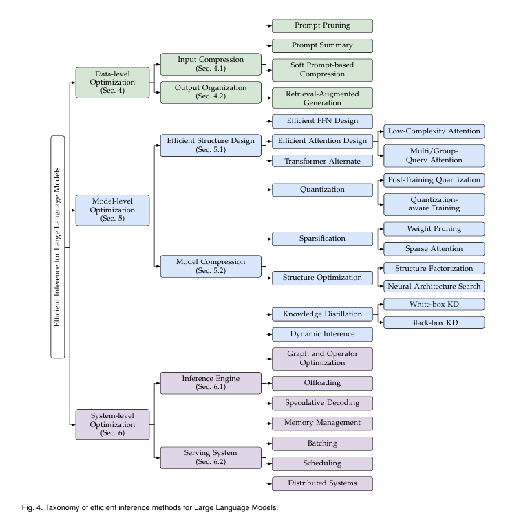

# Request-level Scheduling

## Response Length Perception and Sequence Scheduling（NeurIPS 2023）

**Background / Motivation** 

静态 request-level batch 要等最长输出结束，短序列在后续轮次产生 padding/无效计算。论文在示例负载中观察到 66% token 为冗余计算。输出长度未知，使把相近长度请求放在一起无法直接实施。

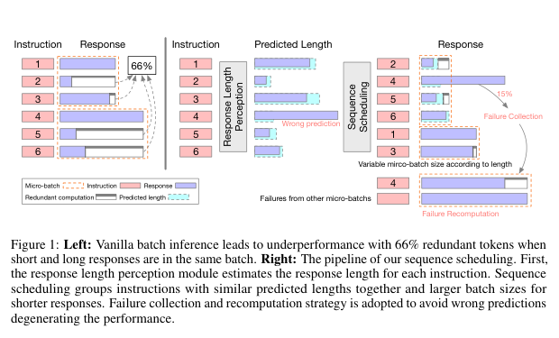

**Design** 

1. 用 Vicuna-7B 预测回答的最大长度。训练集来自 10,000 个 Alpaca prompt，每个 prompt 采样 4 次，以最大输出长度为监督信号；长度按 50-token 分箱，并用 LoRA 训练 3 epoch。**（通过 LoRA 和 instruction tuning 微调的 Vicuna-7B，LoRA小规模训练微调插件? 原始权重加偏置矩阵）**
2. 对一个 group 内的请求按预测长度排序，把相近长度组成 micro-batch。
3. **FCR**：每个 batch 最多生成至该 batch 的最大预测长度；实际未完成者进入失败集合，最后重算，防止少数严重低估拖住整个 batch。
4. **VBS**：短预测使用更大 batch。实验中长度不小于 300 时 batch=16；更短时按 `256×50/L` 计算并取邻近 2 的幂。

**Experienment**

**实验设置与规模。** Vicuna-7B，单张 A100 80GB；Alpaca 测试子集 10,000 条和 Instruction-in-the-Wild 429 条；group size=256；baseline batch=16；采样温度 0.5。吞吐以 samples/s 计。

**结果。** Alpaca 上 baseline 为 1.22 samples/s，指令微调的最大长度预测达到 2.27 samples/s，即 **+86%**；oracle 长度为 2.52 samples/s。平均每 batch token 从 377 降至约 208。Instruction-in-the-Wild 上从 0.78 提升到 1.24 samples/s。预测最大长度时 FCR 比率 15.3%，预测均值时升至 29.8%，吞吐增益只剩 45%。

**限制与启示。** 这是离线/grouped static batching，假设能先积累 256 个请求；不等同于在线 continuous batching。在小并发、串行依赖的 Agent DAG 中直接等待大 group 会增加关键路径时延。应把长度预测用于 KV admission、token budget 与关键路径优先级，而不是机械地先攒大组再排序。


**Result**

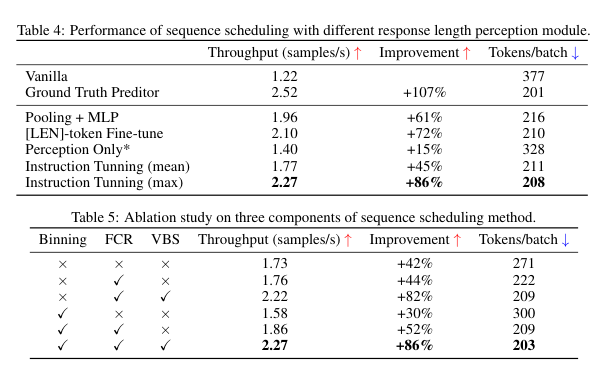

**Restriction**
1. 它不是现代在线 continuous batching 的完整替代方案（vLLM、SGLang）。
2. 等待 256 条形成 group 可能增加低负载延迟。
3. 预测步骤本身要运行模型，虽然作者测得只需生成 1–4 个 token，仍有成本。


## More++....


# Token-level Scheduling

## Orca（OSDI 2022）

RLP 关心的是开始运行前怎样按预测长度分组（静态）；Orca 关心的是**一个 batch 已经开始生成以后，成员能不能随时退出，新请求能不能随时加入**（现有vLLM 的continuous batching方案）

旧执行引擎：

| 轮次 | A | B | 时间点 |
|---:|---|---|---|
| 1 | 生成 token | 生成 token | — |
| 2 | 生成 EOS，已经完成 | 生成 token | 新请求 C 到达 |
| 3 | 已完成但批还没结束 | 生成 token | C 只能排队 |
| 4 | 已完成但批还没结束 | 生成 token | C 继续等待 |
| 5 | 已完成 | 完成 | 整批结束后 C 才能开始 |

执行过程中的每一轮，调度器没有控制权，导致浪费：

1. **提前完成**：A 已经结束，却不能立即从固定 batch 中释放；旧实现可能继续为它执行占位计算，至少也浪费一个 batch 位置。
2. **晚到请求**：C 明明在第 2 轮就到达，却必须等 B 完成，GPU 不能用 A 空出的槽位处理 C。


### **Design** 

**1.Iteration-level Scheduling** 

Iteration 在这里就是模型向前执行一次、为每个 decode 请求产生下一个 token 的一轮。Orca 不再一次下达完成整个请求的命令，而是只下达执行下一轮的命令。


| 轮次 | 本轮 Batch | 动作 |
|---:|---|---|
| 1 | A、B | A、B 各生成一个 token |
| 2 | A、B | A 结束并立即离开；C 到达等待 |
| 3 | B、C | C 立即使用 A 空出的并行位置 |
| 4 | B、C | 每轮继续重新选择 |


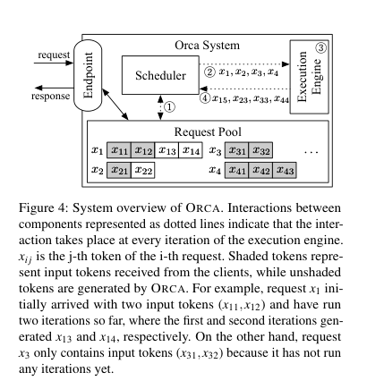

又上提出四个组件：

1. **Endpoint**：接收用户请求、返回最终结果，可理解为 API 入口。
2. **Request Pool**：保存系统中所有等待或正在生成的请求，以及已经生成的 token。
3. **Scheduler**：每一轮从 Request Pool 选择下一批请求。
4. **Execution Engine**：真正运行分布在一张或多张 GPU 上的模型，但每次只执行一轮。


交互过程：

```text
① Scheduler 查看 Request Pool
② 选出 x1、x2、x3、x4，通知 Execution Engine
③ Engine 为四个请求各执行本轮计算
④ 返回 x15、x23、x33、x44
⑤ Scheduler 更新各请求状态，下一轮可以换一组请求
```


**接下来的问题是：随意选出的请求并不天然能够组成 GPU batch**，GPU batch 通常要求参与同一算子的张量形状兼容

比如可能选中的请求为：

| 请求 | 所处阶段 | 本轮要处理的内容 |
|---|---|---|
| A | Prefill / initiation | 200 个输入 token |
| B | Prefill / initiation | 500 个输入 token |
| C | Decode / increment | 第 21 个 token |
| D | Decode / increment | 第 103 个 token |

出现三种不整齐：

1. A、B 都在 Prefill，但 prompt 长度分别为 200 和 500。
2. C、D 都在 Decode，但历史 KV 长度分别为 20 和 102。
3. A、C 甚至处于不同阶段：A 一轮处理整个 prompt，C 一轮只处理一个新 token。

如果要求所有算子的输入形状完全一致才能 batch，那么动态选择的请求几乎无法合批，iteration-level scheduling 就失去 GPU 并行收益。

**2.Selective Batching**

insight：Transformer 里的算子并非都需要知道 token 属于哪个请求。

以四个请求为例，本轮需要处理的 token 数分别是 1、1、2、3，总计 7 个：

```text
请求 x1：1 个 token
请求 x2：1 个 token
请求 x3：2 个 token
请求 x4：3 个 token
合计：7 个 token
```

**Linear、LayerNorm、GeLU 等普通算子**对每个 token 做相同变换，不会让不同请求互相读取上下文。因此可以先忘记 batch 边界，把 7 个 token 展平成一个大矩阵：

```text
[1,H] + [1,H] + [2,H] + [3,H]
                ↓
              [7,H]
```

但遇到attention之后又拆出来计算完再合并，attention要和相应的 KV 计算：

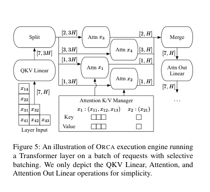


1. `QKV Linear` 对拼在一起的 7 个 token 批量计算。
2. `Split` 根据请求边界拆成 1、1、2、3 个 token。
3. `Attn x1` 到 `Attn x4` 分别读取各自的历史 KV，独立计算 Attention。
4. `Merge` 再把四份 Attention 输出拼回 `[7,H]`。
5. 后面的 `Attention Out Linear` 又可以批量执行。

**3.调度算法**

Orca 使用 **iteration-level FCFS**。FCFS 是 First Come, First Served，即先到先服务。论文给出更严格的定义：如果 `A` 比 `B` 早到，那么 A 已经执行的 iteration 数不能少于 B。这可以防止晚到请求不断插队，让早到请求饿死。

调度还受两个限制：

**限制一：max batch size。** Batch 越大，吞吐通常越高，但单轮耗时和 latency 也可能增加，而且收益会逐渐变小。因此管理员设置 `max_batch_size`，每轮最多选择这么多请求。

**限制二：KV Cache slot。** 请求首次进入时，Orca 按它声明的 `max_tokens` 预留 KV 空间。例如请求最多生成 512 token，就提前保证 512 个位置可用。空间不足时不接纳新请求，避免运行到一半 OOM。（后续论文优化：Efficient Memory Management for Large Language Model Serving with PagedAttention
作者：Woosu，按需分配，随生成过程逐 block 增长，将显存按block划分,不要求同一请求的所有 block 在物理显存中连续）

### **Experiment** 

| 项目 | 设置 | 说明 |
|---|---|---|
| 集群 | Azure ND96asr A100 v4 | 2022 年 Azure GPU 实验环境 |
| 每节点 | 8×A100 40GB，NVLink | 节点内 GPU 高速互连 |
| 节点间 | 8×200 Gbps InfiniBand，合计 1.6 Tb/s | 支撑跨节点的 175B/341B |
| 模型 | GPT 13B、101B、175B、341B，FP16 | 覆盖单 GPU到 32 GPU |
| 13B | 1 GPU | 单卡模型 |
| 101B | 8 GPU | 单节点 tensor parallel |
| 175B | 16 GPU | 两个 pipeline stage，每 stage 8 GPU |
| 341B | 32 GPU | 最多四节点 |
| 输入长度 | 从 32–512 均匀随机采样 | 模拟不同 prompt 长度 |
| 输出长度 | 从 1–128 均匀随机采样 | 制造早结束/晚结束差异 |
| 到达时间 | Poisson 随机到达 | 模拟在线请求 |
| Baseline | FasterTransformer + 论文作者实现的外部 scheduler | SOTA |


纯引擎 Microbenchmark

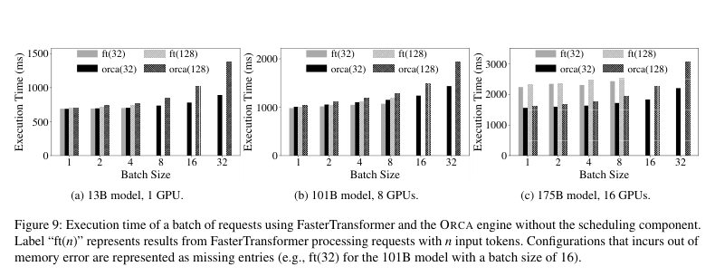

暂时关闭 Orca 动态 scheduler，让 Orca 和 FasterTransformer 处理完全相同的固定 batch。横轴是 batch size，纵轴是完成整批所需 execution time，柱越低越好。`orca(32)` 表示每条请求输入 32 token；`ft(128)` 表示 FasterTransformer 输入 128 token。

- 13B/1 GPU、101B/8 GPU：两者整体接近，Orca 有时略慢，因为 Attention 没有整体合批。
- 175B/16 GPU：Orca 最多快 47%，论文认为主要来自控制信息与 GPU 数据通道分离。

只证明 Orca execution engine 本身没有比 baseline 差很多，不能证明动态调度的端到端收益。

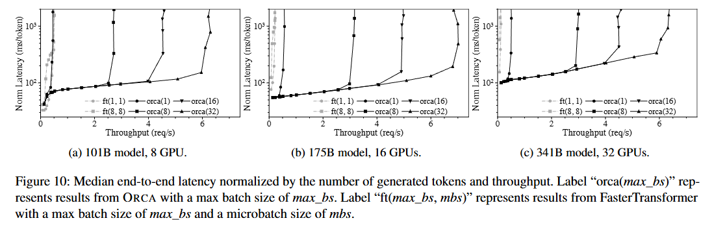


完整在线调度实验

当前裁剪图只有**一排三个子图**，从左到右分别是：

| 子图 | 模型 | GPU |
|---|---:|---:|
| (a) | GPT-101B | 8 |
| (b) | GPT-175B | 16 |
| (c) | GPT-341B | 32 |

三个子图坐标含义相同：

- 横轴：吞吐 `req/s`。
- 纵轴：median normalized latency `ms/token`。
- 每个点代表在某个请求到达速率下，运行整段合成 trace 后测得的吞吐和中位延迟，不代表单条请求或单个 batch。

Normalized latency 的计算是：先对每条请求算 `端到端时间 ÷ 输出 token 数`，再取所有请求的中位数。例子：请求生成 100 token、总耗时 20 s，则 normalized latency 为 `20s/100=200 ms/token`。它不是 TBT，但可把不同输出长度的请求放在近似统一尺度上比较。：

```text
低负载：请求到达后很快执行 → 延迟较低
负载增加：batch 更饱满 → 吞吐提高，延迟只小幅增加
超过容量：到达速度 > 完成速度 → 队列不断增长，延迟陡升
```

拐点越靠右，系统可承受的负载越高。

在 175B 中，Orca(32) 曲线可以在约 100–200 ms/token 附近延伸到 6 req/s 以上；FasterTransformer 曲线很早就向上，说明固定 request-level batch 在异构请求下快速产生排队。

固定一个可接受的 normalized latency 约 190 ms/token，分别读取两套系统在该延迟附近能承受的吞吐，
| 系统 | 吞吐 |
|---|---:|
| FasterTransformer | 0.185 req/s |
| Orca | 6.81 req/s |
| 相对提升 | **36.9×** |。

## DeepSpeed-FastGen（Microsoft DeepSpeed 技术报告 / arXiv，2024）

### **技术报告**

- *DeepSpeed-FastGen: High-throughput Text Generation for LLMs via MII and DeepSpeed-Inference*
- Microsoft / DeepSpeed 
- arXiv preprint（`arXiv:2401.08671`，2024）。
- 价值在于提出并实现了有影响力的 token composition 机制。它决定每次 forward 中放入多少 Prefill token、多少 Decode token。

### **Continuous Batching 之后，为什么仍会卡顿？**

Orca 的 iteration-level scheduling 解决了请求能否在每轮动态进入、退出的问题，但没有保证每个 iteration 的计算量稳定。

假设当前有 32 个请求正在 Decode，每个请求本轮只需要生成 1 个 token；此时新到达一个 2,600-token Prompt。如果系统一次执行完整 Prefill；这一轮会显著拉长正在生成请求的 TBT，用户表现为输出突然停顿。如果始终优先执行 Decode，虽然 TBT 稳定，但新 Prompt 会长时间排队，TTFT 增大。

所以论文要解决的是：

> 在 continuous batching 中，怎样组合 Prefill 和 Decode，使每个 forward 的 token 工作量较稳定，同时兼顾吞吐、TTFT 和生成阶段的尾延迟？

### **Key Insight**

1. **一次 forward 的 latency 主要由本轮处理的总 token 数决定。** 相比有多少条请求，Linear 等主要算子更关心这一轮一共处理多少 token。
2. **Forward token 太少时 GPU 没有吃满。** 增加 token 数会提高 GPU 利用率和吞吐；达到饱和区后，再增加 token 只会增加该轮 latency，吞吐不再明显增长。
3. **每轮 token 数忽大忽小会造成吞吐和延迟波动。** 因此应把每次 forward 控制在接近目标 token budget 的大小。

Token budget : 一次模型 forward 最多安排多少 token。

### **Core design：Dynamic SplitFuse**

- **Split**：把长 Prompt 拆成多个较小 Prefill chunk，分散到多个 iteration。
- **Fuse**：把 Prefill chunk、短 Prompt 和已有 Decode token 组合到同一个 forward，尽量填满固定 token budget。

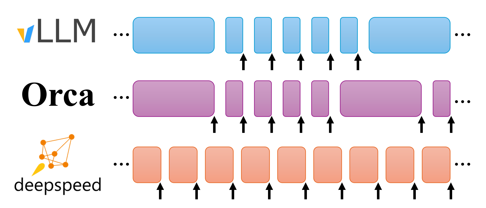

图中每个方块表示一次 forward，方块宽度可以理解为本轮 token 工作量：

1. **vLLM**：一次 forward 主要执行 generation（decode） 或 prompt processing（prefill）；generation 会优先于 prompt，forward 大小变化明显。
2. **Orca**：可以把 Prompt 与 Decode 放在一起，但使用完整 Prompt；长 Prompt 会让某个 iteration 特别长。
3. **Dynamic SplitFuse**：将 Prompt 切块，并与 Decode 组合，短prompt就自行组合，使橙色 forward 大小更加稳定。

#### 分析

- Forward token 数接近 GPU 高吞吐区，减少小 batch 造成的低利用率。
- 长 Prompt 不再形成一个极慢 iteration，正在 Decode 的请求更稳定地收到 token。
- Prompt 不会因 Decode 永久优先而完全饿死，每轮都可以逐块推进。


### **Experiment**

| 项目 | 设置 |
|---|---|
| 主要模型 | Llama-2 70B |
| 主要硬件 | 4×NVIDIA A100 80GB，Tensor Parallel=4 |
| 其他模型/硬件 | Llama-2 13B/单 A100 80GB；Llama-2 70B/8×H100；Llama-2 7B/A6000 |
| Baseline | 论文实验时的 vLLM 版本 |
| Prompt 长度 | 均值 1,200 或 2,600 token |
| Output 长度 | 均值 60 或 128 token |
| 长度分布 | 正态分布 |
| 负载变化 | 改变并发客户端数量，绘制 throughput-latency 曲线 |
| 主要指标 | Request throughput、端到端 latency、effective throughput、P50/P90/P95 per-token generation latency |

### **结果**

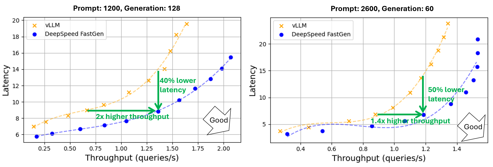

图的横轴是 throughput（queries/s）；纵轴是 latency。

在Prompt 均值 2,600、Output 均值 60 的配置中：

| 点 | vLLM | DeepSpeed-FastGen | 结论 |
|---|---:|---:|---|
| 吞吐约 1.2 req/s 时 | latency 14 s | latency 7 s | 同吞吐下 latency 约降低 50% |
| latency 约 9 s 时 | throughput 0.67 req/s | throughput 1.36 req/s | 同延迟下 throughput 约 2× |

整体报告：

- 最高约 **2.3× effective throughput**；
- 平均 latency 最多约降低 2×；
- P95 per-token generation latency 最多降低 **3.7×**；
- 16 个 replica 从单 replica 约 1.46 queries/s 扩展到约 23.7 queries/s，接近线性扩展。

`Effective throughput` 不是不考虑延迟的原始吞吐，而是同时满足首 token latency 和 generation rate SLA 的有效请求吞吐。

### **一些点**

可以保留 Dynamic SplitFuse 的 token composition，把固定 token budget 扩展为 DAG/SLO-aware 动态预算调度：

```text
关键路径 Decode 接近 TBT deadline → 减小本轮 Prefill chunk，优先稳定 Decode

GPU 当前低并发、没有紧急 Decode → 增大 Prefill chunk，尽快完成关键 Agent 的 Prompt

某个 Prefill 完成后会解锁多个下游 Agent → 在相同预算内提高其优先级
```

## Sarathi-Serve（OSDI 2024）

*Taming Throughput-Latency Tradeoff in LLM Inference with Sarathi-Serve*。

### **Background / Motivation**

与fastgen 核心执行思路高度相似：

> 都不再一次执行完整长 Prefill，而是把 Prompt 切成小块；每次 forward 把 Prefill Token 与正在生成的 Decode Token 组合起来，使单轮工作量较稳定。

Sarathi-Serve它新增的重点是**把相似的执行机制变成一个以 P99 TBT SLO 为约束、 Decode-first 顺序、支持 Pipeline Parallel 的在线调度系统，并用 serving capacity 进行评估。**

时间关系：

| 文献 | 时间与属性 |
|---|---|
| Sarathi | 2023 年 8 月 arXiv 预印本，早于 FastGen，已经提出 Chunked Prefill 与 Decode piggybacking |
| DeepSpeed-FastGen | 2024 年 1 月 arXiv 技术报告，核心机制称为 Dynamic SplitFuse |
| Sarathi-Serve | 2024 年 OSDI 正式论文，在 Sarathi 基础上扩展在线 SLO 调度与 Pipeline Parallel |

FastGen 已经说明，固定一种 forward 类型会带来问题：

- 只做 Decode 时，每轮 Token 少，GPU 计算单元利用不足。
- 插入完整长 Prefill 时，该轮耗时突然变长，正在生成的请求会卡住。
- Dynamic SplitFuse 用固定目标 Token 数把 Prefill chunk 和 Decode 组合起来，缓解这一问题。

Sarathi-Serve 回答三个更具体的在线 serving 问题：

1. **卡顿怎样定义？** 不能只说 generation latency 变小，而要检查最慢的 Token 间隔，即 P99 TBT。
2. **一轮先放谁？** 调度器需要明确保证正在运行的 Decode，再使用剩余预算处理 Prefill，直观来讲。
3. **模型跨节点时怎么办？** 单轮大小忽大忽小不仅影响 TBT，还会让 Pipeline Parallel 的部分 GPU 等待，形成 Pipeline Bubble。

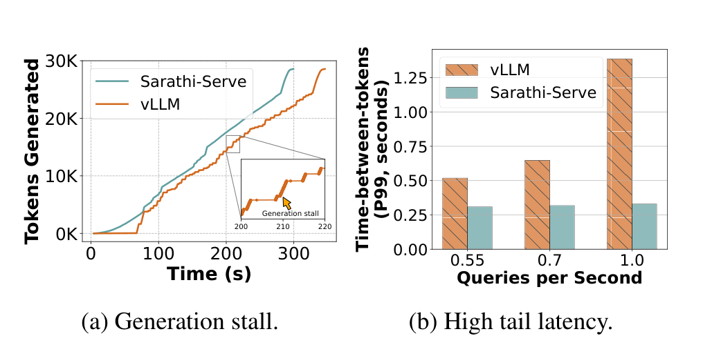

Figure 1 使用 Yi-34B、2×A100 和 128 个 arXiv summarization 请求：

- 左图横轴是时间，纵轴是累计生成 Token。vLLM 曲线出现水平段，表示几秒内没有生成新 Token；论文称为 **Generation Stall**。
- 右图显示负载从 0.55 增加到 1.0 QPS 后，vLLM 的 P99 TBT 快速增大，而 Sarathi-Serve 保持较低。
- 这里比较的是论文当时使用的 vLLM 版本，不能代表当前 vLLM。

Sarathi-Serve 的目标由此变成：

在满足 P99 TBT SLO 的前提下，最大化系统可以长期承受的请求到达率。

这与 FastGen 的 effective throughput 不完全相同。Sarathi-Serve 寻找满足 P99 TBT 上限且队列不会无限增长时的最大 QPS，称为 **Serving Capacity**。

### **Key Insight**

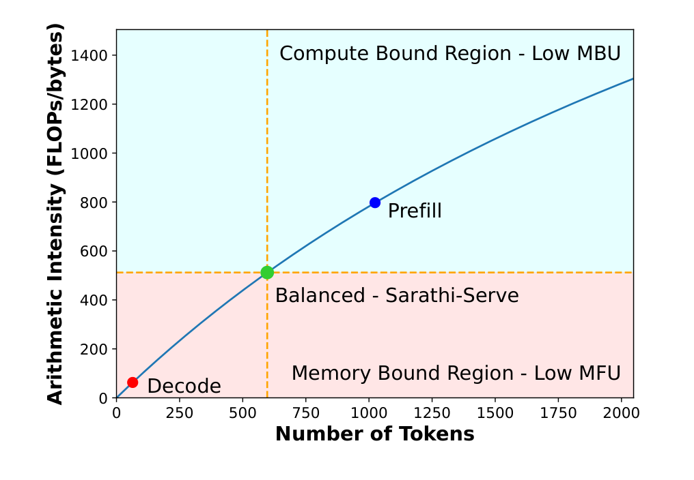

Figure 5 的横轴是一个 batch 中的 Token 数，纵轴是算术强度，即每读取一个 byte 数据执行多少次浮点计算：

- 左下角的 Decode Token 少、算术强度低，主要受显存带宽限制，GPU 计算单元没有吃满。
- 右上角的 Prefill Token 多，计算单元更充分，但可能不能完全利用显存带宽。
- 中间绿色点表示把 Decode 与适量 Prefill Token 组合，使显存带宽和计算资源更平衡。

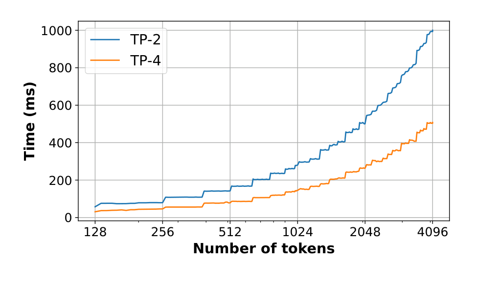

Figure 6 是实际测量。LLaMA2-70B 在 2 路或 4 路 Tensor Parallel 下，batch （一次forward）从约 128 增加到 512 Token 时，Linear 层耗时增长很小，因为这一区间仍主要在等待模型权重从 HBM 读入。超过某个规模后，计算量才开始主导，曲线明显上升。所以要尽量塞满一个合理的batch，减少这一层权重读取占比大的浪费。


### **Core Design：只看比 FastGen 多出来的调度约束**

#### **1. 明确的 Decode-first Stall-free Batching**

每个 iteration 按下面的优先级构造 batch：

1. 先给所有正在运行的请求各安排 1 个 Decode Token。
2. 如果有已经开始但尚未完成的 Prefill，继续放它的下一个 chunk。
3. 还有 Token Budget 和 KV 空间时，再接纳新请求的 Prefill chunk。
4. 执行一次 Hybrid Forward，更新状态后进入下一轮。

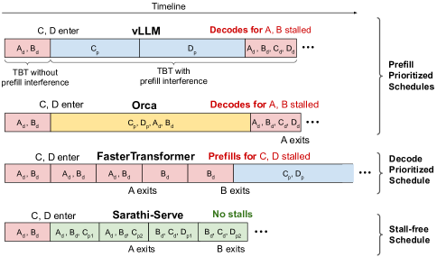

这里的 Stall-free 不是说加入 Prefill 后耗时完全不增加，而是**Decode 不会为了先执行一个完整 Prefill 而被暂停；Prefill 只能使用本轮允许的剩余 Token Budget。**

#### **2. Token Budget 由 TBT SLO 约束**

FastGen 更强调把 forward 填到稳定的目标大小。Sarathi-Serve 则先确定应用允许的 P99 TBT，再通过离线 profiling 选择最大 Token Budget：

| SLO | 论文常用 Token Budget | 含义 |
|---|---:|---|
| Strict | 512 | 单轮较短，优先控制 TBT |
| Relaxed | 2048 | 允许单轮更长，减少切块开销并提高吞吐 |
| LLaMA2-70B Relaxed | 1536 | 在延迟与 Pipeline Bubble 之间折中 |

例如预算为 512、当前有 64 个 Decode 请求时，Decode 先占 64 Token，本轮最多再加入约 448 个 Prefill Token。同前者

#### **3. 量化完整 Prefill和Prefill Chunk的差别**

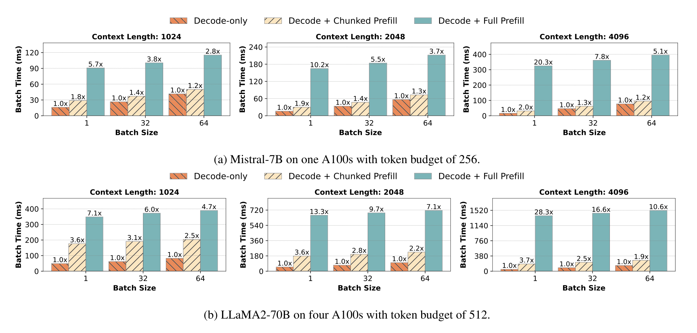

Figure 9 把 Decode-only 的单轮耗时归一化为 1：

- 绿色柱是 Decode + Full Prefill，即 Orca 式完整 Prefill 混合。
- 浅色斜纹柱是 Decode + Chunked Prefill，即 Sarathi-Serve。
- 在 LLaMA2-70B、context length 2048、batch size 1 时，完整 Prefill 使该轮达到 28.3×，chunk 后为 3.6×。
- 随 Decode batch 增大，chunk 的相对额外成本进一步下降。

#### **4. 让 Pipeline Parallel 的每轮工作量更均匀**

Pipeline Parallel 把模型层分到多个 GPU stage。若相邻 iteration 分别处理几十个 Decode Token 和几千个 Prefill Token，各 stage 的完成时间差异很大，一些 GPU 会等待其他 stage，形成 Pipeline Bubble。

也就是说forward size越趋于稳定pipeline越合理，气泡占比越小。

Dynamic SplitFuse 也追求 forward size 稳定，但 FastGen 没有把 Pipeline Bubble 作为主要系统问题展开。Sarathi-Serve 明确利用受控 Token Budget 构造 uniform-compute batch，并把这一点扩展到跨节点 Pipeline Parallel。

### **Experiment**

| 项目 | 设置 |
|---|---|
| Mistral-7B | 1×A100 80GB |
| Yi-34B | 2×A100 80GB，TP=2 |
| LLaMA2-70B | 8×A40 48GB，TP=4、PP=2 |
| Falcon-180B | 两节点共 8×A100 80GB，TP=4、PP=2；节点间 100 Gbps Ethernet |
| Workload | OpenChat-ShareGPT4、arXiv Summarization；Poisson 请求到达 |
| Baseline | Orca、 vLLM |
| 核心指标 | 满足 P99 TBT SLO 且队列稳定时的最大 QPS，即 Serving Capacity |

两种 trace 的长度差别很大：

| 数据集 | Prompt 中位数 / P90 | Output 中位数 / P90 |
|---|---:|---:|
| OpenChat-ShareGPT4 | 1,730 / 5,696 | 415 / 834 |
| arXiv Summarization | 7,059 / 12,985 | 208 / 371 |

这比 FastGen 主要使用正态分布生成 Prompt/Output 长度更贴近真实长 Prompt 负载，也更容易暴露 P99 TBT 和 Pipeline Bubble 问题。

### **Result 1：普通配置下的 Serving Capacity**

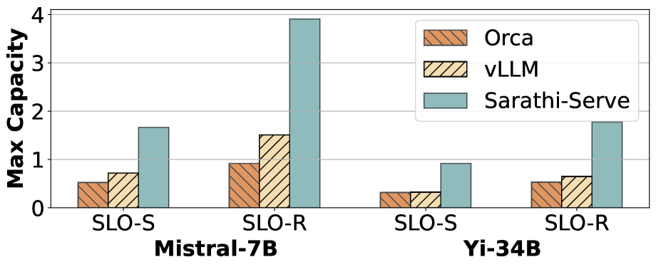

Figure 10 展示 Mistral-7B 和 Yi-34B：

- Mistral-7B 相比 vLLM 最高达到 **2.6× serving capacity**。
- Yi-34B 相比 vLLM 最高达到 **3.7×**。
- 严格 SLO 使用较小 Token Budget，牺牲部分 Prefill 效率换取更低 P99 TBT；宽松 SLO 则可以使用较大预算。

### **Result 2：Pipeline Parallel**

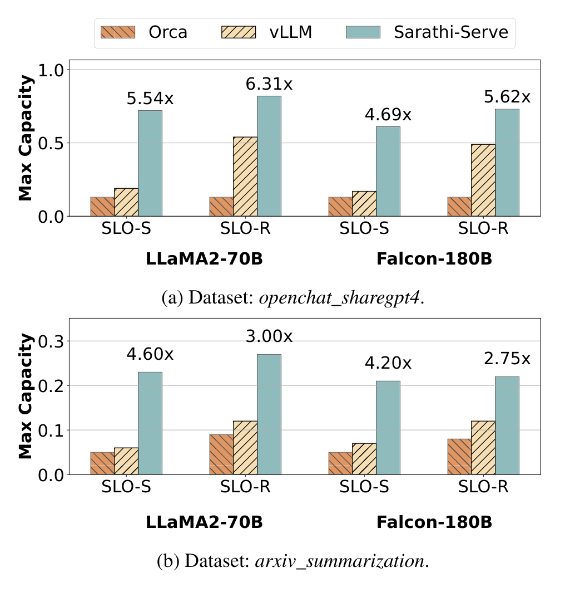

Figure 11 使用 LLaMA2-70B 和 Falcon-180B，二者都包含 Pipeline Parallel：

- 图中柱顶倍数是 Sarathi-Serve 相比 Orca 的提升，最高为 **6.31×**。
- Falcon-180B 的最高 **5.62×** 也是相对 Orca。
- 论文进一步在 Figure 13 中报告：Falcon-180B strict SLO 下，相比 vLLM 的纯 TP 和 TP+PP 配置分别提高 4.3× 与 3.6×。

这部分是 Sarathi-Serve 相比 FastGen 最有辨识度的结果，它证明 uniform-compute iteration 不只是让单卡 Decode 更平滑，还能降低跨节点 Pipeline Bubble。

### **Result 3：Token Budget 敏感度实验**

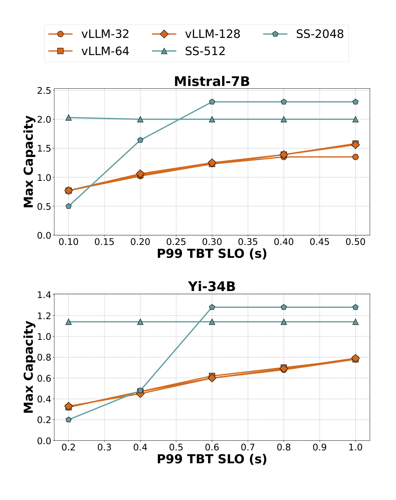

- 横轴是允许的 P99 TBT SLO，越向右表示延迟约束越宽松。
- 纵轴是该 SLO 下的最大 Serving Capacity。
- vLLM 调整 max batch size 后仍较早达到容量上限。
- Sarathi-Serve 可以用 512 或 2048 Token Budget 在严格/宽松 SLO 间切换；Yi-34B 严格条件下论文报告最高约 3.5× 容量提升。

### **Ablation：切得越小并不一定越好**

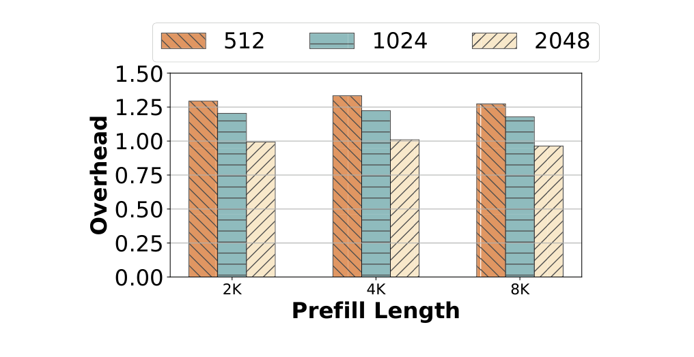

Figure 14 将不切块的 Prefill 耗时归一化为 1：

- 512-token chunk 的额外 Prefill 开销最高约 25%。
- 2048-token chunk 的额外开销接近可以忽略。
- 小 chunk 能降低单轮 TBT，但会执行更多 iteration，并降低 Prefill 本身效率。

OSDI 正式论文 Table 4 的消融结果如下，单位均为秒：

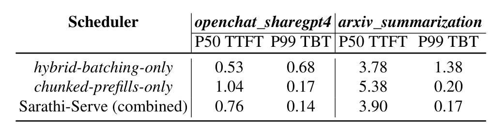

- 只做 Hybrid Batching：TTFT 最低，但完整 Prefill 严重拖慢 Decode，P99 TBT 最差。
- 只做 Chunked Prefill：TBT 明显改善，但 Prefill 分多轮完成，TTFT 较高。
- 两者结合：TTFT 介于两者之间，同时获得最低 P99 TBT。

## Inference without Interference / ShuffleInfer（ACM TACO 2025）

**PD分离**，token level？Splitwise 好像更早些提出PD分离

### **Background / Motivation**

Sarathi 在同一实例内把 Prefill chunk 与 Decode 混合，利用 Decode 的计算余量；论文提出相反风险：P/D 即使能合批，也可能互相争抢计算、显存容量和带宽。

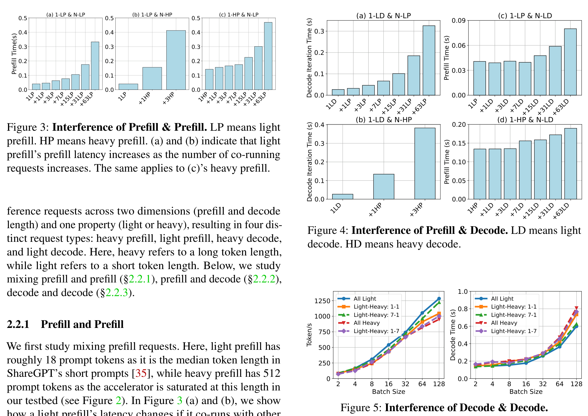

论文测了三类干扰实验：

**1. Prefill 与 Prefill 干扰。** Prefill 是计算密集任务。GPU 达到计算饱和后继续加入 Prompt Token，不再提高 throughput，只会让每个请求等待更久。一个 LP 与 7/63 个 LP 同批时，延迟分别约增加 2×/8×；与 HP 同跑时可超过 10×。

**2. Prefill 与 Decode 干扰。** Decode 是 latency-critical 的逐 Token 工作。一个 LD 与一个 HP 同处 continuous batch，单轮 Decode latency 就可能增加约 5×；反过来，大量 Decode 也会拖慢 Prefill，两者最高约同时慢 2.5×。

**3. Decode 与 Decode 干扰。** 长 Decode 会长期保留更大的 KV working set。batch size=128 时，若一半是 HD、一半是 LD，相比全 LD，throughput 下降 16%，Decode latency 增加 23%。短任务会被长任务的显存占用和带宽竞争拖住，形成 head-of-line blocking。

所以即使已经有 continuous batching，把不同阶段、不同长度的请求放在同一实例，仍会产生计算、显存容量和显存带宽三类竞争；调度器需要同时控制阶段隔离与长短任务分布。

### **Design**

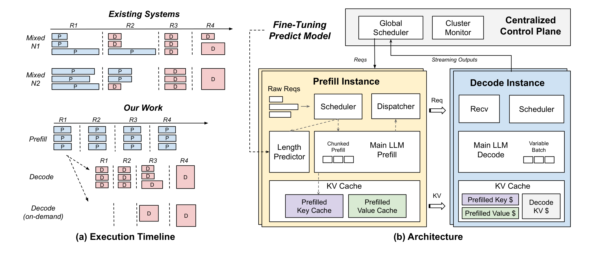


# DAG-aware?

## Agentix: An Efficient Serving Engine for LLM Agents as General Programs (NSDI  26)
