# DAG-aware LLM Inference Scheduling

## Parrot: Efficient Serving of LLM-based Applications with Semantic Variable（OSDI 2024）

论文链接：[USENIX OSDI 2024](https://www.usenix.org/conference/osdi24/presentation/lin-chaofan) ｜ [PDF](https://www.usenix.org/system/files/osdi24-lin-chaofan.pdf)

Parrot 关注一个应用内多个 LLM 请求的端到端性能，与 vLLM 的 engine-level batching 和 KV Cache 管理属于不同层次。

### **Background / Motivation**

复杂 LLM 应用通常需要多个请求才能得到最终结果：

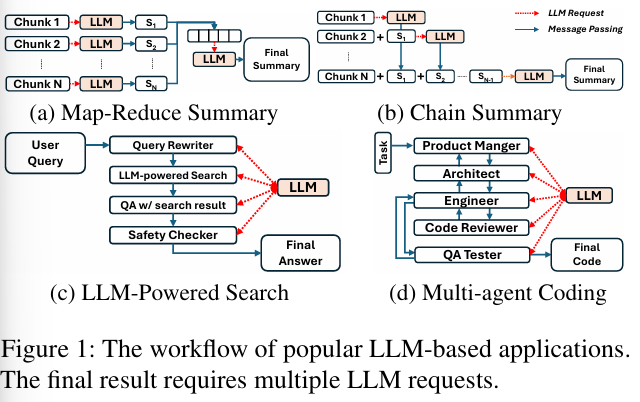

- Chain Summary：前一个摘要是后一个请求的输入，多个请求串行依赖。
- Map-Reduce Summary：多个 Map 请求并行，Reduce 等待全部结果。
- Multi-agent：不同角色多轮交换中间结果。

现有公共服务只看到独立 request，不知道请求属于哪个应用、彼此如何连接、最终输出要求低延迟还是高吞吐，因此存在三个问题：

1. **依赖请求反复经过客户端。** A 的结果先返回客户端，客户端再提交 B；额外产生网络往返和重新排队。论文测得引擎外开销平均占 30%--50%，最差超过 70%。
2. **单请求目标不等于应用目标。** Map 阶段更需要大 batch 提高整组吞吐，Reduce 阶段更需要低延迟；统一按单请求低延迟调度会拖慢最终结果。
3. **共享 Prompt 被重复计算。** Chat Search、MetaGPT、AutoGen 的重复 Token 比例分别约为 94%、72% 和 99%，但 request-level 服务难以在集群层识别并共置共享前缀。

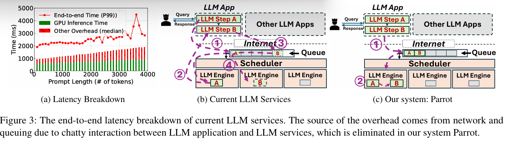

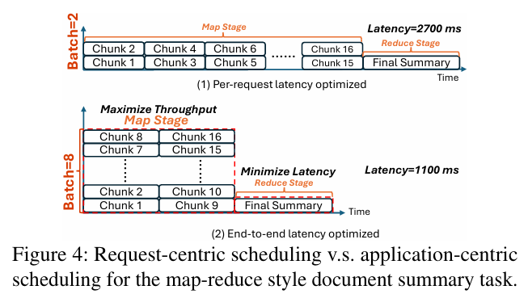

Figure 4 中，**request-centric** 调度限制 Map 请求的并发以降低**单请求延迟**，最终摘要耗时 2700 ms；**application-centric** 调度增大 Map batch、提高整组吞吐，端到端时间降至 1100 ms。

### **Key Insight**

Parrot 将 LLM 应用而不是单个 request 作为优化对象。服务端需要获得三类信息：

| 信息 | 用途 |
|---|---|
| 请求依赖 | 构造 DAG，判断 ready 节点和并行 Task Group |
| 最终输出目标 | 推导中间请求偏向 latency 还是 throughput |
| Prompt 结构 | 识别共享前缀，复用 KV Cache |

### **Core Design**

论文设计分为两部分：Section 4 用 Semantic Variable 可视化（标注？暴露？）应用信息；Section 5 再利用这些信息进行依赖执行、目标推导、前缀共享和调度。

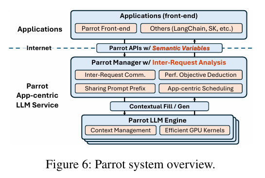

#### **1. Semantic Variable 与 Inter-Request Analysis**

开发者将 LLM 请求写成 **SemanticFunction**，并显式标出输入、输出变量（手动），上一个变量传给下一个输入等（感觉上偏工程实现）：

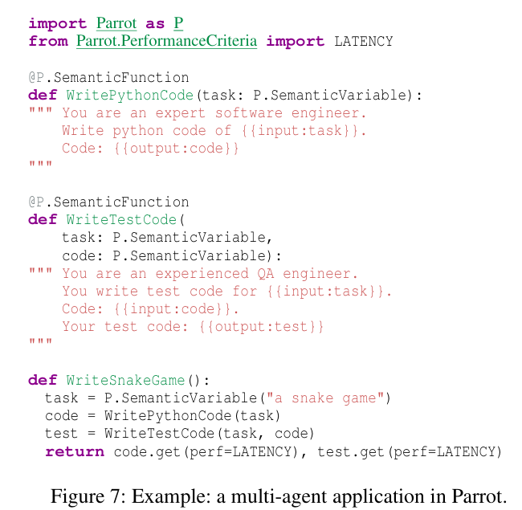

**code** 由第一个请求产生、被第二个请求消费，Parrot Manager 据此建立调用链

```text
task → WritePythonCode → code → WriteTestCode → test
```

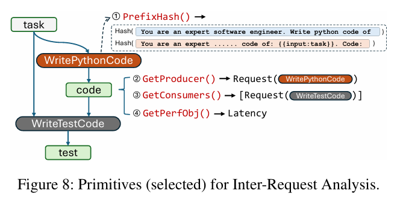

Manager 使用普通代码维护请求和变量组成的 DAG，并提供：

- GetProducer/GetConsumers ：读取变量的生产者和消费者；
- GetPerfObj ：读取最终变量的性能目标；
- PrefixHash ：在变量边界计算 Prompt 前缀 hash。

大模型只执行每个节点的文本生成，建图和分析由 Parrot Manager 完成。

#### **2. Serving Dependent Requests**

Parrot 将普通同步 completion 拆成异步 `submit` 和按需 `get`。应用可以提前提交多个 SemanticFunction；上游完成后，中间变量在服务端直接传给后继请求：

```text
传统：A → 客户端 → 提交 B → 重新排队
Parrot：A → Semantic Variable 队列 → B
```

后继请求在所有前驱完成后立即变为 ready，减少客户端往返。

#### **3. Performance Objective Deduction**

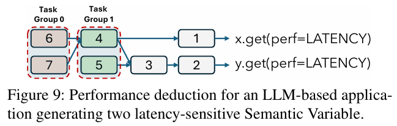

应用在最终 Semantic Variable 的 get(perf=LATENCY) 或 get(perf=THROUGHPUT) 中声明端到端目标。对于 THROUGHPUT，Parrot 将直接或间接生成该变量的请求标记为 throughput-preferred，倾向使用较大的 batch；对于 LATENCY，Manager 从最终变量沿请求 DAG 反向遍历，将直接产生最终结果的请求及其必要前驱标记为 latency-sensitive。（不明就里）..

x，y可以设置不同偏好来达到组合的想要的效果？

#### **4. Sharing Prompt Prefix**

`PrefixHash` 在 Semantic Variable 边界检测共同 Prompt，scheduler 再把共享请求放到同一 engine，就是尽量把共享前缀请求识别处理后放到同一个engine。Parrot 使用 context fork 复用共享 KV Cache，并实现结合 PagedAttention 与 FlashAttention 的 kernel，使共享前缀的 KV tile 尽量只加载一次。

#### **5. Application-Centric Scheduling**

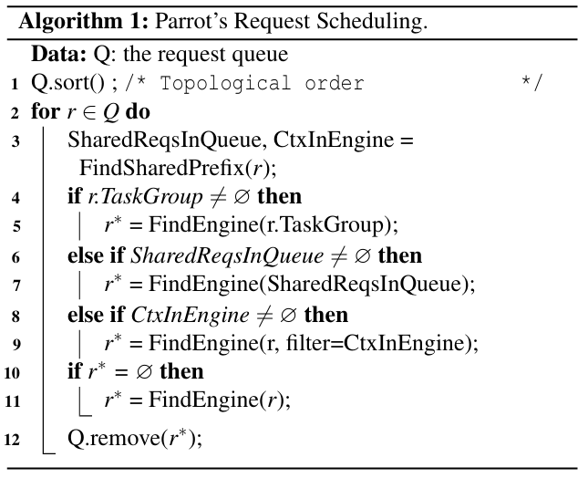

集群 scheduler 按拓扑顺序扫描请求：

1. Task Group 尽量整体分配；
2. 共享前缀请求尽量共置；
3. 优先选择已有对应 context 的 engine；
4. 否则选择满足请求性能偏好的普通 engine。

Parrot Manager 负责跨请求和跨 engine 调度；底层 Parrot Engine 仍采用 continuous batching 和分页 KV 管理。论文实现复用、改造了 vLLM 和 xFormers 的部分技术。

### **Experiment**

| 项目 | 设置 |
|---|---|
| 单 GPU | 1×A100 80GB，LLaMA 13B/7B |
| 多 GPU | 4×A6000 48GB，每个 GPU 一个 LLaMA 7B engine |
| 工作负载 | Chain/Map-Reduce 摘要、Bing Copilot/GPTs、多 Agent 编程、混合负载 |
| Baseline | LangChain + FastChat，底层使用 HuggingFace Transformers 或 vLLM |
| 网络模拟 | 请求加入 200--300 ms 随机网络延迟 |

说明：

- `HuggingFace` 是 FastChat worker 使用 Transformers `generate()` 执行模型，不是 DAG scheduler。
- `vLLM-Latency` 限制 engine token capacity，偏向较低单请求延迟。
- `vLLM-Throughput` 使用更大 batch/capacity，偏向总吞吐。
- `w/ Sharing` 表示共享公共 Prompt 的 KV Cache；`w/o Sharing` 表示每个请求重复计算和保存。

### **Result 1：依赖工作流**

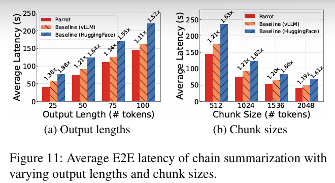
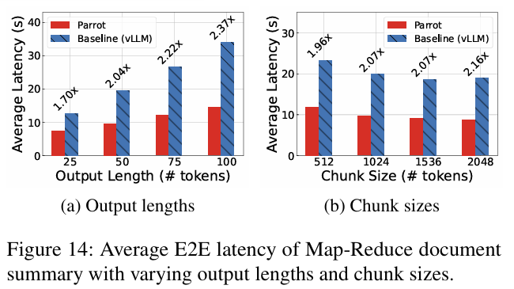
| 场景 | 相对 vLLM |
|---|---:|
| Chain Summary | 最高 1.38× 加速 |
| Chain + 背景请求 | 最高 2.38× 加速 |
| 多个 Chain 应用并发 | 平均 1.68× 加速 |
| Map-Reduce Summary | 最高 2.37× 加速 |

Chain 的收益主要来自服务端传递中间变量，Map-Reduce 的收益主要来自识别并批量执行 Map Task Group。

### **Result 2：共享 Prompt**

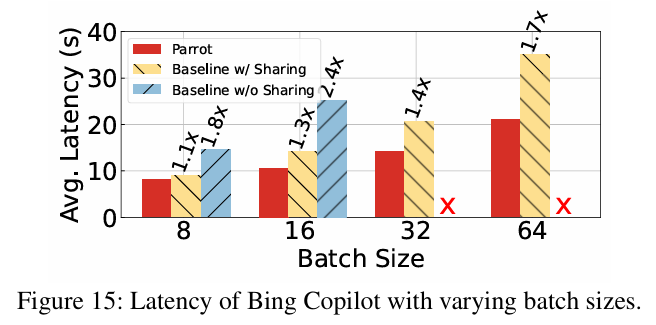

Bing Copilot 实验包含 64 个请求和约 6000-token 公共 system prompt（6000 token公共前缀？而且为什么是baseline without Sharing？）：

- 相比 `w/o Sharing`，Parrot 在 batch 8/16 下加速 1.8--2.4×；
- 相比使用 vLLM PagedAttention 的静态前缀共享，Parrot 的专用 kernel（同一个共享 KV 加载一次多共享） 再加速 1.1--1.7×；

### **Result 3：Multi-agent**

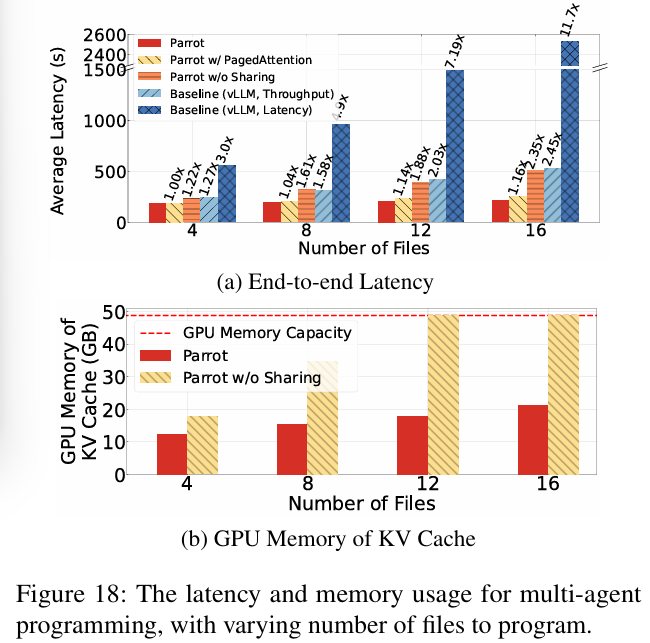

MetaGPT 风格任务包含 Architect、并行 Coder、Reviewer 和三轮 Revision。Parrot 识别并行 Task Group，并共享多轮动态上下文：

- 相比 `vLLM-Latency` 最高加速 11.7×；
- 相比 `vLLM-Throughput` 最高加速 2.45×；
- 关闭 Prompt sharing 后，12/16 文件时 KV Cache 超出 50GB 容量。

### **Result 4：混合负载**

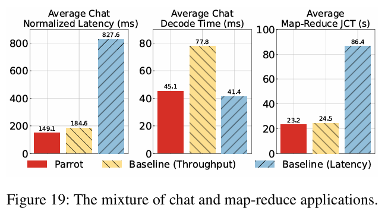

Parrot 将低延迟 Chat 与高吞吐 Map-Reduce 分配到不同 engine：Chat normalized latency 相比 latency/throughput baseline 分别改善 5.5×/1.23×；Map-Reduce 完成时间分别改善 3.7×/1.05×。

### **Restriction**

1. Parrot 主要支持可提前提交的 SemanticFunction；条件分支、Python native function 和动态控制流仍需客户端执行。
2. 实验规模为单机 1×A100 或 4×A6000、LLaMA 7B/13B，未验证大规模异构集群。
3. 请求缺少依赖和共享 Prompt 时，优化空间有限。

Parrot 解决了服务端如何看到 LLM 请求 DAG，但尚未将关键路径与 GPU、KV Cache、网络等多资源联合调度。


## MuxServe: Flexible Spatial-Temporal Multiplexing for Multiple LLM Serving（ICML 2024）

论文链接：[PMLR ICML 2024](https://proceedings.mlr.press/v235/duan24a.html) ｜ [arXiv](https://arxiv.org/abs/2404.02015)

多模型、resource-level LLM serving 系统。不是 DAG-aware，而是解决多个不同 LLM 如何共享 GPU、SM 和 KV Cache。对于会调用多个模型的 Agent DAG，它可以作为底层模型放置和资源复用机制。

### **Background / Motivation**

LLM endpoint provider 通常同时部署不同规模、用途和流行度的模型。固定为每个模型划分 GPU 会出现：热门模型排队，冷门模型长期占着空闲 GPU。

已有两种方式：

1. **Spatial Partitioning：** 每个模型固定占用一组 GPU，模型之间隔离，但无法利用冷门模型的空闲资源。
2. **Temporal Multiplexing：** 多个模型在同一 GPU mesh 上交替执行；它仍把一次 LLM 推理整体看待，没有利用 Prefill 与 Decode 的资源差异。

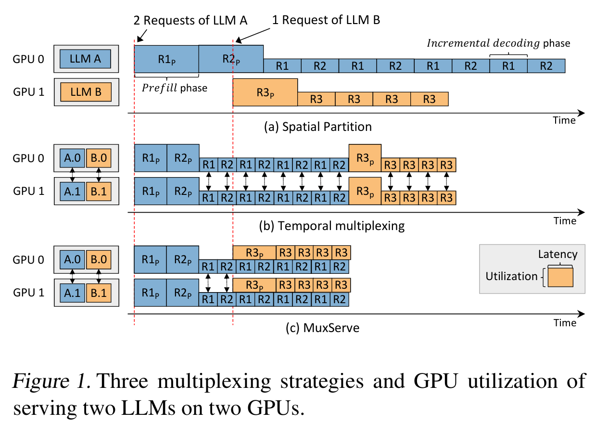

Figure 1 中，Spatial Partitioning 的 GPU 1 在等待 LLM B 请求时空闲；Temporal Multiplexing 让模型轮流使用 GPU，但 Decode 本身利用率低，**还有部分可以利用的空间剩余**；MuxServe 将不同模型的作业并发执行，更早完成全部请求。

### **Key Insight**

1. **模型流行度不同，可以互补共置。** 将高请求率模型和低请求率模型放在同一 GPU mesh，能够共享显存和计算资源。
2. **Prefill 与 Decode 的资源特征不同。** Prefill 计算密集；Decode 每轮 Token 少，通常不能占满 SM。将某个模型的 Prefill 或 Decode 与另一个模型的 Decode 共置，可以填补空闲计算资源，之前的论文做过了。

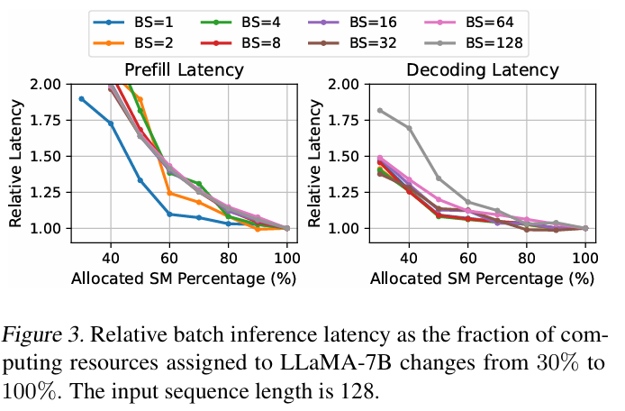

Figure 3 将 LLaMA-7B 可使用的 SM 从 100% 降低到约 60%--70%。Decode 延迟在多数 batch 下增加较小，说明它没有充分使用全部 SM；这些 SM 可以分给其他模型。Prefill 对 SM 减少更敏感，仍需要较集中的计算资源。

### **Core Design**

MuxServe 先根据模型规模和请求率决定放置，再在每个共置组内调度 Prefill/Decode，最后由统一资源管理器落实 SM 和显存共享。

#### **1. LLM Unit 与流行度感知放置**

LLM Unit 表示一组共置的模型及其 GPU mesh。MuxServe 使用历史流量（profiling）估计各模型请求率，目标是在公平约束下最大化所有 Unit 的总吞吐。

虽然论文编号是 Algorithm 1 和 Algorithm 2，但实际执行时，Algorithm 1 会先调用 Algorithm 2。

**第一步：Algorithm 2 生成并行候选配置。**

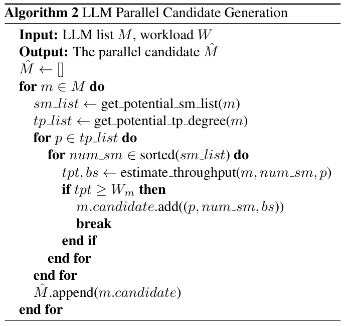

对每个模型，Algorithm 2 枚举可用的 Tensor Parallel degree、SM 配额和 batch size，并用吞吐估计器检查配置能否满足模型请求率 `W_m`。由于 SM 配额按从小到大枚举，对每个 Tensor Parallel degree 只保留第一个满足 `tpt ≥ W_m` 的配置，也就是能够承载当前流量且占用 SM 最少的候选配置。

**第二步：Algorithm 1 完成模型放置。**

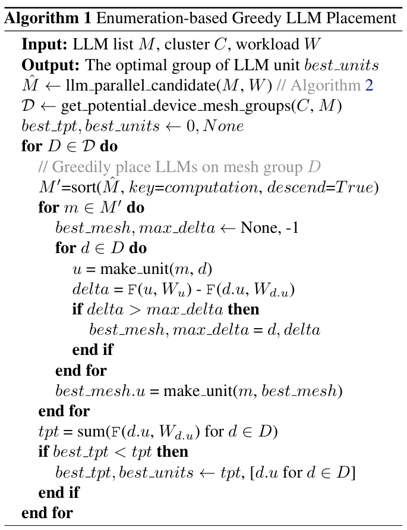

Algorithm 1 使用 Algorithm 2 返回的候选配置进行放置：

1. 枚举集群可能的 GPU mesh 划分方式；
2. 按计算需求从高到低排列模型；
3. 尝试把当前模型加入各个 mesh，计算带来的吞吐增量；
4. 将模型放入吞吐增量最大的 mesh；


#### **2. Prefill/Decode Job 拆分与 ADBS**

不同模型的请求不能组成同一个普通 batch。MuxServe 将每个模型的 Prefill 和 Decode 拆成独立 job，再使用 **Adaptive Batch Scheduling（ADBS）** 在一个 LLM Unit 内安排它们。

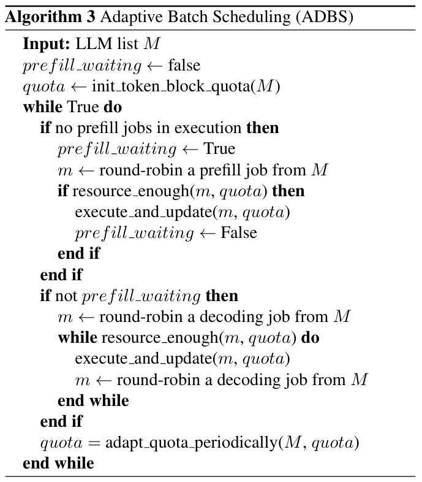

Algorithm 3 直接展示的执行顺序是：

1. init_token_block_quota(M) 为每个模型初始化 Token Block quota；
2. 若当前没有 Prefill 正在执行，按 round-robin 选择一个 Prefill job；
3. resource_enough(m, quota) 检查该模型是否仍有足够的 SM 和 quota，`execute_and_update` 执行作业并更新占用；
4. 没有 Prefill 等待时，再按 round-robin 连续加入能够容纳的 Decode job；
5. 每轮末尾调用 **adapt_quota_periodically(M, quota)** 调整 quota。

伪算法没有展开 init_token_block_quota 和 adapt_quota_periodically 的内部逻辑。Section 3.3 正文进一步说明：初始 quota 根据各模型的请求率进行归一化，使高流量模型可以获得更多 block，同时限制单个模型不成比例地占满 KV Cache；运行时监控各模型的 KV Cache 利用率，再将暂时未被低利用率模型使用的 block 转给高利用率模型。

#### **3. Unified Resource Manager**（SM粒度资源切分）

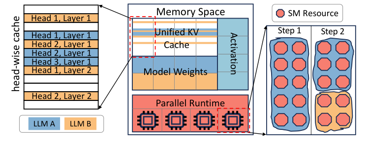

计算侧使用 NVIDIA MPS 按 SM 粒度划分资源：计算密集的 Prefill 可以独占更多 SM，Decode 阶段则允许多个 job 并发。

显存分为三部分：

- Unified KV Cache：以 attention head 为粒度划分 block，不同规模模型共享同一 KV 空间；
- Model Weights：同一模型的 Prefill/Decode process 共用一份权重；
- Activation：保存当前执行所需的临时激活。

MuxServe 基于 vLLM 实现，但不是直接使用原版 vLLM scheduler。每个 Unit 有一个 global scheduler；Prefill/Decode 使用独立 vLLM process，通过 MPS 设置不同 SM 配额，并由 C++ memory manager 和 CUDA IPC 管理统一 KV 空间。

### **Experiment**

| 项目 | 设置 |
|---|---|
| 集群 | 4 节点，共 32×A100 80GB |
| 互连 | 节点内 600 GB/s NVLink；节点间 200 Gbps InfiniBand |
| 模型 | 19 个 LLaMA 系列模型，规模覆盖 4B--70B |
| Synthetic Workload | ShareGPT 请求；Poisson 到达；模型请求率服从不同参数的幂律分布 |
| Real Workload | ChatLMSYS trace；16 个模型、32 GPU；20% 热门模型占 50% 流量 |
| 指标 | 聚合吞吐、SLO Attainment |

SLO Attainment 是在目标延迟内完成的请求比例；SLO 以单设备执行延迟的倍数表示。

Baseline：

- Spatial Partitioning：每个模型独占一组 GPU，组内使用 vLLM；
- Temporal Multiplexing：使用相同优化放置和统一 KV Cache，但模型按 FCFS 轮流执行，每个模型内部使用 continuous batching。

### **Result 1：端到端结果**

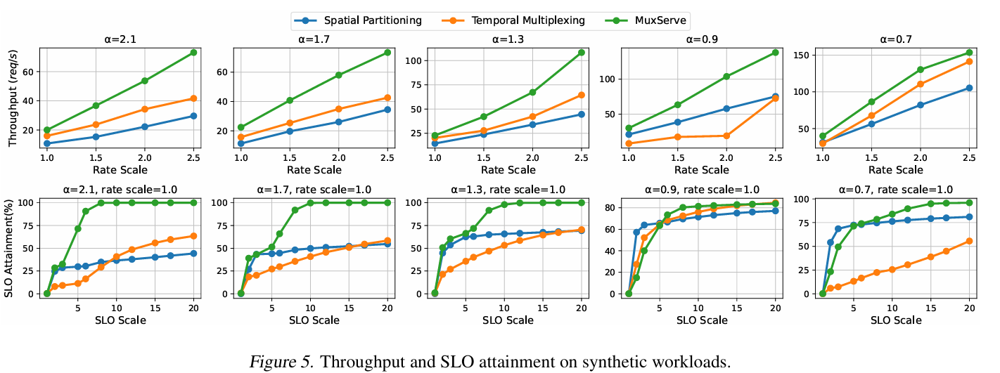

合成负载中，MuxServe 在不同流行度分布下均获得最高吞吐：

- 相比两个 baseline，吞吐最高提高 **1.8×**；
- 在 99% SLO Attainment 下，最多处理 **2.9×** 请求；
- 模型流行度差异越大，热门与冷门模型互补共置的收益越明显。

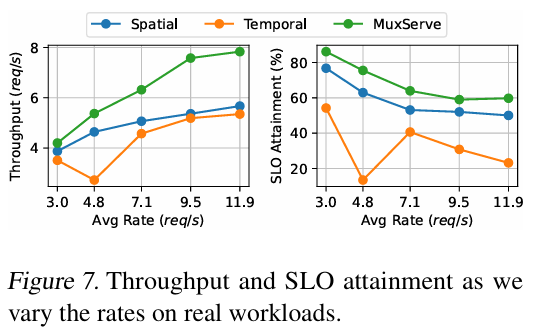

真实负载中，相比 Spatial Partitioning 和 Temporal Multiplexing，吞吐分别最高提高 **1.38×** 和 **1.46×**，同时获得更高的 SLO Attainment。

### **Result 2：Ablation**

#### **1. Placement Algorithm**

放置消融包含两组设置：8 GPU/4 LLM 和 16 GPU/7 LLM；请求按 Poisson 分布到达，其中 50% 的热门模型接收超过 70% 的流量。Greedy baseline 优先放置请求率高的模型，并选择剩余显存最多的 mesh；MuxServe 还联合考虑模型计算需求和共置后的吞吐增量，最终吞吐最高提高 **1.3×**。

#### **2. ADBS 与 Token Block Quota**

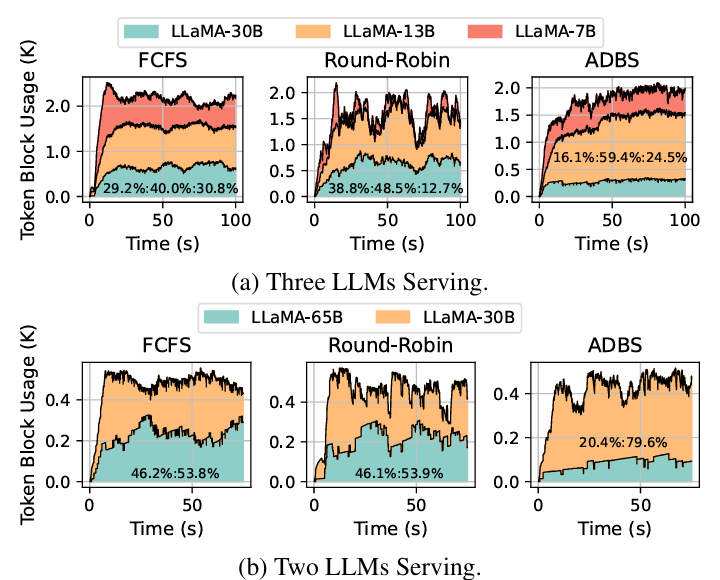

Figure 9 在 4 张 GPU 上比较 FCFS、Round-Robin 和 ADBS。横轴是运行时间，纵轴 Token Block Usage (K) 是正在占用的 KV Cache block 数量，K 表示千；彩色区域分别代表各模型占用的 block，图中百分比是实验期间各模型的相对 Token Block 使用比例。

| 子图 | 模型（按图例顺序） | 请求率 | 平均请求长度比例 |
|---|---|---|---|
| Figure 9a | LLaMA-30B / 13B / 7B | 2:8:8 req/s | 2:1:1 |
| Figure 9b | LLaMA-65B / 30B | 1:8 req/s | 4:1 |

Figure 9a 的三个模型既有不同请求率，也有不同请求长度，因此合理的 KV 分配不应简单地平均。ADBS 根据请求率初始化 quota，再按照实际 KV 利用率动态回收和转移 block，其吞吐达到 6.2 req/s，高于 Round-Robin 的 4.1 req/s 和 FCFS 的 3.8 req/s。

Figure 9b 更直观：LLaMA-30B 的请求率是 LLaMA-65B 的 8 倍，但 FCFS 和 Round-Robin 仍将约 46% 的 block 留给 65B。ADBS 将两者的使用比例调整为 20.4%:79.6%，使更多 30B 请求能够进入执行，吞吐达到 6.6 req/s。

| 调度方法 | Figure 9a 吞吐 | Figure 9b 吞吐 |
|---|---:|---:|
| FCFS | 3.8 req/s | 3.2 req/s |
| Round-Robin | 4.1 req/s | 4.9 req/s |
| ADBS | **6.2 req/s** | **6.6 req/s** |

论文将两组设置汇总后报告，ADBS 吞吐相对 Round-Robin/FCFS 分别提高 **1.43×/1.85×**。图中 Block 总占用高并不等于吞吐高：请求若长时间未完成，其 KV Cache 会一直保留；ADBS 的关键是让 block 分配与实际负载更匹配，使请求更快完成并释放缓存。

#### **3. Unified Resource Manager**

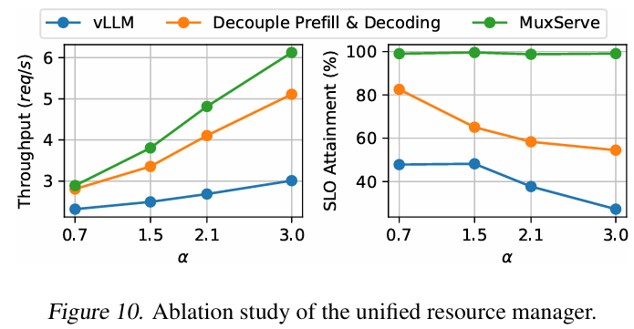

Figure 10 在 4 GPU 上部署 4 个 LLM，请求率服从不同 α 的幂律分布，并固定 SLO scale=8。vLLM 是未做阶段拆分的基线；Decouple Prefill & Decoding 只拆分两个阶段并管理 SM；完整 MuxServe 再加入统一 KV Cache 和显存管理。阶段拆分与计算资源管理使吞吐提高 **1.7×**；统一显存管理在此基础上再提高 **1.2×** 吞吐，并使 SLO Attainment 最高改善 **3.6×**。

### **Restriction**

1. MuxServe 需要已知或根据历史流量估计模型请求率；流行度快速变化时，离线放置可能失效。
2. 主要目标是多模型聚合吞吐，严格 SLO 下共置干扰有时会降低小 SLO scale 的达标率。


**启示：** MuxServe 可为多模型 Agent DAG 提供流行度感知的模型放置、阶段级 SM 复用和统一 KV 管理；


## Towards End-to-End Optimization of LLM-based Applications with Ayo（ASPLOS 2025）

论文链接：[ACM ASPLOS 2025](https://doi.org/10.1145/3676641.3716278) ｜ [arXiv](https://arxiv.org/abs/2407.00326) ｜ [Code](https://github.com/NetX-lab/Ayo)

论文预印本和正文使用 `Teola`，ASPLOS 2025 正式题目及开源项目改为 `Ayo`，两者是同一项工作。

应用级、直接 DAG-aware 的端到端编排系统。Ayo 不只调度 LLM request，而是把 LLM、Embedding、检索、数据库和 API 等操作共同表示为细粒度 dataflow graph，再跨模块进行并行、流水和 topology-aware batching。它比 Parrot 覆盖的操作类型更广，但主要面向结构预先定义的工作流。

### **Background / Motivation**

真实 LLM 应用通常不是输入 Prompt 后只调用一次模，而是由多个模块共同组成。例如高级 RAG 会依次执行文档切分、Embedding、数据库写入、Query Expansion、向量检索、Reranking 和最终 LLM 生成。

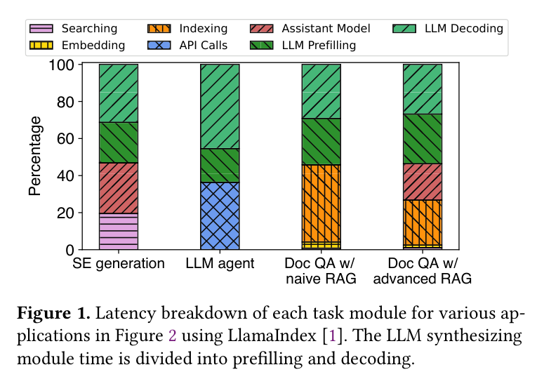

Figure 1 表明，只优化 LLM 推理并不一定能明显缩短应用完成时间：在部分 Document QA 场景中，Searching、Embedding、Indexing 和 Reranking 等非 LLM 模块合计占端到端延迟的 50% 以上。

现有 LangChain、LlamaIndex 等框架通常将工作流写成若干高层 module，并让这些 module 按链式顺序调用各自的后端。这样存在三个问题：

1. **Module 是黑盒。** 系统只知道 `Indexing → Query Expansion → Reranking → LLM` 的模块顺序，不知道模块内部哪些操作具有真实数据依赖，因而把本可并行的工作串行执行。
2. **无法跨 Module 流水。** 一个模块通常要产生全部结果后，下一个模块才能开始。例如 Query Expansion 生成三个新查询时，传统框架会等三个查询全部生成完，才开始 Embedding 和检索。
3. **后端优化目标与应用目标不一致。** Engine 只看到彼此独立的 request，通常优化单个请求延迟或总吞吐，却不知道哪些请求属于同一 DAG、哪个请求执行后能够推进更多后继节点。

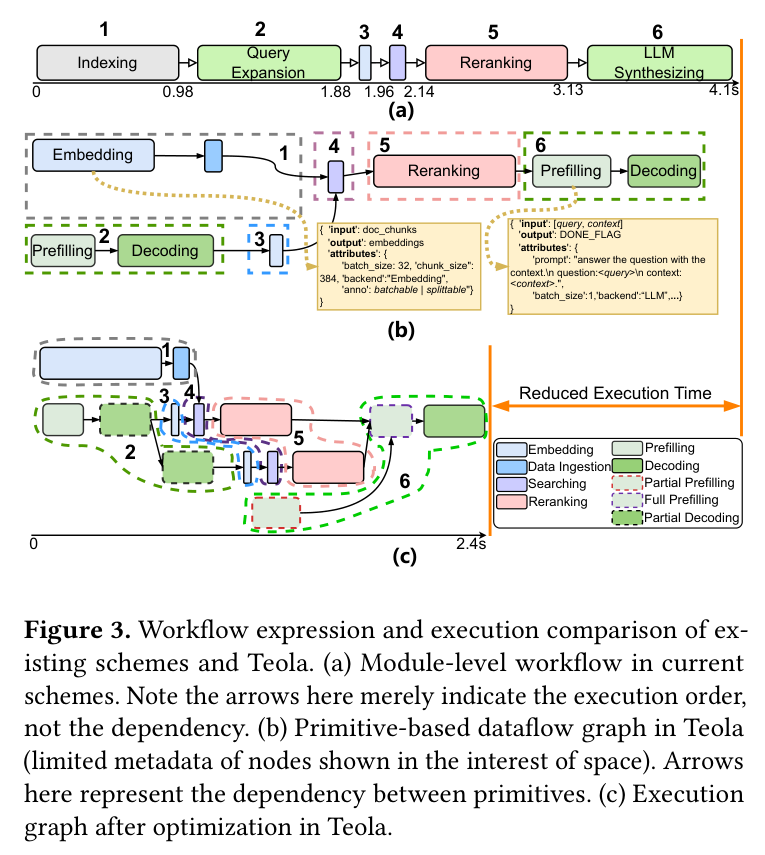

Figure 3a 是传统 module-level 顺序，端到端执行约 4.1 秒。Figure 3b 将 module 展开后，可以看到 Indexing 中的 Embedding 与 Query Expansion 的 Prefill/Decode 并不存在数据依赖。Figure 3c 进一步并行独立分支、拆分 Prefill 并流水传递部分 Decode 输出，将示例执行时间缩短到约 2.4 秒。

论文还给出两类 scheduling mismatch：48 个属于同一 Indexing 操作的 Embedding request 若只用 batch size=4，需要 1.8 秒；知道它们需要整体完成后改用 batch size=16，虽然单个 batch 更慢，整组却在 1.35 秒完成。类似地，树形 LLM synthesis 根据 DAG 深度对同层请求组批，可将完成时间从 1.6 秒降至 1.15 秒。

### **Key Insight**

Ayo 的核心是把编排粒度从粗粒度 module 下沉为 primitive：

| 层次 | 系统能够看到的信息 | 可以进行的优化 |
|---|---|---|
| Module-level | 模块执行顺序 | 模块内局部优化 |
| Primitive-level DAG | 每个操作的输入、输出、依赖、后端和 batch 属性 | 跨模块并行、流水、部分 Prefill 和拓扑感知组批 |

同一个应用模板会根据本次 Query 的文档数量、chunk 数量、RAG 配置和 synthesis mode，展开为一张 query-specific DAG。因此，Ayo 优化的不是固定的一条模块链，而是该次请求真正需要执行的细粒度操作图。

### **Core Design**

Ayo 总体由两个组件组成：

1. **Graph Optimizer：** 将高层 Workflow Template 展开为当前 Query 的 primitive-level DAG，并通过图变换生成更适合执行的 e-graph；
2. **Two-tier Runtime Scheduler：** 上层 Graph Scheduler 按 e-graph 依赖释放节点，下层 Engine Scheduler 在具体 LLM/Embedding 等后端内进行 topology-aware batching。

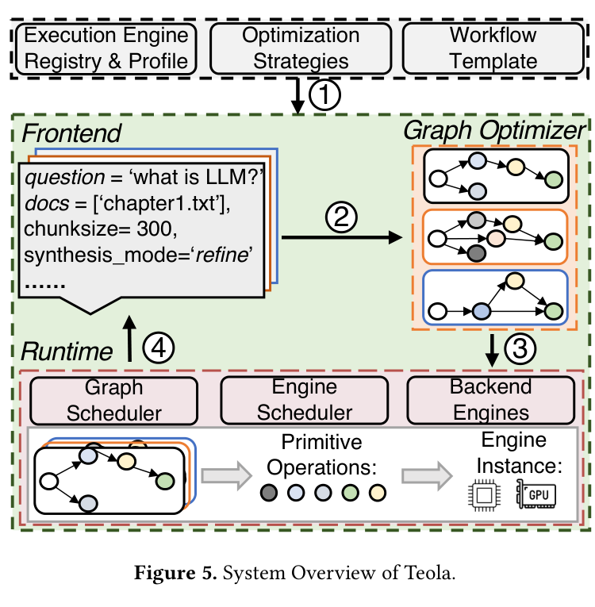

离线阶段，开发者注册工作流模板、各类 execution engine 及其输入规模到延迟/吞吐的 profile；在线收到 Query 后，Graph Optimizer 生成并优化该 Query 的 DAG，Runtime 再按照依赖将节点分发给相应的后端 Engine。

#### **1. Graph Optimizer：构造并优化执行图**

##### **1.1 从 Workflow Template 生成 p-graph**

开发者仍然以较高层的组件定义应用，并用 `>>` 声明组件顺序，同时标注：

- `batchable`：多个输入可以组成 batch，例如一组文档 Chunk 的 Embedding；
- `splittable`：输出可以被拆开并逐部分交给后继，例如结构化生成多个 Query；
- `backend`：该操作应交给哪个 execution engine；
- 输入、输出、Prompt、batch size 等运行参数。

当具体 Query 到达后，Ayo 根据配置将每个组件展开成 primitive。例如一次包含三个 Context Chunk 的 refine synthesis，会变成三组相互依赖的 Prefill 和 Decode 节点。所有 primitive 的输入输出关系组成 **p-graph（primitive graph）**。

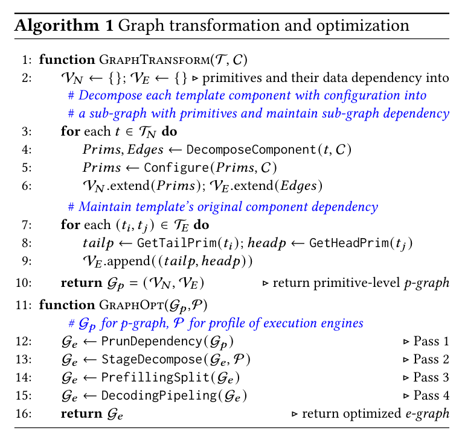

Algorithm 1 的执行过程可以分为两个阶段：

1. `GraphTransform(T, C)` 遍历 Workflow Template 中的每个组件，根据本次 Query 的配置 `C` 调用 `DecomposeComponent`，把组件展开成 primitive 子图；随后用 `Configure` 写入 Prompt、输入规模、batch 属性和目标 Engine，并把原模板中的组件依赖连接到子图的头尾节点，得到 p-graph；
2. `GraphOpt(Gp, P)` 根据后端 Engine profile `P` 依次执行四个优化 Pass。每个 Pass 在图上匹配可优化的 primitive 模式并修改图结构，直到得到不再需要继续变换的 e-graph；相同工作流配置的优化结果可以缓存复用。

##### **1.2 四个 Graph Optimization Pass**

**Pass 1：Dependency Pruning。** 检查 primitive 的实际输入来源，删除只因 module 顺序而产生、并非真实数据依赖的边。这样，文档 Embedding/Indexing 可以与只依赖用户问题的 Query Expansion 同时开始。

**Pass 2：Stage Decomposition。** 如果一个 batchable primitive 的输入规模超过后端的 maximum efficient batch size，就把它拆成多个 sub-micro-batch。前一小批产生结果后，下游便可开始处理，不必等待整个大批次结束；需要汇总时在末尾加入 `Aggregate` 节点。这里是应用算子的流水拆分，不是把模型切成 Pipeline Parallel stages。

**Pass 3：LLM Prefilling Split。** 一个 Prompt 可能由 instruction、question、retrieved context 等部分组成，其中 instruction 和 question 已经到达，而检索结果仍未产生。只要已到达部分位于真实 Prompt 的前缀，Ayo 就先执行 `Partial Prefilling` 并保存 KV Cache；Context 到达后，再用 `Full Prefilling` 继续计算剩余 Token。

与 Sarathi/FastGen 的固定 Token chunk 不同：Sarathi/FastGen 主要为了控制每轮 GPU 工作量而按 Token 数切分；Ayo 根据工作流中各 Prompt 组成部分的**就绪时间**切分，使 Prefill 与上游检索并行。

**Pass 4：LLM Decoding Pipelining。** 对标为 `splittable` 的结构化输出，在 Decode 过程中监控 JSON 等结果。一旦一个完整新 Query 或句子生成，就立即交给下游 Embedding、Searching 和 Reranking；无需等本次 Decode 输出全部结束。

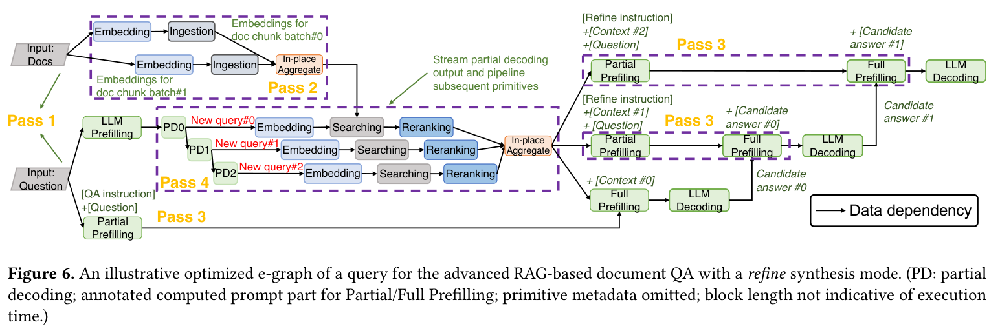

Figure 6 把四个 Pass 放在同一张高级 RAG e-graph 中：左侧两条输入分支通过 Pass 1 并行；文档 Embedding 通过 Pass 2 分批并流水写入；Query Expansion 通过 Pass 4 逐个释放三个新 Query；最终三轮 refine synthesis 又用 Pass 3 提前计算已经可用的 Prompt 前缀。

#### **2. Two-tier Runtime Scheduler：从 DAG 到后端执行**

Graph Optimizer 输出 e-graph 后，运行时并不是直接把整张图交给某个 Engine，而是采用上下两层调度：上层负责哪个 primitive 已经可以运行，下层负责同一个后端的哪些 primitive 应该组成 batch。

##### **2.1 Graph Scheduler：按依赖释放节点**（一般拓扑）

Runtime 上层的 Graph Scheduler 为每个 Query 保存 e-graph：

1. 入度为 0 的 primitive 才是 ready node；
2. ready node 被发给对应的 Engine Scheduler；
3. 节点完成后，Scheduler 保存中间结果并降低后继节点入度；
4. 新的入度 0 节点随即进入执行。

对于相邻且传输数据较大的节点，Ayo 会提前把后继节点发往目标 Engine 等待，并让前驱输出直接传给后继 Engine，避免数据先绕回中央 Scheduler。

##### **2.2 Engine Scheduler：Topology-aware Batching**

多个 ready primitive 可能同时请求同一个 LLM 或 Embedding Engine。普通 FIFO batching 只按到达顺序组批，却没有判断执行哪个节点更能推进整张 DAG。

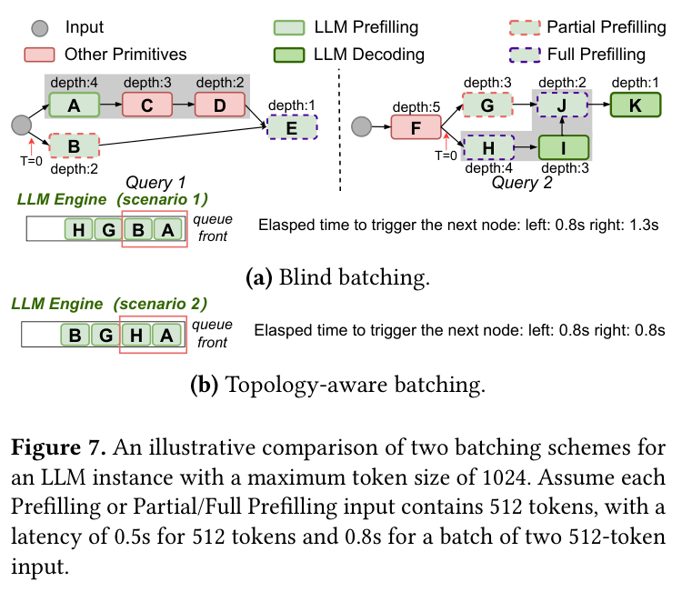

Figure 7 中，LLM 一次最多放入两个 512-Token Prefill。Blind batching 选择队首 A、B，但 B 的后继 E 还在等待另一父节点 D，因此此时执行 B 不能马上推进后续；Query 2 的 G、H 也继续等待。Topology-aware batching 改为选择 A、H：A 推进 Query 1，H 同时推进 Query 2，使两张图下一节点都能在 0.8 秒后触发，而不是让 Query 2 等到 1.3 秒。

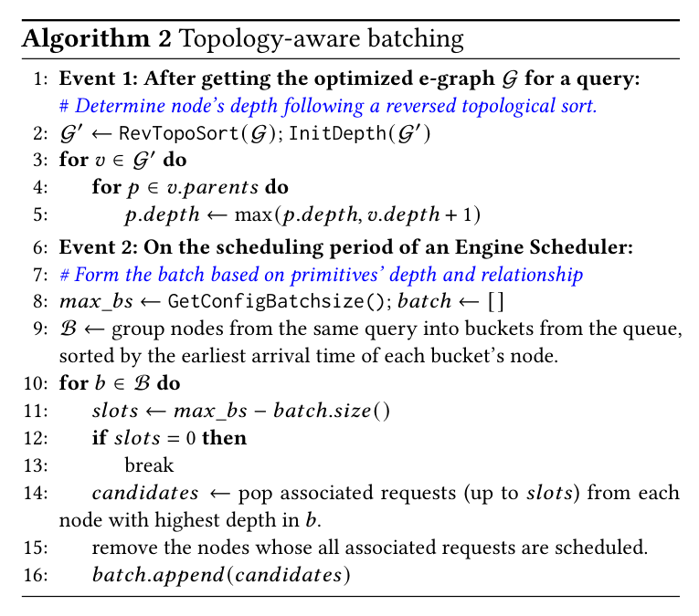

Algorithm 2 分两步：

1. e-graph 生成后进行反向拓扑遍历。输出节点 depth 最小，越靠前且下游链越长的节点 depth 越大；
2. 组批时先把同一 Query 的节点放入一个 bucket，在 bucket 内优先选择 depth 较大的 primitive，再按照各 bucket 最早到达时间依次填满 batch slots。先选总深度减少最多的节点。

这个 depth 是距离 DAG 末端还有多少层的结构信息，不包含各节点的真实执行时间，只考虑节点拓扑而不考虑执行时间。

### **Experiment**

| 项目 | 设置 |
|---|---|
| LLM GPU | Gemma-2-2B、LLaMA-2-7B 使用 1×RTX 3090；LLaMA-2-13B 使用 2×RTX 3090；LLaMA-30B 使用 2×A800 80GB |
| 其他模型 | BGE-large-en-v1.5 Embedding、BGE-reranker-large；每个实例使用 1×RTX 3090 |
| 网络 | 服务器之间 100 Gbps |
| 精度 | 所有模型使用 FP16 |
| 应用 | 搜索增强生成、Naive RAG、Advanced RAG、Contextual Retrieval |
| 数据集 | WebQuestions、HotpotQA、FinQA、TruthfulQA |
| 到达方式 | 基于数据集合成请求，按照 Poisson 分布到达 |

Baseline：

- LlamaDist：作者用 Ray 实现的分布式 LlamaIndex，采用粗粒度 module chain；
- LlamaDistPC：人工并行独立 module，并加入 Prompt prefix cache 的增强版本（hash 匹配类似）；
- AutoGen：将检索、扩展、生成等功能组织为多个 Agent；

请求调度策略：
- PO (Per-Invocation Oriented)：偏向单次调用低延迟；
- TO (Throughput Oriented)：使用预先调好的大 batch/token size，偏向 Engine 总吞吐。

### **Result 1：端到端延迟**

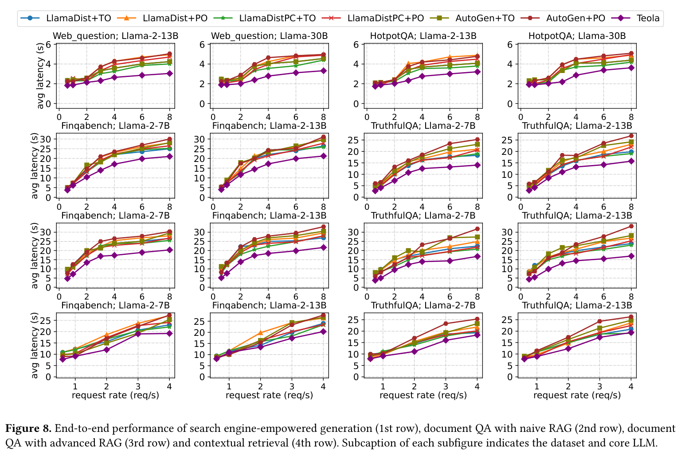

Figure 8 每一行对应一种应用，横轴是请求率，纵轴是平均端到端延迟，越低越好；每列使用不同数据集和核心 LLM。紫色的 Ayo/Teola 在绝大多数负载下最低。

| 应用 | 端到端效果 |
|---|---:|
| 搜索增强生成 | 最高 **1.79×** 加速 |
| Naive RAG | 低负载最高 **1.62×**，高负载最高 **1.67×** |
| Advanced RAG | 低负载最高 **2.09×**，高负载最高 **2.03×** | 
| Contextual Retrieval | **1.06×--1.59×** 加速 |

在 Naive RAG 与 Advanced RAG 共置、每个应用各 3 req/s 的实验中，Ayo 相对较强的 LlamaDistPC baseline 仍获得 **1.2×--1.55×** 延迟改善。

### **Result 2：Graph Optimization Ablation**

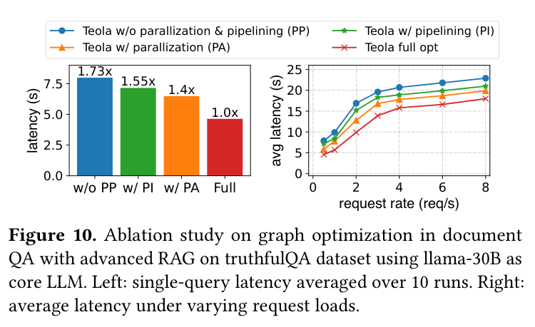

Figure 10 使用 Advanced RAG、TruthfulQA 和 LLaMA-30B：

- `w/o PP` 同时关闭 Parallelization 和 Pipelining，单 Query 延迟是完整 Ayo 的 1.73×；
- 只开启 Pipelining（`w/ PI`）或只开启 Parallelization（`w/ PA`）仍分别为完整方案的 1.55× 和 1.4×；
- 同时启用四个 Pass 的 `Full` 在单 Query 和不同请求率下都具有最低延迟。

Dependency Pruning/Partial Prefill 提供并行，Stage Decomposition/Partial Decode 提供流水。

### **Result 3：Topology-aware Batching 与开销**

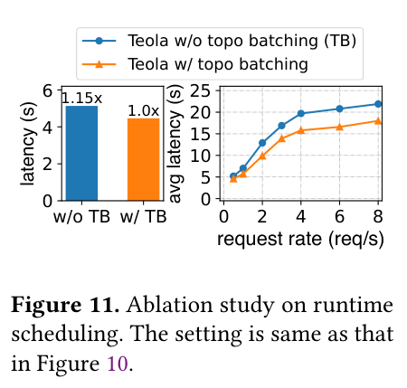

Topology-aware batching 在单 Query 中带来 **1.15×** 加速，在多 Query 负载下使平均延迟最多下降 **19.2%**。

细粒度拆分也会产生额外成本：

- Graph optimization 占端到端延迟约 1.3%--3%；
- Primitive 间通信占约 3.1%--6.2%；
- Partial + Full Prefilling 相比一次完整 Prefill 慢约 3.11%--12.12%，原因包括多次启动执行和重复搬运 KV Cache。

论文实验表明，跨模块并行和流水带来的收益大于这些额外开销。

### **Restriction**

1. Ayo 主要面向开发者预先定义结构的工作流。自主 Agent 的动态分支、循环和 self-reflection 无法在执行前得到完整 p-graph。
2. Partial Prefilling、结构化 Partial Decoding 和特殊 batching 需要修改 vLLM 等后端，系统与 Engine 的耦合高。
3. Topology-aware batching 只使用节点 depth，没有建模节点执行时间、slack 和真实关键路径；论文也将 critical-path scheduling 留作未来工作。

应用 DAG 信息如何下沉到具体 Engine 调度：先用 primitive-level graph 暴露跨 LLM 与非 LLM 操作的真实依赖，再用图变换创造并行/流水，最后以 topology-aware batching 推进 DAG。


## Agentix: An Efficient Serving Engine for LLM Agents as General Programs（NSDI 2026）

论文链接：[USENIX NSDI 2026](https://www.usenix.org/conference/nsdi26/presentation/luo) ｜ [PDF](https://www.usenix.org/system/files/nsdi26-luo.pdf)

**上次分享过了** 

### **Background / Motivation**

Agent 程序会在运行时根据模型输出、工具调用和控制流动态产生新的 LLM 请求，完整 DAG 通常无法提前获知。现有 request-level scheduler 将这些调用视为相互独立的请求：长调用会阻塞短调用，而长程序后续不断产生的新调用还会继续阻塞接近完成的短程序，形成 request-level 和 program-level 两层 head-of-line blocking。因此，调度目标应从单次调用延迟转向整个 Agent 程序的端到端完成时间。

### **Core Design**

Agentix 不要求开发者提前提交完整 DAG，而是在 Agent 程序运行、不断发出 LLM 调用的过程中记录程序状态，再用这些状态调度后续调用。

1. **识别同一程序的调用。** 开发者通过 Agentix 提供的 OpenAI/vLLM 兼容接口发起请求；程序启动时建立 session，之后每次 LLM 调用都携带同一个 program ID。后端的 Process Table 因而知道多个看似独立的 request 实际属于同一程序，并记录该程序已经执行了多久、等待了多久、有哪些并行调用以及此前在哪个 engine 上运行。

2. **PLAS 调度串行程序。** 对于 `A1→A2→A3` 这类单线程程序，PLAS 将已完成调用的 GPU 执行时间相加。例如程序 A 已累计执行 10 秒、程序 B 尚未获得服务，两者的新调用同时到达时，B 优先。它优先服务目前获得 GPU 时间较少的程序，使真正较短的程序更可能尽早完成。
3. **ATLAS 调度并行程序。** 对多分支动态 DAG，未来结构未知，Agentix 无法提前计算真实关键路径。ATLAS 根据目前已完成的父调用，累计每条已观察依赖链的执行时间，并把其中最长值作为程序关键路径的在线近似。新分支到达后继续更新该值；同一程序的并行调用获得相近优先级并尽量一起推进，避免其中一个分支长期落后。
4. **用多级队列实施抢占。** PLAS/ATLAS 得到的优先级被映射到若干队列。调用只运行一个 time quantum；尚未完成时可以降到更低优先级队列，让服务较少的程序先执行。如果某个长程序的等待时间相对已获服务时间过高，anti-starvation（程序累计等待时间 ÷ 已获得服务时间） 机制会把它提升，避免永久得不到执行。
5. **在多个 Engine 间兼顾负载与 KV Cache。** 每个 engine 是一个拥有独立队列和 KV Cache 的 vLLM 实例。小于等于 2048 Token 的短调用被送到当前最空闲的 engine；长调用则尽量固定在该程序先前使用的 engine，那里保存了较长的对话前缀 KV Cache，可避免重新 Prefill。


## KVFlow: Efficient Prefix Caching for Accelerating LLM-Based Multi-Agent Workflows（NeurIPS 2025）

论文链接：[arXiv](https://arxiv.org/abs/2507.07400) ｜ [本地 PDF](paper_1/KVFlow_NeurIPS2025.pdf)

### **Background / Motivation**

多 Agent 工作流中的每个 Agent 通常带有固定角色 Prompt，包括身份、职责、行为规则和 few-shot 示例。同一 Agent 被反复调用时，这部分 Prompt 的 KV Cache 可以跨调用复用，从而跳过重复 Prefill。

现有 SGLang 等系统把 prefix KV 组织成 radix tree，并在 GPU 空间不足时按 LRU 淘汰。然而，**最近是否访问过，不等于下一次是否很快使用**。

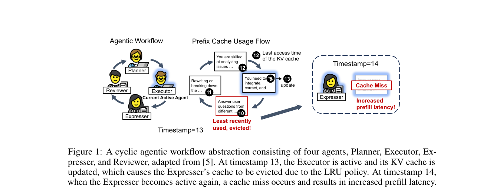

以循环工作流为例：

    Planner -> Executor -> Expresser -> Reviewer -> Planner -> ...

Executor 运行时，Expresser 因为较久没有访问，可能成为 LRU 淘汰对象；但 Expresser 恰好就是下一步。它随后发生 cache miss，需要重新 Prefill 或从 CPU 反应式加载。相反，刚完成的 Executor 虽然时间戳最新，却可能要到下一轮才复用。

因此论文要解决的问题是：

> 已知 Agent 工作流依赖时，怎样用“离下一次执行还有多远”代替历史访问时间，保留更可能在近期复用的 prefix KV，并将不可避免的 CPU-GPU 换入延迟隐藏在其他 Agent 的执行过程中？

### **Key Insight**

1. **工作流提供了 LRU 缺少的未来信息。** 系统可以从依赖关系估计每个 Agent 距离下一次执行还有多少 step。
2. **淘汰粒度应是 KV tree node，而不是整个 Agent。** 不同 Agent 可能共享部分固定前缀；一个节点只要仍被某个近期 Agent 需要，就应继续保留。
3. **从 CPU 换入通常比重新 Prefill 更便宜。** 对 Llama-3.1-8B，prefix 从 128 增至 4096 token 时，Prefill 从 13.0 ms 增至 64.3 ms，论文测得的 PCIe 传输则从 0.46 ms 增至 9.39 ms。
4. **已知下一 Agent 后，传输可以前移。** 当前 Agent 在 GPU 执行时，后台线程可以同时把下一 Agent 的 KV 从 CPU 换入 GPU。

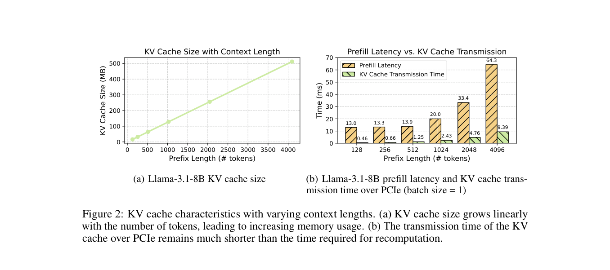

### **Core Design**

#### **1. Agent Step Graph 与 Steps-to-Execution**

KVFlow 将工作流抽象为 Agent Step Graph：节点表示一次 Agent invocation，边表示依赖关系。当前可执行 Agent 的 steps-to-execution 为 0，其他 Agent 的值由前驱和 step aggregation function 递归得到。

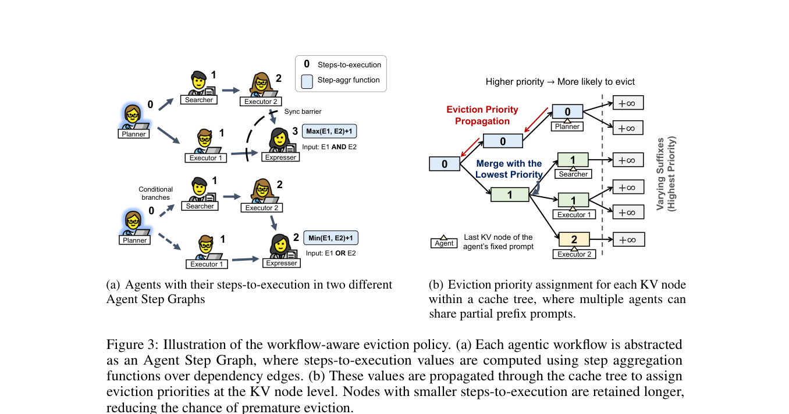

不同依赖语义使用不同聚合函数：

| 依赖语义 | 聚合函数 | 含义 |
|---|---|---|
| AND / synchronization barrier | max(E1, E2) + 1 | 必须等待最晚完成的前驱 |
| OR / conditional branch | min(E1, E2) + 1 | 任一分支完成即可触发 |

例如当前 Planner 的值为 0，下一步可运行的 Searcher 和 Executor 1 为 1；依赖 Searcher 的 Executor 2 为 2。值越小，代表 Agent 越接近执行，其 prefix KV 越值得保留。

需要注意，这个值描述的是 Agent **最早可能在哪一步执行**。它不是 wall-clock time，也没有建模 Agent 执行成本、分支概率和关键路径 slack。论文称之为 Agent Step Graph，而非直接使用普通 DAG，是因为每个节点还带有 AND/OR 等 step aggregation semantics。

#### **2. Workflow-Aware KV Node Eviction**

SGLang 的 prefix cache 是树结构，多个 Agent 可以共享祖先节点。KVFlow 按以下方式把 Agent 的 step 信息映射到 KV 节点：

1. 找到每个 Agent 固定 Prompt 的最后一个 KV node，将该 Agent 的 steps-to-execution 写入该节点。
2. 从叶子向根传播优先级；父节点被多个 Agent 共享时，取所有相关子节点中的最小值。
3. GPU 内存不足时，优先淘汰数值更大的节点，即离执行更远的 Agent KV。
4. 动态 suffix 随任务变化且通常无法复用，因此统一赋值正无穷，最先淘汰。

取最小值是一种保守策略：只要某个即将执行的 Agent 仍需要共享节点，该节点就不会因为另一个较远 Agent 的优先级而被换出。多个并发工作流共享 prefix 时也采用相同规则。

#### **3. Proactive Prefetching**

workflow-aware eviction 能减少错误淘汰，但显存有限时仍无法保留所有 KV。KVFlow 将被淘汰 Agent 的固定 prefix KV 备份到 CPU，并根据 Step Graph 提前加载下一步可能执行的 Agent。

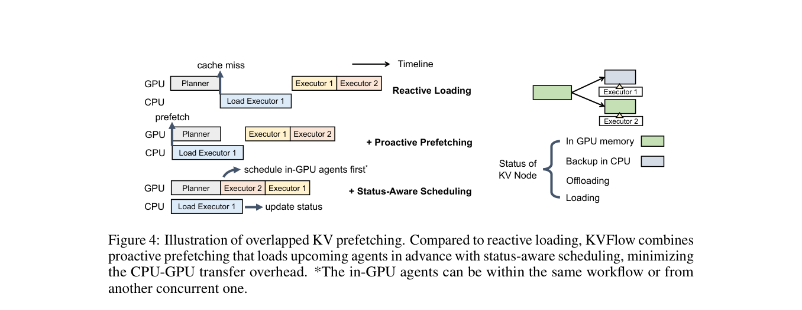

反应式加载会形成以下关键路径：

    Planner 完成 -> 发现 Executor 1 miss -> CPU 加载 KV -> Executor 1 运行

主动预取则将 Planner 的 GPU 执行与 Executor 1 的 CPU-to-GPU load 并行。分支场景下，KVFlow 在预设的并发预取上限内，保守地预取下一步所有可能执行的 Agent。

#### **4. Status-Aware Scheduling**

如果当前 Agent 很快结束，而目标 KV 尚未传完，仅靠提前预取仍可能阻塞。KVFlow 为每个 KV node 维护四种状态：

| 状态 | 含义 |
|---|---|
| in GPU memory | 已经可以使用 |
| backup in CPU | GPU 中不存在，但 CPU 有备份 |
| loading | 正从 CPU 换入 GPU |
| offloading | 正从 GPU 备份到 CPU |

调度器遇到所需 KV 仍为 loading 的请求时，暂时跳过它，先执行 KV 已在 GPU 的其他 ready Agent。这些 Agent 可以来自同一工作流，也可以来自其他并发工作流。后台 load 完成并更新状态后，原请求才重新具备可调度资格。处于 offloading 的节点不会再次参与淘汰，避免内存回收竞态。

KVFlow 在这里确实改变了局部请求选择，但目标是隐藏 KV 传输，不是根据 DAG 计算应用级关键路径优先级。

#### **5. SGLang 实现**

原型基于 SGLang v0.4.4，同时修改 frontend 和 backend：

1. 假设每个 sgl.function 对应一个 Agent；frontend 在 HTTP 请求中携带 client ID、当前 Agent 身份和所有 Agent 的 steps-to-execution。
2. backend 使用这些元数据更新 radix tree 的淘汰优先级，并在可淘汰 GPU 空间足够时触发预取。
3. 固定 Prompt 的结束位置可以由用户显式标记，也可以根据 cache hit 历史推断持续命中的 prefix。
4. client ID 用于区分不同工作流中可能重名的 Planner、Executor 等 Agent。

### **Experiment**

#### **1. 单工作流**

| 项目 | 设置 |
|---|---|
| Workflow | 10 个顺序执行的 Agent；batch size=1 |
| 执行方式 | warm up 固定 prefix 后，执行工作流 10 次并取平均 latency |
| Prompt | 合成 token；分别控制 Fixed / Dynamic / Output 长度 |
| 平台 1 | Llama-3.1-8B，A10G 24GB，PCIe Gen1 2GB/s |
| 平台 2 | Qwen2.5-32B，H100 80GB，PCIe Gen5 64GB/s |
| Baseline 1 | SGLang GPU-only：cache miss 后重新计算 |
| Baseline 2 | SGLang w/ HiCache：CPU 二级缓存、反应式换入与 layer-wise pipeline |
| 解码 | temperature=0，greedy sampling |

论文刻意使用 4096 和 8192 token 的长固定 prefix，使 GPU 空间不足并触发淘汰。

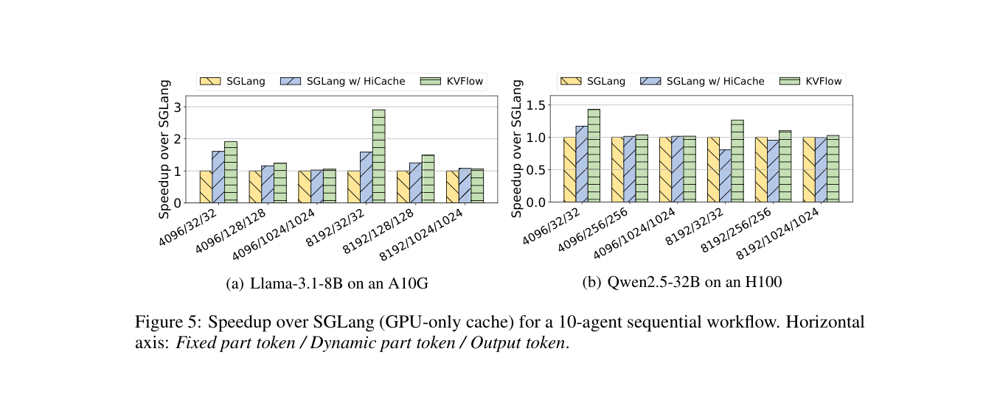

在 A10G、8192/32/32（Fixed / Dynamic / Output）配置下：

| 比较对象 | KVFlow speedup |
|---|---:|
| SGLang GPU-only | **2.91×** |
| SGLang w/ HiCache | **1.83×** |

HiCache 已经避免重新 Prefill，但反应式 load 仍暴露在关键路径上；KVFlow 再用预取和 ready-request 调度覆盖传输。固定 prefix 越长，cache miss 越贵，收益越明显。Output token 增多后，Decode 占总时间的比例上升，prefix 管理可优化的部分变小。

#### **2. 高并发工作流**

高并发实验在单张 H100 （？都不涉及跨卡通信）上同时启动多个互不交互、互不共享的工作流。Dynamic 和 Output 均为 256 token，配置为：

| 模型 | Fixed / 并发工作流数 |
|---|---|
| Qwen2.5-32B | 512/20-task、1024/10-task |
| Llama3-8B | 512/128-task、1024/64-task |

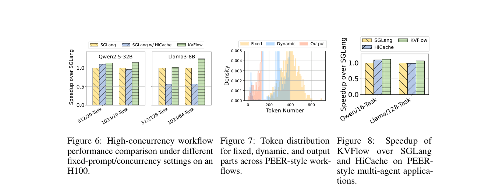

结果需要按 baseline 区分：

- 相比 GPU-only SGLang，KVFlow 最高提升 **1.25×**。
- 相比 LRU + reactive loading 的 HiCache，KVFlow 最高提升 **2.19×**。
- 1024 fixed / 64-task 时，HiCache 只有 GPU-only SGLang 的 0.57×。论文认为频繁反应式换入破坏了调度-计算流水线，碎片化 KV 布局也没有充分利用 PCIe 带宽。

#### **3. PEER 风格真实负载模拟**

论文基于 PEER Financial QA 模板构造四 Agent 工作流。不同工作流的 Prompt 有随机差异，同一应用上下文又会产生部分共享 prefix。

这组 Prompt 主要只有几十到数百 token，远短于 4K/8K 合成压力测试。KVFlow 相比 GPU-only SGLang 最高提升 **1.12×**，相比 HiCache 最高提升 **1.08×**。在更现实但 prefix 较短的负载中仍有收益，不过幅度明显减小。

### **Restriction**

1. KVFlow 依赖 frontend 提供 Agent 身份和工作流 step 信息；对执行路径完全自主、无法提前枚举下一 Agent 的程序，适用性会减弱。
2. steps-to-execution 只计算拓扑步数，没有考虑 Agent 耗时、关键路径 slack、分支概率、prefix 大小或换入收益。
3. OR 分支会预取所有下一步候选，可能浪费 PCIe 带宽和 GPU cache；论文只通过并发预取数量上限控制。
4. 若当前 Agent 很短且没有其他 ready 请求，status-aware scheduling 找不到可插入的工作，load 延迟仍会暴露在关键路径上。
5. 单工作流实验主要使用 10-Agent 合成顺序图和 batch size=1；高并发工作流被设为互不交互、互不共享，而且并发度没有高到 active request 吃光全部显存。
6. **只验证了单 GPU，没有跨卡通信。** Llama-3.1-8B/A10G 与 Qwen2.5-32B/H100 实验均使用单卡，论文中的通信仅为 CPU RAM 与单张 GPU 之间的 PCIe 传输。它没有评估 Tensor Parallel 下分片 KV 的协调预取、Pipeline Parallel 下各 stage 的加载时序与 pipeline bubble、多副本之间的 cache-aware routing 和 KV 迁移，也没有考虑 NVLink、InfiniBand、NUMA 与多 GPU 共享 PCIe/主机内存带宽造成的竞争。因此，不能直接推广到多 GPU 或跨节点 serving。


### **与 DAG-aware Scheduling 的关系**

Parrot、Ayo 和 Agentix 主要回答看到请求之间的依赖后，应该如何推进整张应用图；KVFlow 回答的是另一个问题：

> 已经知道工作流接下来可能运行谁后，如何让 GPU 内存层级提前为这些 Agent 准备好 prefix KV？

因此它在 DAG-aware serving 中更适合作为 **graph-informed KV management** 子方向。

KVFlow 目前只用拓扑 step 排序。进一步可以联合 critical-path urgency、branch probability、avoided prefill cost 和 KV footprint，判断一个 Agent 的 prefix 是否真正值得占用 GPU：

    cache value =
        critical-path urgency
        × branch probability
        × avoided prefill cost
        / KV memory footprint

例如，一个 Agent 完成后会解锁多个下游节点，即使它不是下一 step，也可能比只服务单一下游的 Agent 更值得预取。相反，低概率分支的大 prefix 不应仅因为 steps-to-execution=1，就与确定执行的关键路径 Agent 获得相同资源。
