# Dynamic Agentic Workflow Scheduling and Inference Optimization

动态、多轮Agentic workflow
## Continuum: Efficient and Robust Multi-Turn LLM Agent Scheduling with KV Cache Time-to-Live

论文链接：[arXiv](https://arxiv.org/abs/2511.02230) ｜ [本地 PDF](paper_8_17/Continuum.pdf)

作者：Hanchen Li、Runyuan He、Qiuyang Mang、Qizheng Zhang、Huanzhi Mao、Xiaokun Chen、Hangrui Zhou、Alvin Cheung、Joseph Gonzalez、Ion Stoica。

论文状态：arXiv 预印本；另有 ICLR 2026 Lifelong Agent Workshop 版本。

### Motivation

#### Agent 不是一次 LLM 请求

普通聊天请求通常是一次完整的 Prefill → Decode。

ReAct Agent 范式：

LLM 第 1 轮 → Tool → LLM 第 2 轮 → Tool → …… → LLM 第 N 轮

每一轮几乎总会复用此前全部上下文。问题是：工具执行期间 LLM 暂停，serving engine 看不到这个程序何时回来，却必须立刻决定是否保留它的 KV Cache。

删掉、换出、保留都可能出问题。

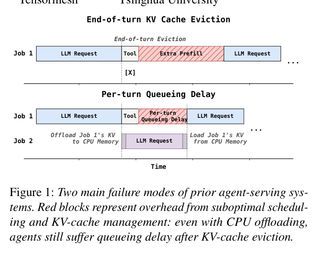

1. **轮末立即淘汰会重复 Prefill。** 如果第 1 轮结束就释放 KV，第 2 轮返回时必须重新处理全部历史上下文。Agent 越往后上下文越长，重复计算越贵。
2. **换出到 CPU 仍有排队延迟。** CPU offloading 可以避免从 Token 重新 Prefill，但请求返回时仍要把 KV 搬回 GPU，并重新进入 serving 队列。
3. **永久保留浪费显存。** 工具可能几毫秒返回，也可能运行数十秒。长期 pin 住所有暂停 Agent 的 KV，会挤压正在 Decode 的请求。

所以 CPU 中有 KV 备份不等于多轮 Agent 没有调度问题。Continuum 的目标是同时减少**恢复成本**和**每轮重新入队成本**。

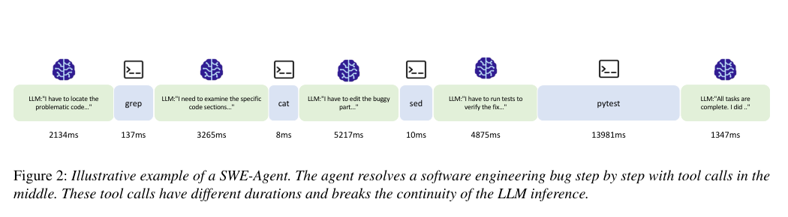

Figure 2 ReAct Agent 范式的例子。一次修复任务依次调用 grep、cat、sed、pytest；工具耗时从 8 ms 到 13,981 ms 不等。LLM 请求之间不是预先可知的 DAG 节点，而是由上一轮模型输出动态决定的工具间隔。

#### 1.4 现有方案的核心缺陷

| 方法 | 保留 KV 缓存 | 考虑每轮排队延迟 | 限制保留时长 | 核心问题 |
|---|---:|---:|---:|---|
| vLLM | ✗ | ✗ | ✗ | 回合结束立即驱逐，不适配 Agent |
| Autellix | ✗ | ✗ | ✗ | 仅做任务级调度，不关注 KV 复用 |
| Pie | ✓ | ✗ | ✗ | 仅提供可编程接口，无内置策略 |
| InferCept | ✓ | ✗ | ✗ | 仅考虑重载成本，忽略排队延迟；无保留时长上限 |

其中 InferCept 是最接近的相关工作，但它只比较重载 KV 的成本 和 占用显存的机会成本，没有建模多轮排队延迟的累积效应；其静态保留策略也难以适应工具调用时长的高方差。

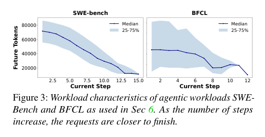

论文使用 GPT-5 生成并分析 100 条 mini-SWE-agent/SWE-Bench 轨迹和 100 条 BFCL V4 Web Search 轨迹。Figure 3 则给 program-level FCFS 提供经验依据：随着当前 step 增加，两类轨迹的未来 Token 中位数总体下降。较早进入并已经执行多轮的程序通常更接近结束。

因此按程序首次到达时间维持相对顺序，可作为不可知未来时的 SRTF **(先完成距离完成轮数最少的任务)** 近似。

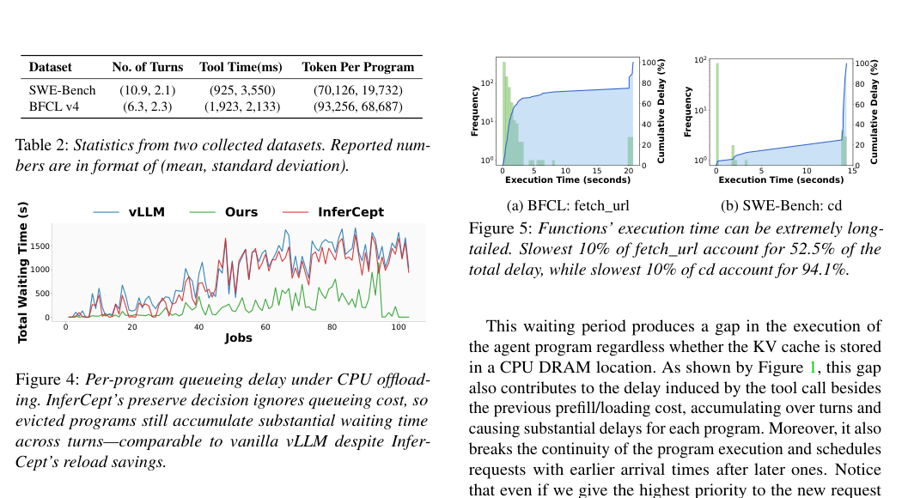

Figure 4 进一步证明只考虑 CPU offload 不行。InferCept 即使省下一部分 reload，仍因忽略逐轮 queueing cost 而积累接近 vLLM 的 waiting bubble；Figure 5 则说明永久 preserve 同样危险，预测偏长会让慢工具长期占住 HBM。

### Core Design

#### Continuum 调度闭环

#### **1. Program 与工具时长预测**

Continuum 为属于同一个 Agent 的多轮请求附加 program_id。当一轮 LLM 调用结束、工具开始运行时，系统记录工具类型；下一轮 LLM 请求到达时，工具处理器计算两次事件的时间差，并更新该工具的经验耗时集合。

它不训练复杂预测模型，而是直接使用经验累积分布：

$$
P(\tau,f)=\Pr(T_f\le \tau)
$$

其中 f 是工具，τ 是候选 TTL。这个量表示：若 KV 保留 τ 时间，该工具能在过期前返回的概率。

冷启动时历史数据不足，系统分三级回退：

1. 工具 f 的样本数超过阈值 K=100：使用该工具自己的分布；
2. 工具样本不足、但全局样本足够：使用全部工具的全局分布；
3. 系统刚启动、全局样本也不足：使用指数分布先验 Exp(1)。

这种方法预测的是**分布**而不是单个点估计。长尾工具即使均值相同，最优 TTL 也可能不同。

#### **2. TTL 的收益与成本模型**

保留请求 r 的 KV τ 时间，显存时间成本定义为：

$$
Cost(\tau,r)=\frac{MemUsage(r)}{M}\tau
$$

 MemUsage(r) 是该请求 KV 占用，M 是 GPU 可用于 KV 的总容量。其单位可以理解为“占用了多少比例显存 × 多长时间”。

若工具在 TTL 内返回，收益由两部分组成：

$$
Benefit(r)=CacheMissCost(r)+OutOfOrderCost(r)
$$

第一部分是避免 KV miss：

$$
CacheMissCost(r)=\frac{MemUsage(r)}{M}\left(Prefill(r)-Reload(r)\right)
$$

 Prefill(r) 表示从 Token 重算上下文的时间，Reload(r) 表示从 CPU 等层级恢复 KV 的时间。两者之差越大，留在 GPU 越有价值。

第二部分是避免程序顺序被打乱：

$$
OutOfOrderCost(r)=\frac{T}{M}MemUsage(r)\eta
$$

 T 是滑动平均排队延迟，η 是论文定义的 **memoryfulness**：

$$
\eta=-Corr(k,N-k)
$$

 k 是程序已服务的请求数，N-k 是剩余请求数。若轮数近似固定，做得越多意味着剩得越少，二者负相关，η 接近 1；若过程近似无记忆的几何分布，已完成轮数不能预测剩余轮数，η 接近 0。意思大概是只有在程序历史确实能提示剩余工作时，Continuum 才给保持原程序顺序更高价值。

综合后，系统选择：

$$
\tau^*=\arg\max_{\tau}\left[P(\tau,f)\cdot Benefit(r)-Cost(\tau,r)\right]
$$

化简后：

$$
\tau^*=\arg\max_{\tau}\left[P(\tau,f)\left(T\eta+Prefill(r)-Reload(r)\right)-\tau\right]
$$

系统只需枚举经验分布中出现过的工具时长以及 0，不需要在线求解连续优化问题。模型—硬件组合的 Prefill 与 GPU/CPU 传输曲线在离线 profiling 阶段获得：使用 1K、2K、4K 等上下文长度采样，再拟合二次函数，耗时低于 10 分钟。

结合前面的工具调用预测结合TTL做判断 KV 去留

#### **3. Program-level FCFS**

TTL 只决定 KV 是否留在显存，仍需要决定请求先后。Continuum 的优先级为：

1. 已被抢占、需要恢复的请求；
2. TTL 尚未过期、KV 仍 pinned 的程序；
3. 其余程序按**整个程序第一次到达系统的时间** FCFS。

##### **4. KV Pin、过期与死锁处理**

在 vLLM 中，一轮结束时 pin_request 保存 KV block，并记录过期时间；常规 block 回收会跳过仍在 TTL 内的请求。下一轮到达时若 KV 仍在，直接复用。

过期也不意味着无条件立即释放：如果程序已经在 waiting queue 中，说明下一轮已经回来，系统不会刚命中又淘汰。程序最终结束时则显式 unpin。

若 pinned KV 占满显存，以至于新 batch 无法执行，系统启动 deadlock recovery：从最近到达的程序开始逐个解除 pin，直到能够继续调度。这保证 TTL 是性能偏好，而不是破坏系统活性的硬约束。

实现约 1K 行 Python，主要增加 func_call_finish、update_tool_call_time、set_up_ttl 等路径，并修改 vLLM 的 KV 生命周期和优先级。

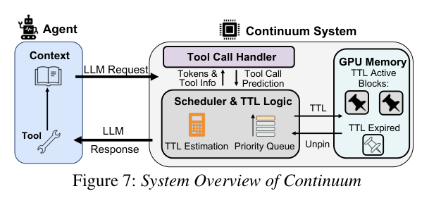

Figure 7 展示了运行时闭环。Agent 将 LLM request 送入系统；Tool Call Handler 从回复中识别工具类型，并在下一轮到达时获得真实工具耗时；Scheduler 用工具历史、Token 数和排队状态计算 TTL 与优先级；GPU Memory 将 block 标记为 TTL Active，过期后再 unpin。这里没有提前构造完整 DAG，预测对象只是工具间隔及程序历史。

### Evaluation

#### 实验如何检验这些设计

| 项目 | 设置 |
|---|---|
| 模型 | Llama-3.1-8B、Llama-3.1-70B、Gemma-3-12B；真实部署另测 GLM-4.5 FP8 |
| GPU | A100-SXM、H100、B200；真实 OpenHands 使用 8×H100 |
| 工作负载 | SWE-Bench、BFCL V4 Web Search、OpenHands；轨迹按 Poisson 到达回放 |
| Baseline | vLLM 0.10.2、LMCache 0.3.7、Autellix/PLAS、InferCept |
| CPU KV 空间 | A100 100 GB；H100/B200 200 GB |
| 分布式栈 | SGLang 0.5.5.post3、Dynamo 0.7.0.post1，1P1D |
| 主要指标 | Average response time、尾延迟、throughput、scheduler overhead |

论文用多条真实 Agent 轨迹按到达过程并发回放；真实部署还运行了 500 个 SWE-Bench Verified 任务。

#### 结果

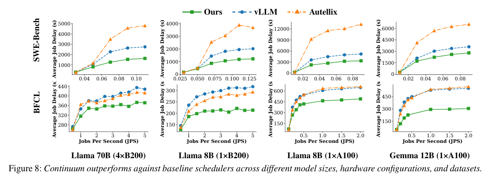

Figure 8 的横轴都是到达率 JPS，纵轴是 average job delay，因而曲线越低越好。上、下两排分别为 SWE-Bench 与 BFCL，列方向改变模型和 GPU。随着 JPS 增加，vLLM 与 Autellix 的延迟增长更快；绿色曲线更平缓。证明动态 TTL 在不同 KV 容量和模型大小下都能延缓排队拥塞。不过各子图纵轴范围不同，不能拿曲线高度跨图直接比较。

Llama-3.1-8B 轨迹回放中，相比原始 vLLM，平均响应时间最高约降低 2×。

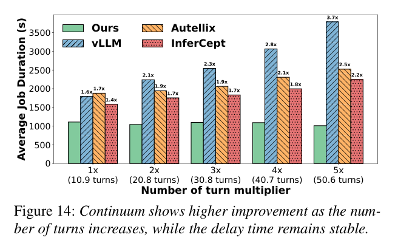

Figure 14 固定一组 SWE-Bench 轨迹，并把轮数从平均 10.9 放大到 50.6。Continuum 的绿色柱基本保持在约 1,000 秒，而其他方案随轮数上涨；相对 vLLM 的优势由 1.6× 增至 3.7×。

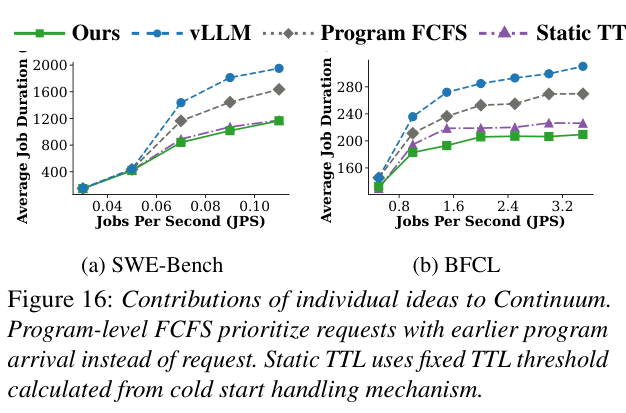

Figure 16 依次比较 vLLM、只加入 Program FCFS、再加入 Static TTL，以及完整动态 TTL。Program FCFS 已降低延迟，说明保留程序顺序本身有效；Static TTL 继续改善，但完整方案在 SWE-Bench 和 BFCL 上最低。

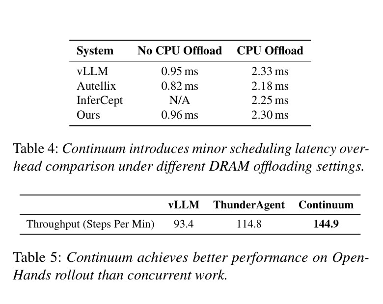

**Table 4：调度开销。** 表中报告的是 scheduler overhead：无 CPU offload 时 vLLM 为 0.95 ms、Continuum 为 0.96 ms；开启 CPU offload 时分别为 2.33 ms 和 2.30 ms。说明 Continuum 没有引入显著的额外调度延迟。

**Table 5：面向强化学习 rollout 的 micro-benchmark。** 论文使用 OpenHands Agent、GLM-4.5-fp8、Multi-SWE-Bench 和单节点 8×H100，报告 vLLM、ThunderAgent、Continuum 分别为 93.4、114.8、144.9 steps/min。

## ThunderAgent: A Fast, Simple, and Program-Aware Agentic Inference System（ICML 2026）

论文链接：[arXiv](https://arxiv.org/abs/2602.13692) ｜ [本地 PDF](paper_8_17/ThunderAgent.pdf) ｜ [代码](https://github.com/ThunderAgent-org/ThunderAgent)

作者：Hao Kang、Ziyang Li、Weili Xu、Xinyu Yang、Yinfang Chen、Junxiong Wang、Beidi Chen、Tushar Krishna、Chenfeng Xu、Simran Arora。

**ICML 2026 论文**。

### Motivation

#### 1.1 现有系统缺陷

工业界的 Agent 服务通常把 vLLM/SGLang 和 Kubernetes 拼在一起：前者只调度单轮 LLM 请求，后者只管理工具容器。推理引擎不知道请求属于哪个多轮程序，也不知道工具何时返回；编排器又看不到 GPU 显存和 KV Cache 状态。两套调度器都只看到局部，因而无法管理完整的 Agent 生命周期。

#### 1.2 三痛点

1. **KV Cache thrashing。** 高并发时，工具暂停程序的 KV 会被驱逐；工具返回后只能重新 Prefill，反复驱逐和重算会让端到端延迟最高增加约 7.14×。仅设置 TTL 也不够：当活跃解码任务已经占满 HBM，pinned KV 仍可能被迫让位（刚才Continuum提到的死锁恢复）。
2. **跨节点内存不均衡。** KV-aware 路由为命中缓存把同一程序固定在原节点，但 Agent 上下文增长不可预测，容易出现一个节点爆满、另一个节点空闲。论文在 90 分钟 RL rollout 中观察到峰值内存不平衡度约 51%。
3. **工具生命周期脱节。** 沙箱、磁盘、端口和 API 连接没有和推理程序绑定，导致任务结束后资源泄漏；如果等任务开始后才准备环境，LLM 又会同步等待镜像和依赖安装。

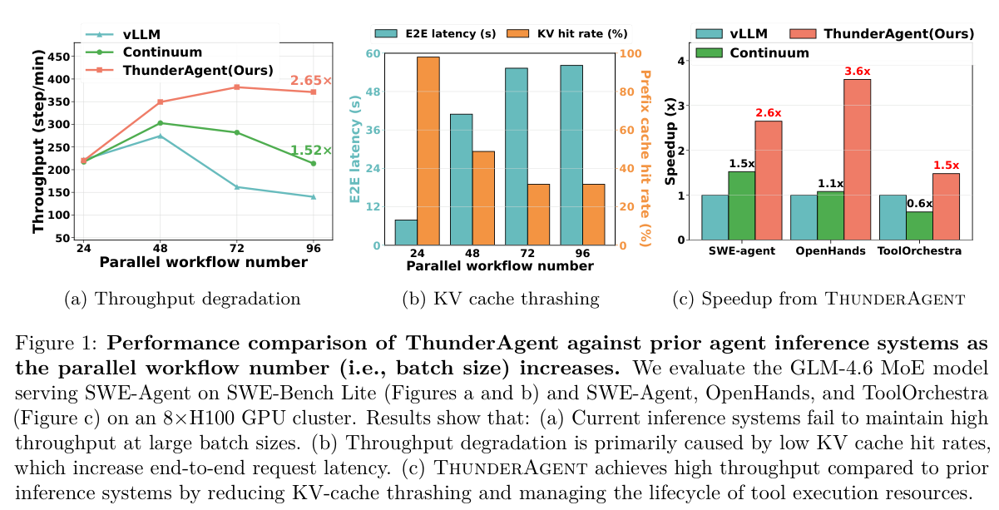

Figure 1 ：并发 workflow 增加后，普通系统的 hit rate 下降、延迟上升，而 ThunderAgent 的吞吐下降较慢。右侧 speedup 是这条链路的端到端结果。

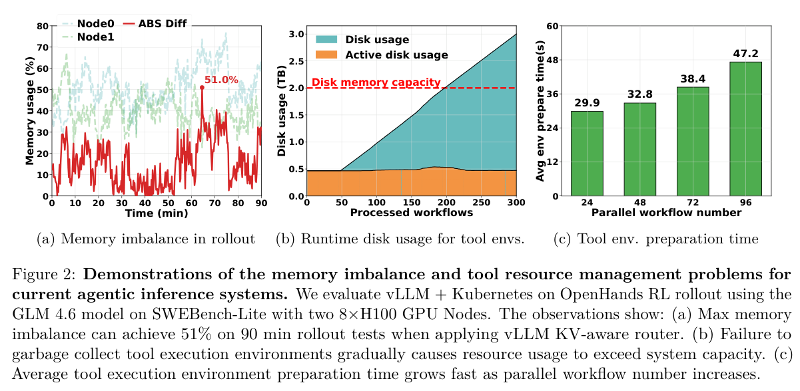

Figure 2 同时展示另外两问题：双节点显存峰值相差约 51%，工具环境磁盘随 workflow 数增长，并发升高还会显著拉长环境准备时间。

### Core Design

#### 2.1 Agentic Program：统一调度单位

ThunderAgent 把一个任务从开始到结束的多轮推理、工具调用和环境资源定义为一个 Agentic Program：

$$
P=\langle ID,c,\mathcal{T},\mathcal{L},\tau,s\rangle
$$

| 字段 | 含义 | 调度用途 |
|---|---|---|
| ID | 程序身份 | 关联同一程序的多轮请求 |
| c | 当前上下文 Token 数 | 估计 KV 显存占用 |
| {T} | 工具环境集合 | 管理沙箱、端口和磁盘 |
| {L} | 部署的 backend | 记录节点位置 |
| τ | Reasoning 或 Acting | 判断是否需要 GPU |
| s | Active、Paused 或 Terminated | 驱动暂停、恢复和回收 |

#### 2.2 STP 衡量资源占用

论文用 Space-Time Product 衡量资源占用：

$$
Cost_x=\int_0^{t_x}M_x(t)dt
$$

总成本近似为：

$$
Cost_{total}\approx Cost_{decode}+Cost_{prefill}+Cost_{recompute}+Cost_{unused}+Cost_{caching}
$$

前两项是有效工作；后三项分别对应 thrashing 重算、跨节点闲置显存，以及 Acting 期间暂时不用却仍保留的 KV。ThunderAgent 提出的三个机制分别针对这三种浪费：active-set 控制减少重算，global queue 减少节点空闲，时间衰减减少无效缓存。

#### 2.3 单节点：状态感知的暂停与恢复

调度器每隔 Δt 检查一次显存工作集，并设置高低水位：超过 λ_max·C 时暂停请求，低于 λ_min·C 时恢复请求。Reasoning 阶段的上下文按完整大小计入，Acting 阶段则随工具等待时间衰减：

$$
\hat C=\sum_{p:\tau=R}c_p+\sum_{q:\tau=A}c_qf(t_q),\qquad f(t)=2^{-t}
$$

工具运行越久，其 KV 越像暂时不用的缓存，因而更容易被暂停。水位差形成滞环，避免系统在临界显存附近频繁暂停和恢复。

当必须释放 ΔC 显存时，论文给出短上下文优先的理由。长度为 c_i 的程序被驱逐后，重算成本近似满足：

$$
Cost_{recompute}(i)\propto c_i^2
$$

因此暂停集合的近似目标是：

$$
\min_S\sum_{i\in S}c_i^2\quad\text{s.t.}\quad\sum_{i\in S}c_i\geq\Delta C
$$

这意味着应优先暂停 Acting 阶段、且上下文较短的程序；恢复时则优先让需要继续 Reasoning 的短上下文程序上 GPU。论文将规则写成：

$$
S_{pause}(P)=\frac{1}{c_P}+\mathbb{I}(\tau=A),\qquad
S_{restore}(P)=\frac{1}{c_P}+\mathbb{I}(\tau=R)
$$

指示器函数保证阶段优先，1/c_P 只负责同阶段内的长度排序。被暂停程序会释放 KV，因此恢复时需要重新 Prefill；这不是 GPU 间的 live KV migration。

#### 2.4 多节点：全局程序等待队列

KV-aware 路由坚持节点 locality，但暂停后 KV 已经释放，继续绑定原节点只会放大不均衡。ThunderAgent 将未分配和暂停程序放入 global waiting queue：哪个 backend 有空间，就把程序放到哪个 backend；程序恢复时重新 Prefill，不需要迁移 live KV。

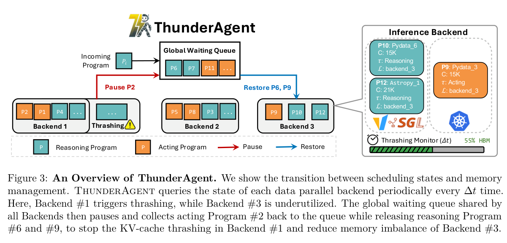

Figure 3 展示了这一闭环，代价是一次重算，收益是把空闲显存重新变成可用。

#### 2.5 Tool Resource Manager：把工具资源纳入生命周期

ThunderAgent 还把 sandbox、磁盘、端口和连接绑定到 Agentic Program。程序接近恢复时可以异步准备环境，避免 LLM 在关键路径上等待；程序进入 Terminated 后由钩子立即回收资源，防止沙箱和磁盘泄漏。这个组件解决的是工具侧等待与资源回收，不能把它的收益误认为 KV thrashing 的收益。

### Evaluation

#### 评估覆盖场景
| 场景 | 工作负载与配置 |
|---|---|
| Coding Agent | mini-SWE-agent / SWE-Bench-Lite，OpenHands |
| General Agent（routing workload） | ToolOrchestra 运行 HLE：在搜索、model-as-a-tool reasoning 和最终回答等工具之间路由 |
| Scientific Discovery Agent | OpenHands 运行 ScienceAgentBench：用 Bash、IPython、编辑器等完成数据驱动的科学分析任务 |
| 大模型 | GLM-4.6 355B、Qwen3 235B，FP8、TP=8，运行于 8×H100 节点 |
| 小模型 | Qwen3-8B FP16，单 RTX 5090 |
| RL rollout | 两个 8×H100 节点；与 vLLM + SGLang Gateway 比较 |
| Baseline | vLLM、Continuum；rollout 场景另含 SGLang Gateway |
| 主要指标 | steps/min、KV cache hit rate、端到端阶段延迟、磁盘占用 |

论文将一步定义为一次 Reasoning 加一次 Acting。

#### 端到端 Serving 结果

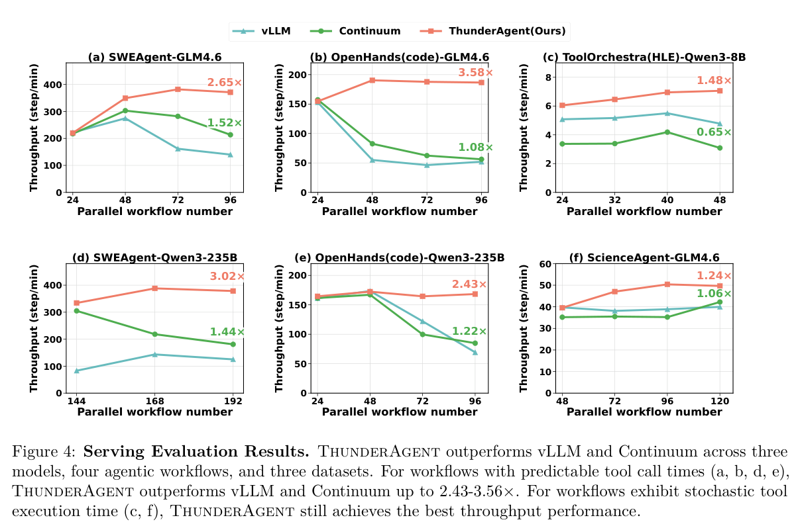

Figure 4 测试并发 Agent workflow 增加时的 serving throughput。

六个子图覆盖 SWE-agent、OpenHands、ToolOrchestra 和 ScienceAgent，并更换 GLM-4.6、Qwen3-235B、Qwen3-8B 等模型；

横轴是 parallel workflow number，纵轴是 steps/min。低并发时三者差距较小，因为 GPU 尚未出现严重 KV 压力；并发升高后，vLLM 和 Continuum 的吞吐更容易下降，ThunderAgent 相对稳定。

论文高并发结果，相对 vLLM 提升 1.48–3.58×，相对 Continuum 提升 1.17–3.31×。

#### KV Cache 命中率实验

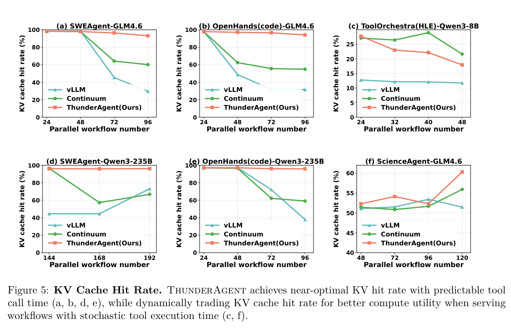

Figure 5 专门观察并发度上升时三种系统能保留多少可复用前缀：横轴仍是 parallel workflow number，纵轴是 KV cache hit rate，比较 vLLM、Continuum 和 ThunderAgent。

在前一类实验中，ThunderAgent 随并发增加仍接近 100% hit；论文指出 Continuum 可从 90% 以上下降到约 60%，原因是显存不足时不同程序的 active requests 仍会竞争并触发驱逐。在随机工具时长的 c、f 中，ThunderAgent 的 hit rate 反而可能低于 Continuum：

（c，f）是工具时间不固定且变化大的任务，时间衰减会降低长时间 Acting 程序的保留优先级，把显存让给能够继续推理的程序。

#### RL Rollout

论文在 Table 2 中另测两个 8×H100 节点上的分布式 rollout，使用 GLM-4.6、144 个并发程序，并与 vLLM + SGLang Gateway 比较。

mini-SWE-agent 从 375.4 提升至 671.8 steps/min（1.79×），OpenHands 从 69.1 提升至 270.8（3.92×）。

#### 延迟构成分析与参数敏感性

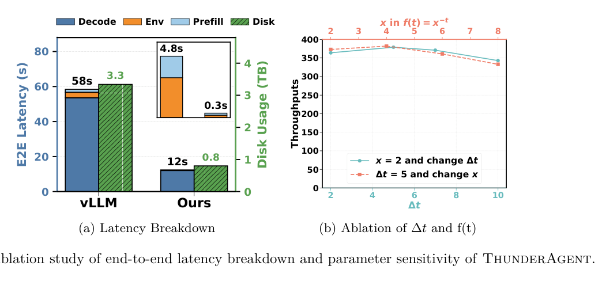

Figure 6 左图把 OpenHands latency 拆成 Decode、Environment、Prefill、Disk：vLLM 主要耗在 Decode，而 ThunderAgent 通过程序暂停、工具异步准备和减少重复 Prefill，把总延迟压低。论文将其中约 10% 的延迟改善归因于 Tool Resource Manager。

右图改变衰减函数或调度周期，曲线整体较稳定，说明方法不是只在一个 Δt 取值下有效。

#### 消融

只加入单节点内的 program-aware eviction 与 decay 后达到 602（1.61×）；再加入 global waiting queue 达到 672，额外约 1.12×。

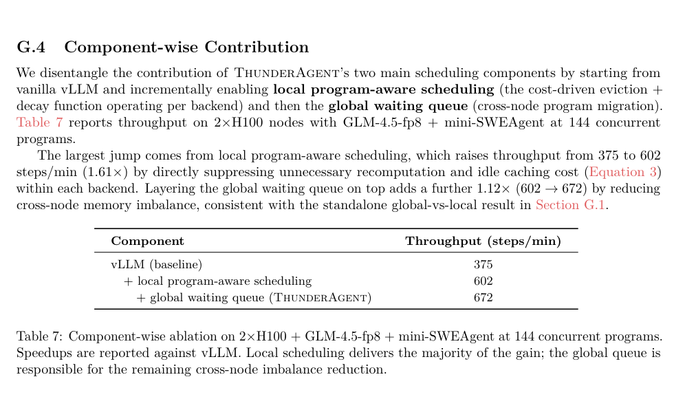

### Limitations

1. 跨节点恢复依赖丢 KV 后重算。上下文很长、节点间链路很快或 Prefill 很贵时，直接传输 KV 是否更好未回答。
2. ThunderAgent 与 Continuum 两篇论文在不同场景下报告比对方更优秀的结果，两组实验的代码版本、并发和配置不同。

## CONCUR: High-Throughput Agentic Batch Inference of LLM via Congestion-Based Concurrency Control（ICML 2026）

论文链接：[arXiv](https://arxiv.org/abs/2601.22705) ｜ [本地 PDF](paper_8_17/CONCUR.pdf)

作者：Qiaoling Chen、Zhisheng Ye、Tian Tang、Peng Sun、Boyu Tian、Guoteng Wang、Shenggui Li、Yonggang Wen、Zhenhua Han、Tianwei Zhang。

**ICML 2026**

### Motivation

#### 为什么高并发会让吞吐下降

ReAct Agent 不是一次请求，而是不断循环：

LLM 生成 → 工具调用 → 工具结果回到 LLM → ……

每一轮都会把思考、工具调用和工具结果追加到上下文，因此单个 Agent 的上下文长度和 KV Cache 占用会随执行步数增长。不同 Agent 的进度又不同：有的正在 GPU 上生成，有的在等待外部工具。

这会产生一个冲突：等待工具的 Agent 暂时不发起推理请求，但下一轮仍然需要原来的 KV 前缀；其他 Agent 继续生成，持续占用新的 KV Cache；GPU 紧张时，普通 serving engine 按请求和 LRU 规则驱逐前者的缓存；工具返回后，前者只能重新 Prefill 或从 CPU 搬回 KV。因此即使 Agent 总数没有变化，也可能反复发生“驱逐 → 重算/搬运 → 再驱逐”。

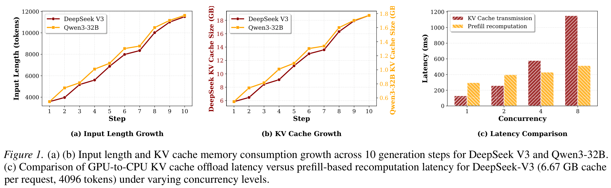

**Figure 1 解读：** 左图和中图的横轴是 Agent 执行步数，纵轴分别是输入上下文长度和 KV Cache 占用。两条曲线都随步骤上升，说明一个 Agent 的 KV footprint 会持续变大，并不是固定大小的请求。

右图比较不同并发下的 GPU-to-CPU KV 传输与 Prefill 重算延迟，并发越高，KV 传输的柱子增长更快，说明把 KV 全部 offload 到 CPU 可能把显存问题转化为 PCIe 传输问题。

Figure 1 说明需要主动控制 working set，不是证明重算在所有硬件上都一定比 offload 快。

#### 论文发现的 middle-phase thrashing

论文用真实部署轨迹展示了 Agent batch 推理的三阶段：

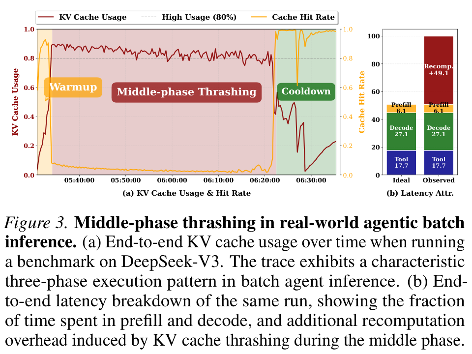

**Figure 3** 上图横轴是执行时间，左纵轴同时展示 KV 使用率和命中率。中间阶段 KV 使用率维持在约 80%–100%，

但命中率掉到低位，表示显存被占满却没有转化为有效缓存复用；这是 middle-phase thrashing。

1. **Warmup：** Agent 处在较浅步骤，前缀较短且复用较多，KV 使用量低、命中率高；此时增加并发通常能提高吞吐。
2. **Middle phase：** Agent 上下文变长，KV 使用率长期处于约 **80%–100%**，但命中率突然下降。系统看似一直在使用显存，实际上大量时间花在缓存驱逐和 Prefill 重算上。Figure 3 报告额外重算约占端到端延迟的 **49.1%**，并持续超过总执行时间的 **90%**。
3. **Cooldown：** 一些 Agent 完成并释放 KV 后，压力下降，驱逐减少，命中率恢复。

作者将第二阶段称为 **middle-phase thrashing**。它解释了为什么继续加入 Agent 有时会适得其反：新增 Agent 不仅增加有效工作，也会把已有 Agent 推入缓存颠簸区。Figure 1 还说明上下文长度和 KV 占用会随步骤增长；当每个请求需要搬运数 GB KV 时，CPU offload 的 PCIe 传输成本也可能高于直接 Prefill。

### Core Design

#### 从 request-level 调度转向 agent-level admission

CONCUR 不重写 SGLang 的 KV 管理，而是在二者之间插入轻量的 **Agent-Level Controller**：

~~~text
Agent Execution Layer
        ↓ generation request
Agent-Level Controller
        ↓ admit / pause / resume
LLM Serving Engine + GPU KV Cache
~~~

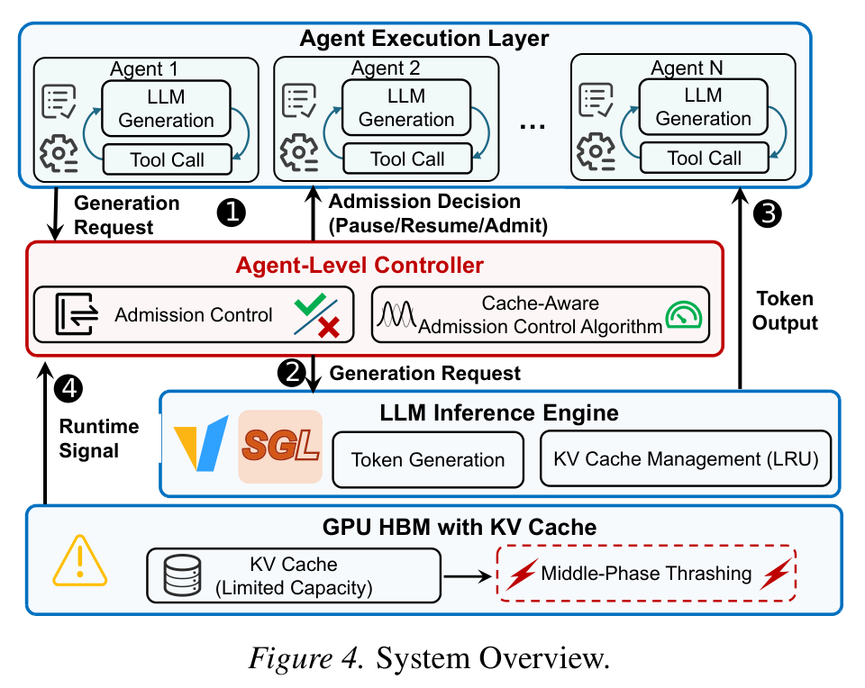

**Figure 4** 图中 Controller 位于 Agent 执行框架和 LLM serving engine 之间。Agent 仍负责工具调用和工作流循环，serving engine 仍负责 token generation 与 LRU KV 管理；

Controller 只在 Agent 边界发出 admission、pause、resume 决策，并读取 KV 使用率和命中率反馈。

每个 Agent 准备发起下一次 LLM 生成时，先向 Controller 请求 admission。被允许的 Agent 才进入 serving engine；未被允许的 Agent 暂停，不继续发请求但保留执行状态；Agent 完成并释放 KV 后，Controller 再从 pending 集合恢复其他 Agent。

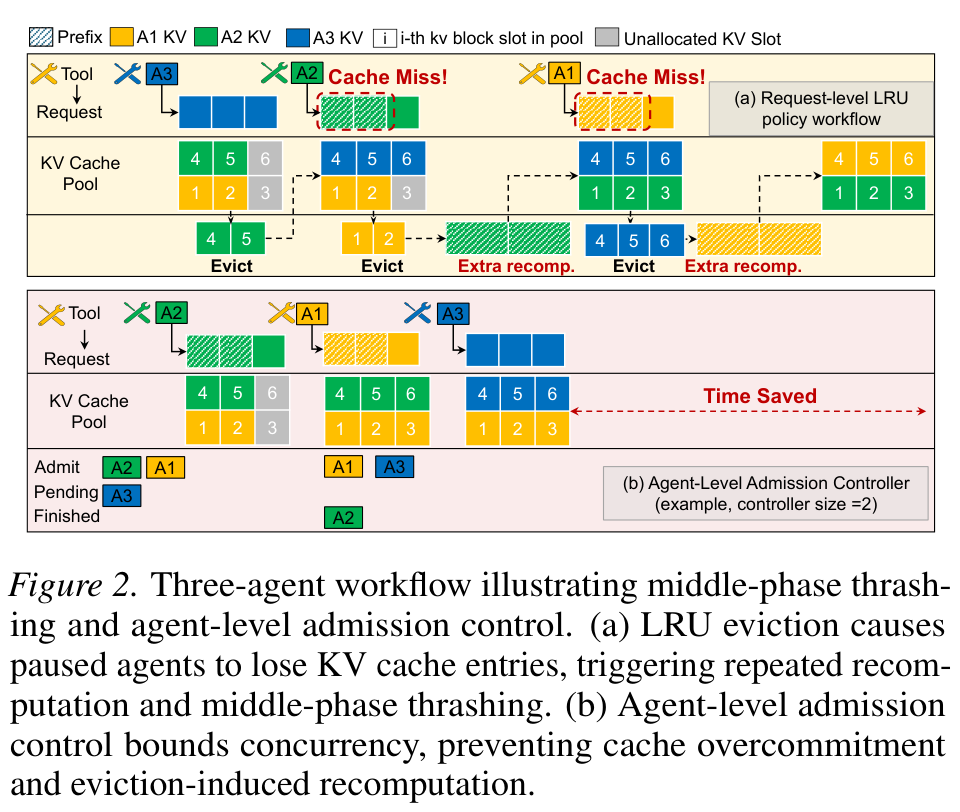

**Figure 2** 上图中 A1、A2 在工具调用期间暂停，A3 继续生成并消耗 KV 空间；LRU 会先驱逐暂停 Agent 的前缀，A1/A2 恢复时就产生 Cache Miss 和额外重算。

下图把 admission 单位提升为 Agent：只让 A1、A2 进入 active set，A3 留在 pending；等 A2 完成并释放 KV 后再接纳 A3。

#### Cache-Aware Admission Control（核心调度）

**固定并发上限不够用**。

早期上下文较短时，128 个 Agent 可能还能运行；执行到中段后，每个 Agent 都变长，同样的上限就可能导致显存过载。反过来，一开始使用很小的固定上限又会浪费早期 GPU 容量。

**借鉴借鉴 TCP 经典的 AIMD 算法**

CONCUR 把允许同时活跃的 Agent 数量记为 **W_t**，通过两个运行时信号调节：**U_t** 是 KV 使用率，**H_t** 是 KV 命中率。

$$
W_{t+1} =
\begin{cases}
W_t + \alpha, & U_t < U_{\mathrm{low}} \\
W_t \times \beta, & U_t > U_{\mathrm{high}} \land H_t < H_{\mathrm{thresh}} \\
W_t, & \text{otherwise}
\end{cases}
$$

默认参数为 **alpha = 2**、**beta = 0.5**、**U_low = 0.2**、**U_high = 0.5**、**H_thresh = 0.2**。显存明显空闲时，窗口加少量 Agent；高使用率同时伴随低命中率时，窗口减半；其他情况下保持不变。

**H_thresh** 区分“高占用但有效复用”和“高占用且已经颠簸”。U_low 与 U_high 之间提供缓冲，减少窗口在边界附近反复增减。

### Evaluation
论文评估三个问题：
- Agent-level admission 能否降低整批完成时间；
- 是否提高 KV 命中率并消除 middle-phase thrashing；
- 动态控制是否比固定并发上限可靠。

实验在 NVIDIA H100 80GB 上进行，使用 Qwen3-32B 和 DeepSeek-V3，比较原始 SGLang、固定 request-level admission、SGLang + HiCache CPU offload 和 CONCUR。这里的 batch latency 是完成整个离线 Agent batch 的时间。

#### 端到端延迟

Table 1 测量同一批 Agent 全部完成所需的时间，括号相对原始 SGLang。

CONCUR 在六组配置中都取得最低延迟：

| 模型与配置 | SGLang | Request Control | HiCache | CONCUR |
|---|---:|---:|---:|---:|
| Qwen3-32B，256，TP8/8 GPU | 1480s | 2049s | 976s | **362s（4.09×）** |
| Qwen3-32B，256，TP4/4 GPU | 2213s | 1089s | 1678s | **757s（2.92×）** |
| Qwen3-32B，256，TP2/2 GPU | 2527s | 1383s | 1112s | **846s（2.99×）** |
| DeepSeek-V3，16，TP16/16 GPU | 873s | 861s | 2559s | **521s（1.68×）** |
| DeepSeek-V3，32，TP16/16 GPU | 1226s | 1367s | 2277s | **1018s（1.20×）** |
| DeepSeek-V3，40，TP16/16 GPU | 3877s | 2903s | 2320s | **2043s（1.90×）** |

不是并发越小越好，而是动态寻找不会进入颠簸区的 active set。

原始 SGLang 在中段发生大量重算；

固定 cap 可能过于保守或仍然过载；

HiCache 命中率高但有 CPU-GPU 搬运代价；

CONCUR 则减少无效重算，把 GPU 时间用于有效生成。

#### KV Cache 实验：测的是缓存是否真正被复用

Table 2 使用 DeepSeek-V3、TP8、8 张 GPU，在不同 batch size 下测 KV Cache hit rate：

| Batch | SGLang | HiCache | Request Control | CONCUR |
|---:|---:|---:|---:|---:|
| 16 | 80.38% | 97.48% | 69.00% | **96.38%** |
| 32 | 77.72% | 97.13% | 68.39% | **93.65%** |
| 40 | 35.41% | 96.08% | 32.21% | **73.36%** |

原始 SGLang 的命中率随并发增加明显坍塌，batch 40 时只有 35.41%。

HiCache 命中率最高，但依赖 CPU offload；但搬运 KV 需要 PCIe 时间。

Figure 5 进一步显示，基线 KV 使用率接近容量时命中率下降，而 CONCUR 通过限制 active agent set 维持更稳定的命中率。

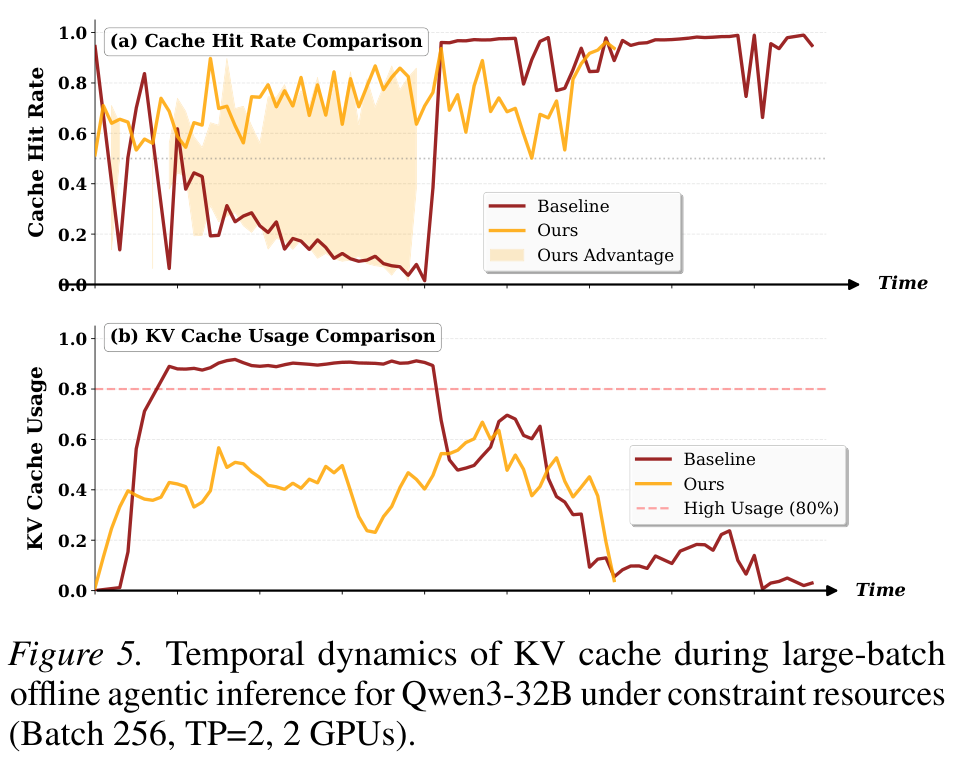

**Figure 5** Baseline 在下图长期贴近高水位时，上图命中率逐渐跌到接近 0，说明系统陷入驱逐和重算循环；

CONCUR 的 usage 更低且波动，hit rate 则保持在较高水平。这里的收益是留出空间避免缓存 working set 进入拥塞坍塌区。

#### 固定并发上限实验

Figure 6 在 Qwen3-32B、batch 256、TP2、2 张 GPU 上比较固定 admission level 与动态控制：

| 策略 | 完成延迟 |
|---|---:|
| 无控制 | 2527ms |
| 固定 30 | 1749ms |
| 固定 32 | 1287ms |
| 固定 64 | 1605ms |
| 固定 128 | 2386ms |
| CONCUR | **846ms** |

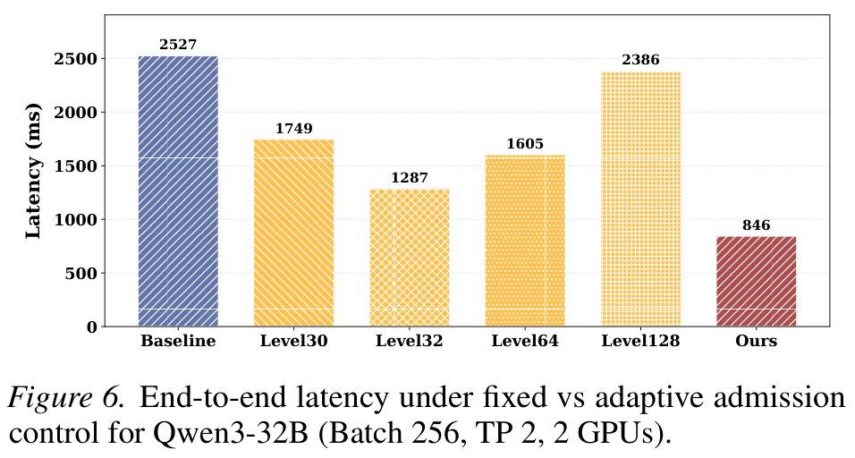

**Figure 6**固定 30、32、64、128 的结果呈现明显折中：level 32 比无控制好，但 level 128 又接近 baseline，说明一个固定 cap 不能适应 Agent 上下文在不同阶段的增长。

CONCUR 的动态窗口达到 846 ms，低于所有固定 level。

同时固定上限太小会浪费 GPU，太大则会在中段把 KV Cache 推入颠簸区；

### Limitations

1. CONCUR 评估的是离线 batch inference，主要指标是整批完成时间，在线服务中的单请求 JCT、P99 SLO 和 starvation？

2. 

## PASTE: Parallelizing Tool Execution and LLM Generation for Low-Latency Agent Serving

论文链接：[arXiv](https://arxiv.org/abs/2603.18897)

**工具侧优化**

### Motivation

#### 工具等待也是 Agent 的关键路径

React范式：
LLM 生成 → 发起工具调用 → 等待工具结果 → 结果回到上下文 → LLM 继续生成

现有系统通常把这条链路物理串行化。

论文在没有排队竞争的单请求条件下测得，工具执行占代表性 deep research、coding 和 scientific-agent 任务端到端延迟的 **45%–57%**。因此只优化 LLM 的 token 生成速度，仍然无法消除 Agent 的主要等待。

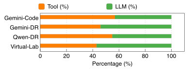

**Figure 3** 这项实验刻意使用单请求、无排队的有利条件，排除了 GPU 拥塞造成的额外等待，工具执行仍占 45%–57%，说明工具时间是关键路径的一主要部分，而不只是高并发时才出现的调度问题。

进一步观察到，工具调用中存在可重复的局部模式，例如 search → visit、edit → run test、grep → file_editor。如果能在当前 LLM 轮次结束前猜到下一次具体工具调用，就可以提前执行工具，把一部分工具时间藏到当前 LLM 生成阶段中。

但盲目并行也有风险：工具结果集中返回时，多个 session 会同时重新进入 LLM engine，造成 GPU 排队。
论文实测并发从 1 增加到 192 时，LLM 生成时间增长超过 17 倍，而工具执行时间变化相对有限。

因此 PASTE 同时解决两个问题：提前执行正确的工具调用，以及控制工具结果返回 LLM 的节奏。

### Core Design

#### PASTE 的整体结构

PASTE 在 Agent runtime、工具执行器和 vLLM 之间增加 session-level control plane，由三个组件组成：

- **Pattern Analyzer**：从历史和在线轨迹中识别重复的工具调用模式，并将模式绑定到当前任务的具体参数。
- **Tool Speculation Scheduler**：按照预测结果提交推测工具调用，并用预算、优先级和可抢占机制限制猜错的代价。
- **LLM–Tool Co-Scheduler**：联合考虑工具执行和 LLM session 返回，避免工具侧加速造成 LLM 侧拥塞。

PASTE 不改变 Agent 的语义顺序，而是提前准备可能发生的未来工具结果，只有当 LLM 后续实际生成了匹配的调用，推测结果才会被采用。

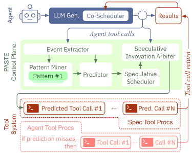

**Figure 7** 图中上层负责从 session 轨迹产生具体预测，中层负责推测任务的 admission、优先级和隔离，下层同时连接工具执行资源与 vLLM。

#### Pattern Analyzer：预测具体的下一次调用

分析器记录 LLM turn、工具名、参数、输出、时间和 session 标识，把连续工具调用压缩成模式，再将模式中的变量绑定到当前任务已有的 payload。比如历史上经常出现 search(query) → visit(url)，只有当当前任务已经产生具体 URL 时，系统才会实例化 visit(url) 并执行。参数不完整的预测只作为提示，不会真正发起调用。

论文使用历史任务挖掘模式，并在不重叠的新任务上测试预测质量。因此它仍然依赖工作流中存在可复用的局部模式。

#### Tool Speculation Scheduler：把推测调用和真实调用隔离

工具调用分为两类：

- **Authoritative call**：LLM 已经明确生成的真实调用，优先级最高。
- **Speculative call**：PASTE 提前发起的候选调用，不能直接修改 Agent 正式状态。

执行流程是：预测具体调用，先在受控环境中执行；等 LLM 生成权威调用后，比较工具和参数是否匹配。匹配时复用推测结果；不匹配时丢弃推测结果，并正常执行权威调用。推测任务受并发、CPU、内存和网络预算限制，并且可以被抢占，因此不会挤压真实工具调用。

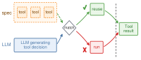

#### LLM–Tool Co-Scheduler：防止工具加速反而拖慢 LLM

如果只加入预测工具执行，许多结果可能在短时间内同时返回，导致 LLM engine 突然接收大量 ready session。PASTE 因此把“工具结果已经准备好”与“现在立刻恢复 LLM”分成两个事件。

它先为每个候选 session 计算收益/压力优先级：

$$
priority(i)=\frac{ExposedToolGain(i)}{LLMPressure(i,load)}+Aging(i)
$$

其中 ExposedToolGain 表示提前完成工具后可能隐藏的时间，LLMPressure 表示把该 session 放回 engine 对当前负载造成的压力，Aging 用来提高等待过久 session 的优先级。收益大且不会明显增加 GPU 压力的 session 先恢复，其他结果暂存在 ready queue 中。

批次级的 engine pressure 定义为：

$$
EnginePressure(B)=DecodeLoad(B)+\gamma\cdot KVLoad(B)
$$

PASTE 只在压力处于 workload-aware 的安全区间时放行新的 session：

$$
P_{low}\leq EnginePressure(B)\leq P_{high}
$$
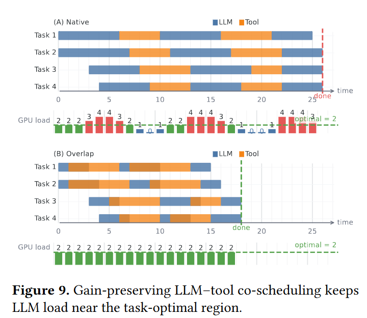

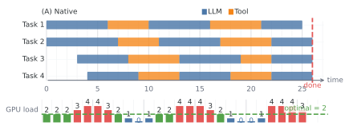

**Figure 9 的三层逻辑：**

1. **Native execution**：LLM 生成和工具执行严格串行，工具运行时 GPU 可能空闲，下一轮 LLM 必须等工具结束后才能开始。
2. **单纯 overlap**：如果所有提前完成的工具同时把结果推回 LLM，会形成 ready-session burst，工具等待减少了，但 Decode queue 和 KV 压力会突然升高。
3. **Gain-preserving co-scheduling（PASTE）**：工具执行与 LLM 生成可以重叠，但结果按照 priority 和 EnginePressure 分批放行

### Evaluation

#### 实验设置与比较对象

实验使用 4 个节点，每节点 8 张 NVIDIA A100 80GB、96 个 vCPU 和 512GB 内存，共 32 张 GPU。LLM 后端为 vLLM，模型为 Qwen-DeepResearch-30B 和 Qwen3-30B-A3B。

评估覆盖三类 Agent：VirtualLab（科学研究）、Qwen Deep Research（多步搜索和报告生成）以及 gemini-cli （代码修改和命令行任务）。基准包括 DeepResearchBench、SWE-bench 和 ScholarQA；请求到达过程还通过生产 Azure Functions invocation trace 重放来模拟突发流量。

比较对象分成两侧：vLLM 和 Agentix 代表 LLM/Agent serving 调度，ORION 和 SpecFaaS 代表工具侧加速。

#### 端到端延迟：两侧机制共同降低等待

Figure 10 显示，PASTE 相比 vLLM、Agentix、ORION 和 SpecFaaS 都降低了端到端延迟；论文报告平均延迟最高降低 **43.5%**，P99 尾延迟最高改善 **55.4%**。

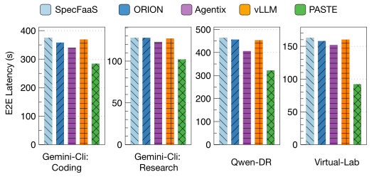

Figure 15 的时间拆分显示，PASTE 的暴露工具时间降到约 **34 秒**，工具侧 baseline 约为 **84–89 秒**；LLM 侧时间降到约 **186 秒**，LLM/Agent serving baseline 约为 **226–249 秒**。因此它是两侧都减少了可见等待。

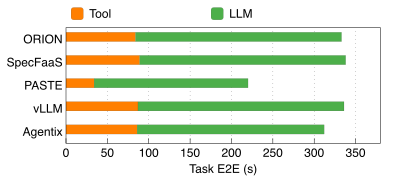

#### 工具侧效果与并发扩展

Figure 11 和 Figure 12 显示，相比 ORION 和 SpecFaaS，PASTE 的平均工具延迟最高降低 **55.2%**，P99 工具延迟最高降低 **60.6%**；汇总配置下工具侧 speedup 分别为 **1.71×** 和 **1.83×**。

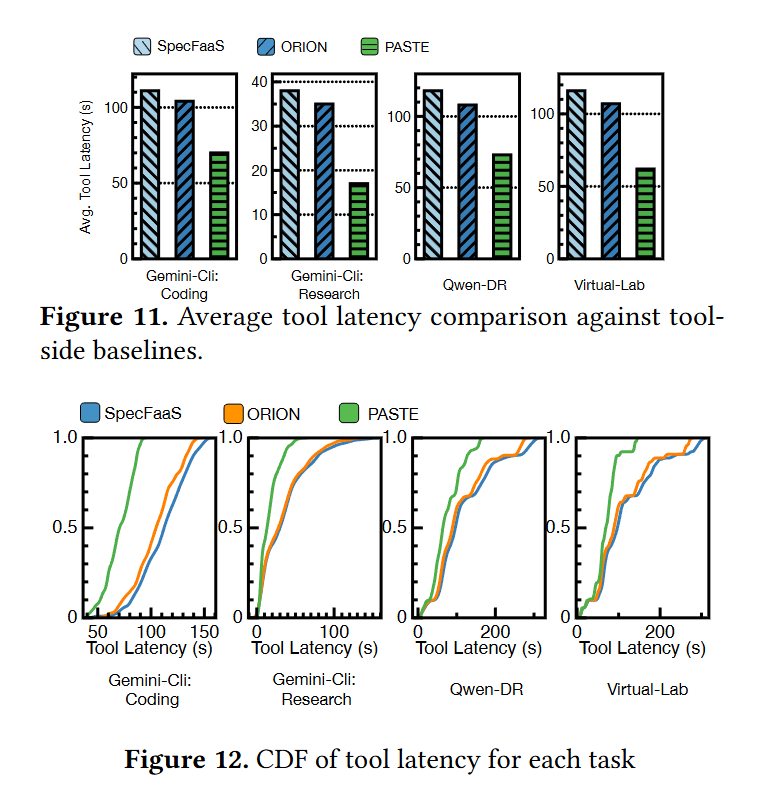

#### 消融

论文比较了 PASTE-Tool-Only、PASTE-LLM-Only、vLLM 和 Agentix。前者只有推测工具执行，没有 LLM–Tool Co-Scheduler；后者没有推测执行，只通过 LLM 侧 admission/pacing 减少 GPU 排队。

Figure 17 显示，单独做工具侧或 LLM 侧都不如 Full PASTE。Full PASTE 在该消融设置中将 E2E 延迟降到约 **270 秒**，LLM queueing time 降到约 **45 秒**；不同 baseline/消融版本之间，E2E 延迟降低 **21.1%–35.6%**，LLM 排队时间降低 **13.5%–30.8%**。

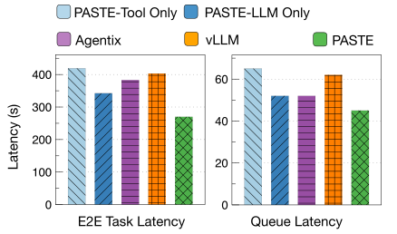

#### 预测质量、安全性与开销

Figure 18 报告最高 **27.8% Top-1 accuracy、43.9% Top-3 recall 和 93.8% overall hit rate**。overall hit rate 允许系统执行多个候选，编译/测试循环等结构化工作流更容易预测，开放式研究任务更难预测。

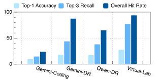

副作用审计中，论文报告没有产生可提交的外部副作用，最终任务结果与 baseline 没有差异。资源实验中，PASTE 使用约 **1–3 个额外空闲 CPU core 和 250MB 内存**，将工具延迟降低约 **48%**；归一化开销约为每节省 1 秒延迟增加 0.02 core-seconds CPU、2.6MB 内存和 0.9MB 网络带宽。

