# Agentic 推理优化论文精读

这三篇论文从不同层面利用 Agentic 推理中的可预测性：Pythia 预测整个工作流，协同优化缓存、调度和扩缩容；CacheScout 在线学习 Agent 转移关系，保护可复用前缀；OasisKV 则预测单个 decode step 需要读取的 KV block。共同目标都是把传统的被动资源管理，转变为有置信度约束的主动决策。

---

# Pythia：Exploiting Workflow Predictability for Efficient Agent-Native LLM Serving

原文：[Pythia.pdf](paper_8_27/Pythia.pdf)  
作者：Shan Yu、Junyi Shu、Yuanjiang Ni、Kun Qian、Xue Li、Yang Wang、Jinyuan Zhang、Ziyi Xu、Shuo Yang、Lingjun Zhu、Ennan Zhai、Qingda Lu、Jiarong Xing、Youyou Lu、Xin Jin、Xuanzhe Liu、Harry Xu。  
时间与状态：arXiv:2604.25899，首次公开于 2026-04-28；原 Markdown 标注日期为 2026-05-14。  
研究层次：面向工作流的集群级缓存、请求调度和 autoscaling。

## Motivation

传统 LLM serving 通常把每一条请求视为独立、随机的文本生成任务：请求抵达后才路由，缓存按最近访问时间保留，队列拥塞后才扩容。这个假设对普通聊天较为自然，却不适合生产多 Agent 应用。后者往往由固定角色、系统提示词、工具依赖、有限循环和并行 fan-out 组成；一次执行可以动态分支，但主要路径通常远比开放式对话稳定。

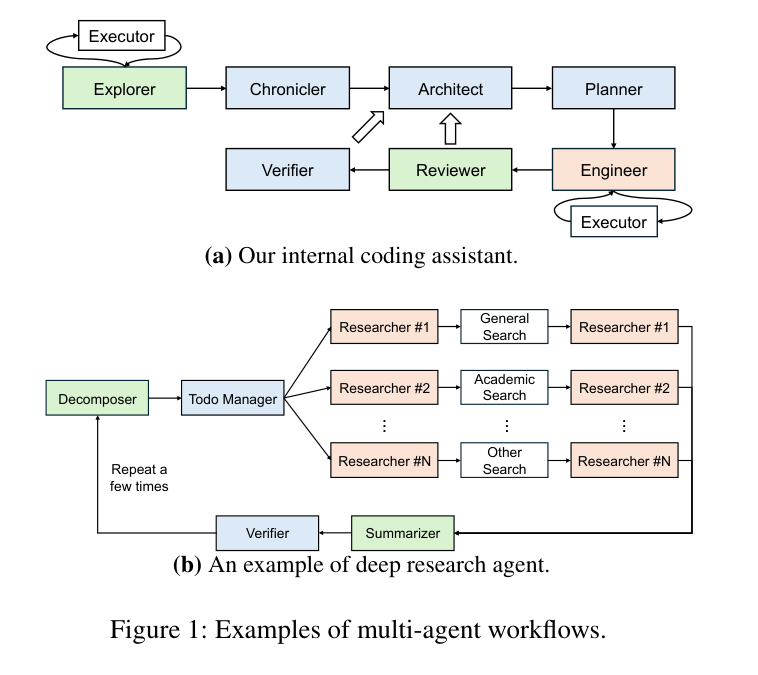

图 1：coding assistant 和 deep research 的多 Agent workflow。角色、循环、并行 fan-out 和工具职责构成可利用的结构信息。

作者对生产 trace 的分析指出，忽略这类结构会同时造成三类问题。

**第一，前缀缓存命中率低，Prefill 经常重复执行。** 超过 40% 的请求 prefix hit 很低甚至为零。这不是 Agent 没有重复上下文，而是不同角色使用不同的 system prompt；同时，代码执行、搜索等工具会在两个 Agent 调用之间留下较长间隔。等到某个角色再次运行时，它原本的 KV 往往已经被其他请求挤出缓存。被动的 LRU 只依据过去是否刚被访问，无法识别某段上下文在后续工作流中仍有明确用途。

**第二，请求大小异构，按请求数调度会引发负载不均。** Planner 可能只输出几十个 token，而 Engineer 可能生成数千 token；它们占用的 KV 容量、执行时间和对下游的影响都不同。仅按队列长度做 FCFS 或 replica routing，会让部分 worker 显存吃紧、发生 preemption，另一些 worker 却仍有空闲资源。被抢占请求需要稍后恢复甚至重算，长请求还可能把短而关键的请求堵在队列后面，形成 head-of-line blocking。

**第三，工作流会产生级联突发，而反应式扩缩容来不及。** 一个上游 Agent 完成后，可能立即触发多个下游 Agent；论文观察到这种 fan-out 可在一分钟内带来约 50.3% 的负载增长。传统 autoscaler 依据当前队列长度或过去一段时间的平均利用率决策，但模型副本启动本身需要时间，因此常在流量高峰已经到来后才补齐资源。

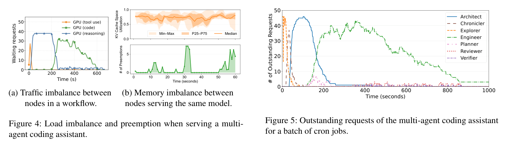

图 4：生产 trace 中的负载不均、KV utilization 差异和请求抢占，说明仅按请求级策略会浪费显存并增加重算。

## Key Insight

Pythia 并不要求准确预知一条工作流的全部未来。它只需从历史执行中得到带置信度的局部预测，并在预测不足时退回传统 reactive 策略。论文认为，生产 Agent 工作流通常能提供以下三类信息。

**工作流结构可预测。** 角色的转移、循环和并行模式具有稳定的主导路径。知道当前请求所处的位置后，系统可以判断哪些 Agent 的上下文未来仍值得保留、哪些内容已经不可能复用，也可以预估下游将唤醒哪些模型。

**负载特征可预测。** Agent 的职责相对固定，因此输出长度与执行时长通常形成可学习的分布。调度器不再把每个请求当作相同大小的任务，而可以根据高置信度的长度上界安排显存容量，并估计请求何时会释放或触发下游工作。

**下一提示词的组成可预测。** 下一个 Agent 的 prompt 通常由稳定的系统前缀和已经产生的上游结果组合而成。当前一步完成后，系统可以先拼接、分层存放甚至在空闲 GPU 上预填充这段 prompt，从而把一部分 Prefill 延迟隐藏在工作流的等待时间内。

因此，Pythia 的总思路是把“请求到达后再处理”改为“根据工作流局部未来提前准备”，分别作用于缓存、调度和扩缩容。难点有两个：如何在不过度增加应用负担的前提下获得工作流信息，以及如何让错误预测的代价受控。

## Core Design

### 系统总览：先学习，再消费预测

Pythia 只要求 OpenAI-compatible API 的 `extra_body` 携带三个标识：`workflow_type_id` 标识应用类别，`workflow_id` 标识一次执行或会话，`agent_id` 标识当前角色。应用不需要手写完整 DAG，也不需要直接指定缓存和调度策略；这些标识可由 Agent 框架或接入层统一注入。

Gateway 中的 Workflow Profiler 异步消费 request/response log，学习工作流结构、输出长度分布和 prompt composition。它先形成 Probabilistic Finite Automaton，再把主导路径综合为能表达并行、循环和可选分支的正则表达式。例如：

$$planner\rightarrow explorer^{||3,4}\rightarrow engineer^{3,6}\rightarrow reviewer\rightarrow (engineer^{2,4}\rightarrow reviewer)?\rightarrow verifier.$$

其中，Explorer 会并行 fan-out 3--4 个实例，Engineer 迭代 3--6 次，Reviewer 后可能出现一次受限返工。低于 5% 的罕见转移会被过滤；输出长度采用高置信上界，例如 P99。对于新上线或统计不足的 workflow，系统保留 reactive fallback，而不是基于不稳定样本激进预取或预留容量。

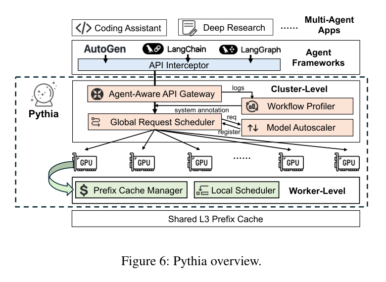

图 6：Pythia 在 gateway、cluster 和 worker 三层使用 workflow 信息，连接 profiler、global scheduler、autoscaler、prefix cache 和 local scheduler。

图 6 可以将 Pythia 理解为两部分：入口侧把历史轨迹转成“长度上界、后续路径、prompt 组成”三类标注；服务侧消费这些标注，分别执行推测式缓存管理、前瞻式请求调度和阶段自适应扩缩容。

### 三项核心机制：如何把预测稳妥地转成收益

#### 1. 推测式缓存管理：保留将要复用的，提前释放已经无用的

传统缓存淘汰只看过去的访问时间；Pythia 更接近受限的 Belady 思路，即利用预测的未来路径判断一个 KV block 是否还会被使用。Cache manager 从 `predicted_path_regex` 中解析后续节点，再检查每个 block 的 lineage。

当一个请求完成时，后续路径中已经不可能再次出现的 transient 或 dead token 可以立即释放，不必等到 LRU 在显存压力下被动淘汰；后续仍可能使用的前缀则被保留，并可转入共享 L3。这样既释放了无用显存，也避免缓存只能绑定原 worker。

对于下一个 Agent，系统根据 `prompt_composition` 在 L3 shared cache 或 L2 host DRAM 提前组装 exact prompt。若缓存缺失且 GPU 处于空闲状态，才会发起后台 Prefill。预测结果优先停留在 L2，而不是直接占用稀缺的 HBM；这使错误预测通常只带来较低层级的空间或带宽开销。

#### 2. 前瞻式请求调度：按容量安全路由，再按工作流价值排序

Pythia 将调度拆成集群级和 worker 级两层。首先，Profiler 为请求 $r_i$ 给出高置信输出长度上界 $u_i$，满足：

$$P(L_i>u_i)\le \alpha_i.$$

容量为 $C$ 的 worker 只有在下式成立时才接收新请求 $R$：

$$\sum_{r_i\in active\cup\{R\}}u_i\le C.$$

由 union bound 可得 $P_{oom}\le\sum_i\alpha_i$。直观地说，系统不是看“这个节点还有几个请求”，而是看“这些请求在保守估计下是否仍装得下”。路由器先过滤不满足容量约束的节点，再选择预计剩余空间最大的节点；若多个节点同样安全，则优先选择已持有目标 prefix 的节点，以兼顾负载均衡与缓存命中。

第二步是全局优先级。Pythia 同时奖励两类请求：一类离工作流终点更近，完成后可缩短整个任务的 JCT；另一类能尽快解除下游模型的空闲。论文将二者写为：

$$S_{completion}=\frac{1}{E[D_{remain}]},\qquad S_{unblock}\mathrel{+}=\frac{1}{E[D_m]},$$

$$base\_priority=\omega_1S_{completion}+\omega_2S_{unblock}.$$

请求到达 worker 后，local scheduler 每轮重新排序，并加入 aging，避免早期 Agent 长期得不到执行。显存仍不足时，系统抢占动态优先级最低的请求并放回全局队列。这套设计的目标不是单纯偏爱短请求，而是在缩短整体完成时间的同时维持关键路径的连续性。

#### 3. 阶段自适应扩缩容：沿着工作流前沿准备副本

传统 autoscaler 对当前队列作出反应；Pythia 则在预测窗口 $H$ 内投影活跃请求的正则路径，统计即将出现的 Agent 和对应模型负载。当上游节点即将 fan-out 时，系统会提前启动可能被唤醒的模型副本；真正的请求洪峰抵达时，副本已处于可服务状态。

缩容也使用相同的信息：已经离开当前执行前沿、短期内不会再被触发的模型停止接收新请求，待现有请求 drain 后再回收资源，而非机械等待固定 keep-alive 时间。这样扩缩容对齐的是工作流 wavefront，而不是带明显滞后的平均队列长度。

Pythia 基于 SGLang 实现：Profiler 与 global scheduler 接入控制面，speculative cache 接入分层缓存，local scheduler 在每轮动态重排，L3 使用 Mooncake；vLLM baseline 通过 LMCache 接入同一 L3。论文的价值主要在于控制逻辑，底层缓存和 serving engine 可以替换，但迁移需要相应工程适配。

## Evaluation

### 收益来自不同负载阶段的不同机制

实验使用两台 AMD EPYC 7J13、1.7 TB DRAM、8 张 A100 80 GB NVLink。基线包括 vLLM Production Stack 0.1.10、SGLang 0.5.9、重实现的 Autellix、Continuum，以及调整为每模型一个 queue 的 ThunderAgent。工作流来自内部 coding assistant 和 Deep Research Agent，并迁移到 AutoGen；benchmark 为 SWE-bench Pro 和 Deep Research Bench。为适配实验设备，生产 trace 中的 frontier model 映射到 Qwen/Llama 3B--14B，TP 为 1--4。主要指标是平均 JCT、P95 JCT 与吞吐。

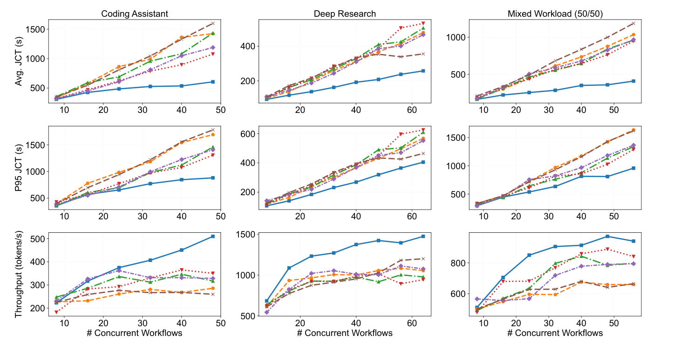

图 7：不同并发 workflow 下的平均 JCT、P95 JCT 和吞吐；Pythia 在三类 workload 中保持更低延迟和更高吞吐。

在峰值并发下，Pythia 将平均 JCT 降低 1.38--2.9 倍，P95 JCT 降低 1.15--2.02 倍，吞吐提高 1.12--1.96 倍。低负载时，主要收益来自推测式缓存将部分 Prefill 隐藏在等待时间中；高负载时，收益更多来自全局仲裁减少异构工作流造成的 head-of-line blocking。P95 没有因近似 SRTF 策略显著恶化，原因是能够解除下游空闲的上游请求会获得额外优先级，而 aging 防止了长期饥饿。

在 Deep Research 工作流中，semantic keep/drop 先释放 dead transient token；再开启 L2/L1 speculative prefetch 后，Decomposer 的 TTFT 可从约 4.1 s 降至约 1.4 s。论文在某些特定场景中报告最高约 25.5 倍的相对改善。共享 L3 还降低了 worker affinity：后续请求不必为了复用 prompt 被强行路由回原节点。

## Limitations

Pythia 适合少数几类、主导路径相对稳定的生产 Agent 工作流。它依赖应用或框架提供 workflow/session/agent metadata，也依赖足够历史数据来学习路径和长度分布。新 workflow、工作流版本变化和输出分布漂移都会造成短期失准；完全开放、强随机或对抗性的流程会让正则模型退化，因此应进入 reactive fallback。

论文当前的优化目标主要是平均 JCT 和吞吐，尚未系统解决多租户公平性、单个 workflow 的 P99 SLO 与 starvation。内部 coding trace、生产搜索 API 和完整模型映射也未完全公开，公开 benchmark 因而不能独立复现全部生产结果。与 KVFlow 相比，Pythia 不只做 KV 调度，而是把 workflow 信号送入缓存、路由、local scheduler 和 autoscaler；与 CacheScout 相比，它的覆盖范围更广，但也更依赖显式元数据和相对稳定的工作流结构。

---

# CacheScout：Learning Agent Execution for KV-Cache Management in Agentic Serving

原文：[CacheScout.pdf](paper_8_27/CacheScout.pdf)  
作者：Rui Zhang、Chaeeun Kim、Shaoting Feng、Kuntai Du、Yuhan Liu、Yi Zhong、Cheng-Wei Ching、Junchen Jiang、Liting Hu。  
时间与状态：arXiv:2608.14624，2026-07-16。  
研究层次：面向 Agent 的 KV cache 管理。

## Motivation

CacheScout 处理的是比 Pythia 更局部的问题：多 Agent 应用中，GPU 缓存究竟应当保留哪些前缀。每个 Agent 角色往往带有一段稳定的前缀，包括 system prompt、工具定义、skills 和 few-shot 示例。论文将这一段称为 **agent anchor**。它与本次会话的用户问题、上游输出不同，后两者通常只在当前会话中出现；anchor 则可能跨轮次、跨 session 反复复用。

普通 vLLM 或 SGLang 按 prompt 内容划分 block，再以 LRU 等基于最近访问时间的策略淘汰。它能识别重复文本，却看不到这个 block 属于哪个 Agent，也不知道这个 Agent 在几步之后是否会再次出现。因此，某个暂时未被访问、但很快会重用的长 anchor 可能被误逐出缓存，下一次调用又要从头 Prefill。CacheScout 的重点不是改写 prefix matching，而是把 Agent 的执行语义传给缓存决策。

## Key Insight

作者先回答了两个基础问题。第一，anchor 是否真的比 session history 更值得保留？测量结果显示，anchor block 的未来平均复用次数为 49--173 次，session-history block 只有 12--15 次，前者高 4--13 倍；工作流进行约 12 轮后，anchor 仍占每轮 prompt 的 43%--60%。因此缓存若把两者等价对待，会错过最有价值的可复用部分。

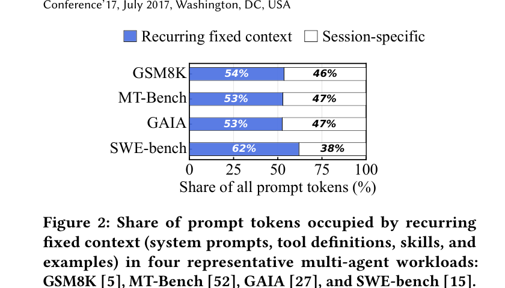

图 2：四个代表性 workload 中，Agent anchor 占 prompt 的 53%--62%，是最值得保护的重复上下文。

第二，动态 Agent workflow 是否完全不可预测？令 $A_t$ 为第 $t$ 步运行的 Agent，论文用

$$R=1-\frac{H(A_{t+1}|A_t)}{H(A_{t+1})}$$

衡量当前 Agent 对下一 Agent 的预测价值。Pipeline、Debate、SelectorGroupChat、Random 的 $R$ 分别为 1.00、0.78、0.57、0.12；在线观察约 50 次 dispatch 后，top-1 下一 Agent 的准确率达到 76%--86%。这意味着无需假设完整 DAG 固定不变，仅利用局部转移统计也能得到足够有用的缓存线索。

不过，执行结构不能从框架名称中直接推断。同一组六 Agent 在 Pipeline 中近似链式，在 Debate 中主要于 Coder/Reviewer 间往返，在 Selector 中转移集中于少数边，在 Random 中则接近均匀。缓存策略因此必须随运行时行为在线更新。

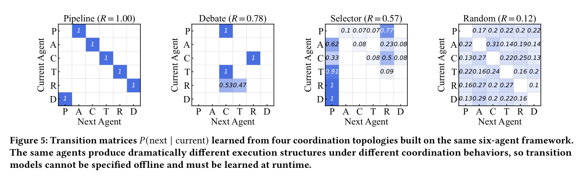

图 5：同一组六 Agent 在 Selector 与 Random 协调下产生不同转移矩阵，说明需要根据运行时行为学习后继关系。

由此，CacheScout 形成三项设计约束：系统必须知道 block 对应的 Agent identity；预测必须能适应动态分支；淘汰处在 serving 热路径上，决策只能是微秒级的轻量计算。

## Core Design

### 在线学习“下一步可能是谁”，再决定缓存去留

CacheScout 位于 Agent framework 与 vLLM 之间，不改变 Agent 的选择逻辑，也不重写 attention kernel。它通过 Agent metadata 标记 anchor 所属角色，借助 block touch hook 记录访问，并在两次真实请求之间通过后台 warmup 预取高概率 anchor。

#### 1. Transition Learner：学习转移关系

每次观察到 $A_t=i\rightarrow A_{t+1}=j$，系统更新计数 $C_{ij}\leftarrow C_{ij}+1$，并使用平滑项 $\epsilon$ 估计：

$$P_{ij}=P(A_{t+1}=j|A_t=i)=\frac{C_{ij}+\epsilon}{\sum_k(C_{ik}+\epsilon)}.$$

当前 Agent 为 $i$ 时，转移矩阵的第 $i$ 行给出下一步分布，最可能后继为 $\hat A_{t+1}=\arg\max_jP_{ij}$。模型不需要训练，也不需要提前提供完整工作流；其状态仅是随 Agent 数量平方增长的小型计数矩阵。

#### 2. Survival Scorer：估计 anchor 的未来存活价值

只看下一步概率还不够，因为某个 Agent 可能不是立即出现，却拥有很长、重算代价高的 anchor。理想目标是计算：

$$p_{surv}(a;a_0,K)=\Pr(\exists k\in[1,K],A_{t+k}=a\mid A_t=a_0).$$

精确枚举所有未来路径太慢。CacheScout 只保留 $P(b|a)\ge\tau$ 的高概率边，形成稀疏图；从当前 Agent 做 BFS，得到到各候选 Agent 的最短 hop $E[a]$，再近似为：

$$\tilde p_{surv}(a)=1-\frac{\min(E[a],E_{max})}{E_{max}}.$$

每个 KV block 继承其 anchor 的存活分数，并与最近访问时间、block 大小结合为淘汰分数：

$$Score(b)=\big(\tilde p_{surv}(a_b)+\delta\big)\big(e^{-\lambda age(b)}+\delta\big)|b|.$$

$a_b$ 是 block 所属 anchor，$age(b)$ 是距上次访问的调度步数，$|b|$ 表示 token 数。低分 block 优先淘汰。这个公式将“未来会不会用”“刚才是否用过”“重新计算的成本”同时纳入决策；当转移预测缺乏区分度时，survival 分数相近，策略自然接近 LRU，而非持续依赖错误预测。

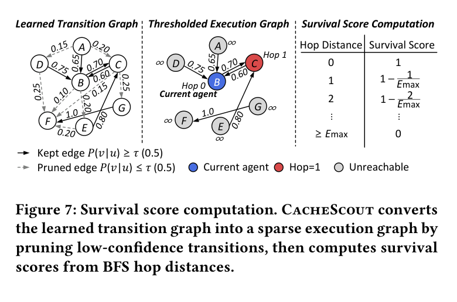

图 7：从转移图得到当前 Agent 到候选 Agent 的 hop distance，再将距离映射为未来存活分数，指导 KV block 淘汰。

#### 3. Background Prefetch Coordinator：在预测足够可靠时预热

**目标。** eviction 只能保护已经存在的 KV；如果未来会用的 anchor 已被淘汰或从未构建，仍会在真实请求到达时产生 Prefill。Prefetch 的目标是在两个 Agent turn 之间，提前恢复这段缺失的 anchor KV。

**选择谁。** 当前 Agent 为 $a_t$ 时，Coordinator 从转移矩阵的当前行选择概率最高的直接后继：

$$a^*=\arg\max_aP(a\mid a_t).$$

**如何预热。** 假设 `Planner` 后最可能执行 `Researcher`。系统不直接向 GPU cache pool 写入 block，而是通过 serving engine 的标准 Prefill API 发一条后台 warmup request：内容为 `Researcher` 的 anchor（system prompt、工具定义和最小 user prompt），并设 `max_tokens=1`。这一个 token 只是使请求走完整推理路径；预取真正需要的结果是 Prefill 产生的 anchor KV。若外部 KV pool 中已有该 anchor，engine 将其恢复；否则按正常 Prefill 重建。真实 `Researcher` 请求到来时即可命中固定前缀，只处理新增的动态上下文。这样无需修改 allocator、block table 或 attention kernel，但预取的最小单位是完整 anchor，而不是任意 KV block。

**何时有效。** warmup 仅在 turn 间空隙、可预测性 $R\ge R_{min}$ 且未触及 rate limit 时运行；Random workflow 关闭它，避免错误预取与前台请求争抢 GPU。它还必须与 predictive eviction 配合：prefetch 负责把缺失 anchor 提前恢复，eviction 负责保护恢复后的 KV 不被 LRU 再次逐出。论文消融中，单独 warmup 对命中率最多增加约 1 个百分点；在 eviction 已开启、预热结果能被保护时，GAIA 的每轮延迟才从 347 ms 进一步降至 251 ms。

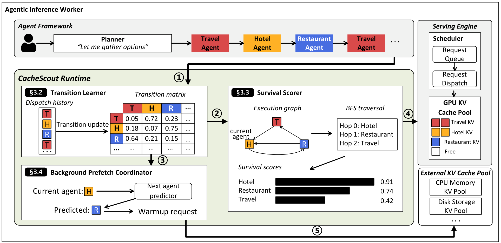

图 6：CacheScout 位于 Agent framework 与 serving engine 之间，在线学习转移、计算存活分数，并通过标准接口完成预取。

一轮请求完成后，BlockTouch 记录 block 所属 Agent 和访问时间；发生 Agent 切换时更新转移矩阵，并刷新阈值图与 BFS hop table；显存压力出现时计算 `Score` 并淘汰最低分 block；两轮之间再根据 $R$、rate limit 决定是否 warmup。论文实现约 2,300 行 runtime logic 和约 800 行 vLLM patch；24 个 Agent 的状态小于 25 KB，block touch 约 1 微秒，`PredictSurvival` 保持微秒级。

## Evaluation

### 实验设置与问题

实验使用 8 张 NVIDIA RTX PRO 6000 Blackwell 96 GB，主模型为 Llama-3.1-8B-Instruct；所有系统采用相同的 vLLM 配置、GPU cache budget、解码参数和 prefix cache 设置。工作负载为 GSM8K、MT-Bench、GAIA、SWE-bench，均采用六 Agent 的 AutoGen `SelectorGroupChat`，下一 Agent 由 LLM 动态选择。它们覆盖短数学协作、多轮对话、工具密集型网页推理与长上下文软件工程四类场景。

基线是采用 reactive prefix caching 与 LRU 的 vLLM，以及以 TTL=0.3 s 在工具调用边界固定当前 session KV 的 Continuum。指标包括：KV hit rate（被缓存 token 占全部 prompt token 的比例）、TTFT、单轮端到端延迟与吞吐（completed agent turns/s）。实验依次检验：整体收益是否成立、eviction 与 prefetch 分别贡献多少、是否能扩展至大模型、在缓存压力和高负载下是否仍有效，以及运行时开销是否足够低。

### 主结果：减少高价值 anchor 的误淘汰

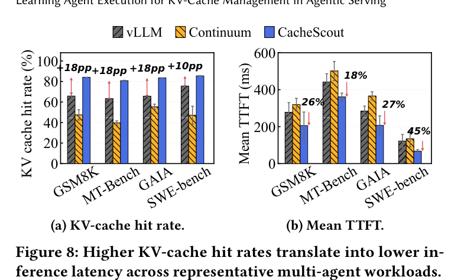

图 8：CacheScout 提高 KV 命中率并降低平均 TTFT；四组 workload 中命中率提升约 10--18 个百分点。

四个任务上的 KV hit rate 达到 81%--85%，比 vLLM 高 10--18 个百分点；平均 TTFT 降低 18%--45%。这说明 Agent-aware 保留策略确实把更多固定 anchor 留在了 cache 中，并将收益直接传递给 Prefill 延迟。

延迟分布也整体下移，而非只改善少数请求：中位数 TTFT 降低 14%--52%，三个任务的 P99 TTFT 降低 21%--52%；SWE-bench 的 P99 从 711 ms 降至 342 ms。图 9 的横轴为对数刻度 TTFT，蓝线整体比灰色 vLLM 和橙色 Continuum 更靠左，说明从中位请求到慢请求均有改善；其中 GSM8K、GAIA、SWE-bench 的中位 TTFT 分别降低 52%、51%、25%，MT-Bench 的改善较小，为 14%。

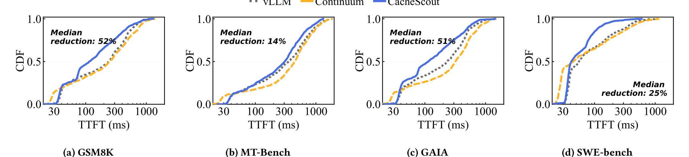

图 9：四个 workload 的 TTFT CDF。曲线越靠左，表示相同分位数下 TTFT 越低；CacheScout 的收益并非只来自少数请求。

端到端看，平均每轮延迟降低 29%--38%，峰值吞吐提高 19%--57%。图 10 直接将完整 CacheScout 与 vLLM、Continuum 对比：左图表示每次 Agent 调用从进入到完成的平均时间，右图表示系统被压到饱和时每秒完成的 Agent turn 数。它说明更高 KV hit rate 不只缩短首 token，也释放了计算和显存，从而提升并发处理能力。

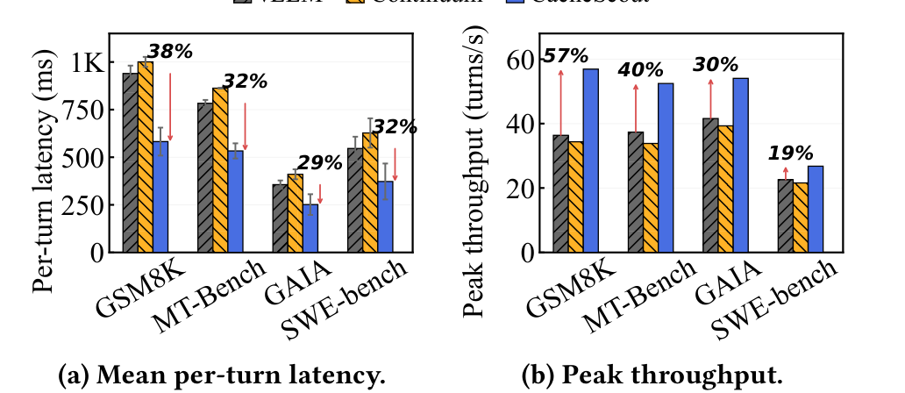

图 10：四类 workload 的平均每轮延迟与峰值吞吐。CacheScout 在所有 workload 中同时降低端到端延迟并提高吞吐。

随着 session arrival rate 增长，vLLM 在 KV cache 饱和后较早出现吞吐平台；CacheScout 的拐点更晚，并且在相同平均延迟预算下可承载 vLLM 的 1.7--12 倍、Continuum 的 4.2--16 倍到达率。图 11 分别给出四类 workload 下的平均/P90/P99 每轮延迟与吞吐曲线：蓝线不仅将均值压低，也延后了 P90/P99 上升和吞吐饱和的位置。因此它验证的是高负载稳定性，而不是单个固定并发点的偶然优势。

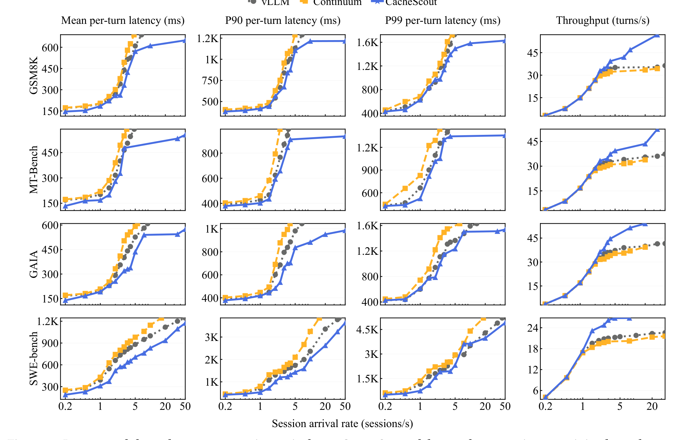

图 11：随 session 到达率上升的平均、P90、P99 每轮延迟与吞吐。CacheScout 延后 cache saturation，在更高负载下仍维持较低延迟和更高吞吐。

### 机制消融：eviction 是主收益，prefetch 提供条件性加速

论文比较 vLLM、仅启用 predictive eviction、完整 CacheScout。单独 predictive eviction 已使命中率相对 vLLM 提高 18--22 个百分点，并带来更低的 TTFT、每轮延迟和更高吞吐，说明系统最主要的收益来自少误删高价值 anchor。

Background prefetch 对命中率额外贡献至多约 1 个百分点，原因很重要：这些 workload 的中位 Agent turn 没有可单独预热的完整前缀；更关键的是，若没有 predictive eviction，warmup 重建的 KV 可能在预测 Agent 到达前又被 LRU 逐出。因此不能把它理解为“预取本身提升所有任务的命中率”。它在存在可利用时间空隙、且淘汰策略能保护预热结果的场景更有价值：在 GAIA 上，完整系统将每轮延迟从 eviction-only 的 347 ms 进一步降至 251 ms，即额外降低 28%。图 12 中完整方案的峰值吞吐相对基线提高 8%--19%。

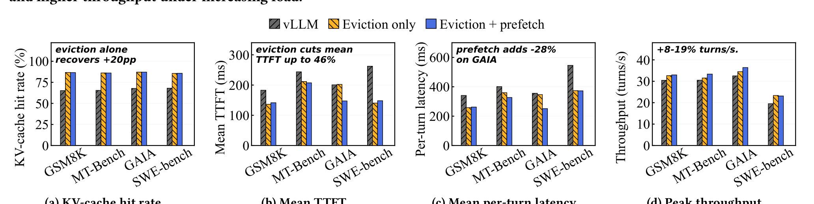

图 12：机制消融。黄色为仅 predictive eviction，蓝色为 eviction 加 prefetch；前者恢复大部分命中率，后者主要在部分 workload 继续压低延迟、提高吞吐。

### 模型规模、缓存压力与高负载鲁棒性

在 Qwen3-235B-A22B-FP8、4 张 H200 的大模型配置上，CacheScout 在四个 workload 的命中率仍提高 7--13 个百分点。对 prefill 更昂贵的 SWE-bench，随着到达率从 0.2 增至 2.0 sessions/s，平均 TTFT 在每个负载点降低 33%--54%，每轮延迟降低 26%--36%；当 vLLM 吞吐饱和在 5.2 turns/s 时，CacheScout 可达到 7.2 turns/s，即提高 37%。

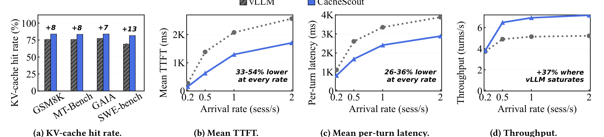

图 13：Qwen3-235B-A22B-FP8、4 张 H200 上的结果。左图验证四个 workload 的命中率提升；后三图在 SWE-bench 上展示随负载增加的延迟与吞吐优势。

缓存预算从 100 到 200 blocks 时，CacheScout 的命中率基本稳定在 86%--87%；vLLM 则从 64.4% 缓慢升至 76.6%，需要更多 GPU cache 才能接近前者。负载从 0.2 增至 50 sessions/s 时，CacheScout 的命中率也维持在 86%--87%，vLLM 约为 65%--68%。此外，关闭 adaptive prefetch gate 会让无谓 warmup 与前台推理竞争，在小缓存配置下使每轮延迟最多上升 22%；这验证了“预取必须受预测可信度约束”的设计选择。

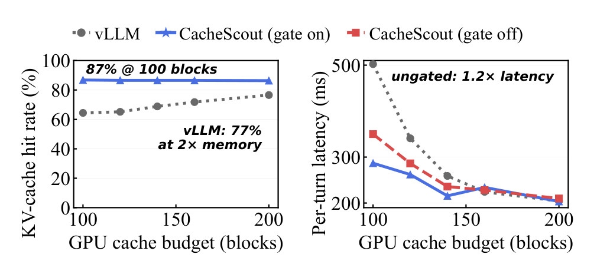

图 14：GPU cache budget 敏感性。左图显示 CacheScout 在紧张缓存下仍有较高命中率；右图显示关闭 prefetch gate 会因无谓 warmup 增加延迟。

### 运行时开销

Coordinator 的状态在 24 个 Agent 时仍低于 25 KB。`ObserveTouch` 约为每个 block 1 微秒，`PredictSurvival` 即使在 24 个 Agent 时也在 6 微秒内完成。转移图构建与 warmup 均在关键路径之外运行，因此论文认为缓存策略本身的控制开销相对于 LLM serving 延迟可以忽略。

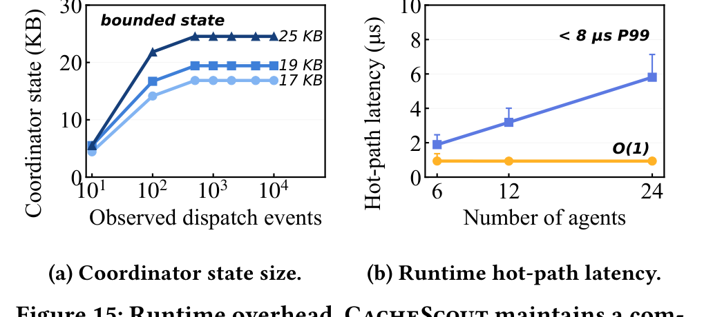

图 15：运行时开销。状态随 Agent 数增长仍低于 25 KB；block touch 与 survival 预测维持微秒级，不成为 serving 热路径瓶颈。

## Limitations

CacheScout 的一阶 Markov 模型只利用相邻 Agent，因此无法表达必须依赖较长历史才能判定的路径。强随机 workflow 的收益会接近 LRU；冷启动、Selector 策略变化和 prompt fingerprint 漂移也会造成短时间失准。实验主要集中在六 Agent AutoGen 和 vLLM，跨节点路由、MoE 专家并行、租户公平性与复杂工具生命周期尚未完整验证。

与 KVFlow 相比，CacheScout 在线学习动态转移，而非预先提供 Step Graph；与 Continuum 相比，它优先保护跨 Agent、跨 session 的 anchor，而不只是工具等待期间的当前 session；与 Pythia 相比，它不进行集群级资源编排，但可在更少的工作流先验下改进单机或单服务实例的缓存决策。

---

# OasisKV：Scaling In-Decode KV Cache Beyond HBM with Lookahead Sparse Prefetching

原文：[OasisKV.pdf](paper_8_27/OasisKV.pdf)  
作者：Can Xiao、Sukmin Cho、Junbong We、Zhixiong Niu、Jianyi Cheng、Yiren Zhao、Youngjin Kwon、Yongqiang Xiong、Rui Ma、Junyi Liu。  
时间与状态：arXiv:2608.08097，2026-08-08。  
研究层次：decode 阶段的稀疏 KV 读取，以及 CPU/远程内存扩展。

## Motivation

OasisKV 关注的不是下一步由哪个 Agent 执行，而是一个正在 decode 的请求在生成当前 token 时，究竟需要读取历史中的哪些 KV。随着上下文和并发增长，完整 KV cache 同时受到容量和带宽两道约束。其大小近似为：

$$M_{KV}(B,L)=B\cdot L\cdot N_{layer}\cdot2\cdot N_{kv}\cdot d_h\cdot s,$$

因此，HBM 中可容纳的 batch 上限为：

$$B_{max}=\left\lfloor\frac{M_{HBM}}{L\cdot N_{layer}\cdot2\cdot N_{kv}\cdot d_h\cdot s}\right\rfloor.$$

以 GQA 模型为例，32B 模型的每个 token KV 约为 256 KiB；32.7K 上下文的单个请求可能占用 8.6 GB。80 GB HBM 扣除权重和运行时空间后，只能容纳约 9 个这样的请求。把完整 KV 放到 CPU 或远程内存能缓解容量压力，却会把问题转化为每个 decode step 的数据搬运压力。

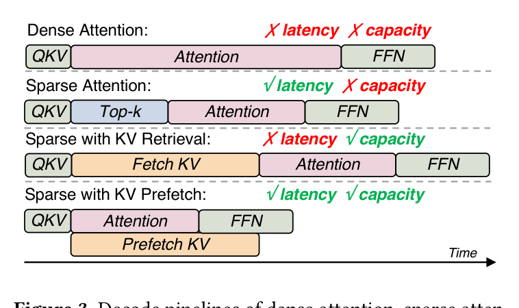

图 3：dense attention、稀疏 attention、KV retrieval 和 KV prefetch 的路径对比；OasisKV 试图把“只读取必要 KV”做成可流水化的 serving 机制。

每个 decode step 可用于传输的预算约为 $C_{token}=B_{link}T_{decode}$。在 Qwen3-8B、H100、2K active context 的测量中，decode step 约 17 ms；PCIe 64 GB/s 在这一窗口内仅能为每个请求搬运约 118 个新 KV token。若每步都搬回完整历史，传输会直接进入关键路径，decode 无法持续推进。Prefill-Decode disaggregation 还会在请求准入时传输整份 KV，造成 admission burst 和 decode 节点主机内存占用。

因此，OasisKV 要同时解决三件事：以低开销预测下一步 attention 的 top-K block；将预测、选择和传输隐藏在前台前向计算背后；在 PD 场景中只传输当前真正需要的 KV 子集。

## Key Insight

相邻 decode step 的 query 往往关注相近的历史位置。论文发现，上一 token 与下一 token 的 top-20 平均有 83.9% 重合；利用 draft token 传播 look-ahead query 后，预测 top-K 与精确下一 token query 在每层的一致率都超过 98.2%，平均为 98.74%。这使系统无需额外运行一次完整目标模型，也能提前估计下一步需要从 CPU 或远程层取回哪些 block。

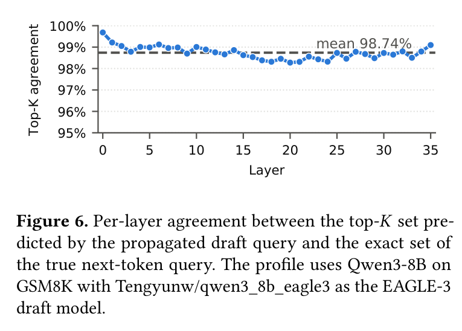

图 6：传播 draft query 后，各 Transformer layer 的 top-K 预测与真实下一 token query 的平均一致率为 98.74%。

这里的预测并不是认为其余 KV 永远无用，而是将完整 KV 作为容量层，GPU 中只保留当前 attention 的稀疏 working set。只要该 working set 能在下一个 attention 前到位，前台 decode 就不必等待完整历史的传输。

## Core Design

### 完整 KV 放在容量层，HBM 保存工作集

OasisKV 的前景路径正常生成 token；后台路径根据 look-ahead signal 预测下一步的 top-K、选择需要的 block 并异步搬入。完整 KV 保存在 CPU 或远程层，HBM 只保留被选中的历史 block 和 local window。

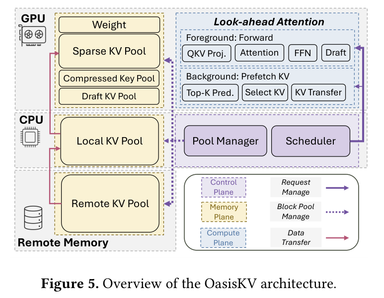

图 5：OasisKV 的 GPU、CPU 和 Remote Memory 三层 KV pool，以及 look-ahead attention、pool manager 和 scheduler。

#### 1. Look-ahead Attention：低成本预测候选 block

为避免扫描完整 key，OasisKV 为每个 KV block 保存 key 的逐维 min/max summary，而不是保存全部 key。预测 query 只需扫描这些摘要即可筛出候选 top-K，随后再按 block 获取 full KV。这样将“在完整历史里找可能相关位置”的开销，压缩为对少量元数据的扫描。

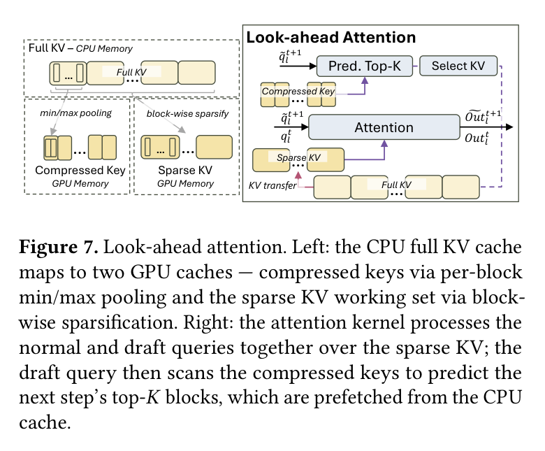

图 7：左侧是 CPU full KV 到 compressed-key pool 和 sparse KV pool 的映射；右侧把 normal query 与 draft query 放在同一个 attention kernel 中处理。

#### 2. Fully Asynchronous Pipeline：用异步流水线隐藏取数延迟

每层都有独立的 prediction、selection 和 KV transfer worker。第 $t$ 步执行前向计算时，后台已在准备第 $t+1$ 步的 top-K；只要搬运能在下一次该层 attention 前完成，就不会阻塞前景路径。论文将这一约束写为：

$$T_{pipe}=\max(T_{pred},T_{select},T_{transfer})\le \Delta_{prefetch},$$

其中 $\Delta_{prefetch}$ 是同一层连续两次处理之间的可用时间窗口。这个条件也解释了为什么系统不仅需要预测准确，还必须严格控制预测、选择和传输本身的开销。

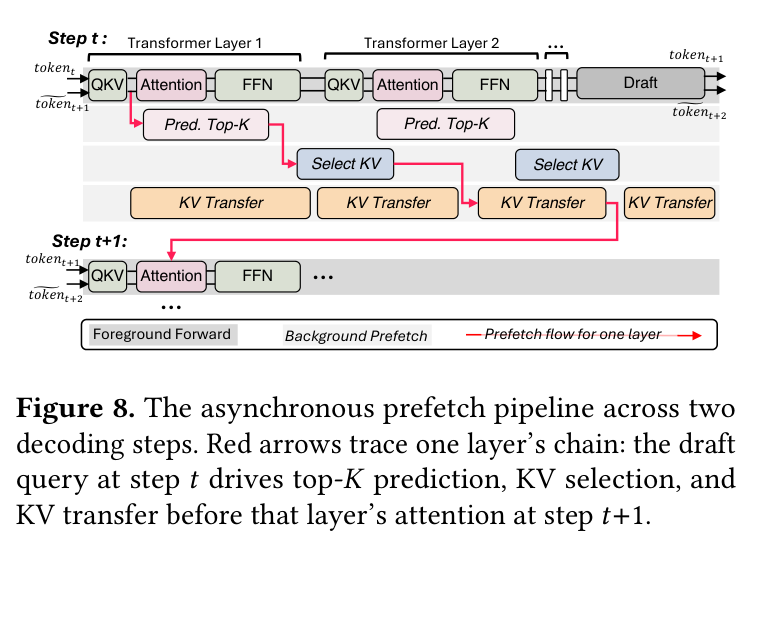

图 8：跨两个 decode step 的异步流水线；红色链路展示 draft query、top-K prediction、KV selection 和 transfer 的依赖关系。

#### 3. Fetch Cap 与 Head-wise Mapping：给搬运量设置上限

每个 head 在每步最多 fetch $rK$ 个新 block，其他需求由已经驻留的 block 覆盖。实验表明，当 fetch ratio 超过 0.10，链路在约 30--34 GB/s 附近饱和，继续搬运反而会拖慢 decode。OasisKV 还在 vLLM page table 之上增加 head-wise logical-to-logical mapping，使不同 KV head 维持各自的稀疏集合，同时尽量保留既有 FlashAttention 执行路径。

#### 4. Remote Partial Fetching：在 PD 中按需远程取回

Prefill 节点额外执行一个 decode step，获得首步 query 与各 head top-K 的并集。请求准入时，系统只传输首步 working set、compressed-key cache 和 draft state；后续若 top-K 漂移导致 miss，再从 prefill 节点的 host pool 远程读取，先到 decode 节点 DRAM，再 gather 到 HBM。每个 block 最多跨网络一次，resident set 单调增长，避免在 admission 阶段复制整份 KV。

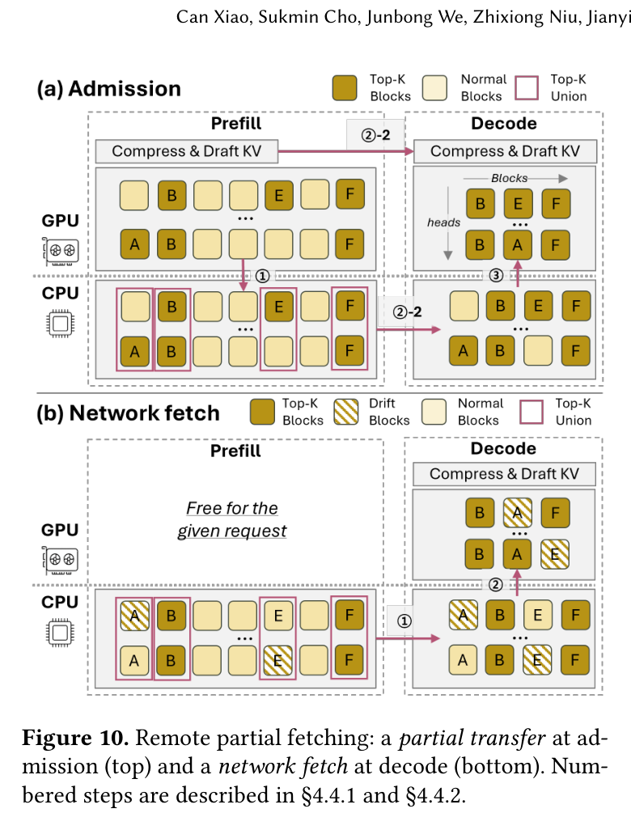

图 10：远程部分读取分为 admission partial transfer 和 decode-time network fetch，避免在请求开始时搬运完整 KV。

## Evaluation

### 以小幅 attention 近似换取更大的并发空间

实验使用 8 张 H100 80 GB、2 个 Xeon Platinum 8480C、2 TB 主机内存；GPU 经 NVLink/NVSwitch 互连，单卡经 PCIe Gen5 x16 连接 CPU。PD 实验使用两节点 ConnectX-7 400-Gbps RoCE。模型包括 Qwen3-8B、Qwen3-235B-A22B MoE、Llama-3.1-8B，使用 EAGLE-3 draft heads。准确率任务包括 AIME24/25、GPQA-Diamond、LongBench v2；性能 workload 为 16K/32K context、每请求生成 2,048 token，默认 block size 为 16、top-K 为 128 blocks。

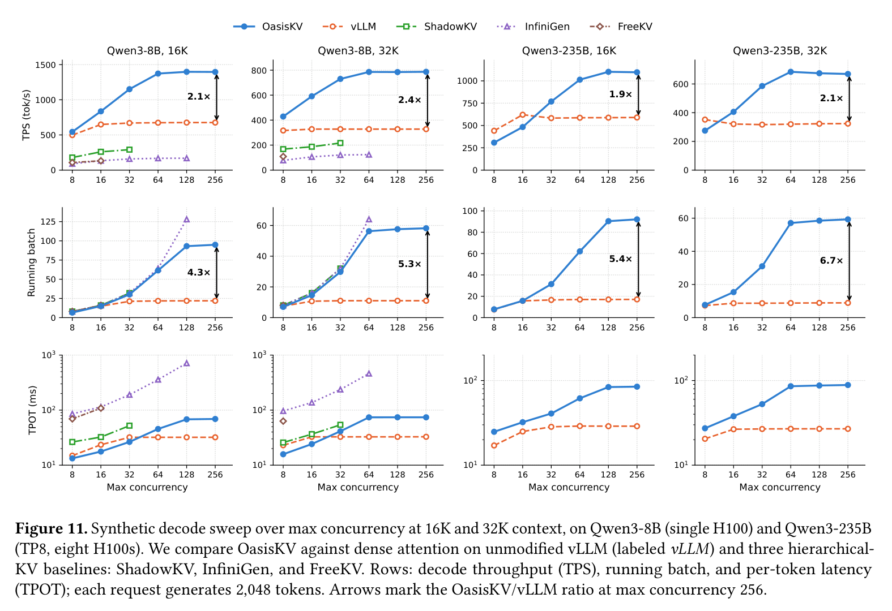

图 11：在不同最大并发下比较 decode throughput、running batch 和 TPOT；OasisKV 在 KV 填满 HBM 后仍能扩大 batch。

在单张 H100、Qwen3-8B、16K context、并发 128 时，OasisKV 达到 1,398 tok/s，dense vLLM 为 676 tok/s，约为 2.1 倍；并发 16 时，TPOT 为 17.7 ms，对比 dense 的 23.5 ms，吞吐为 836 对 649 tok/s。Qwen3-235B 在高并发 16K workload 上最高约有 1.9 倍吞吐；低并发时模型计算占主导，稀疏管理开销可能使 TPOT 略高，说明它主要解决的是 KV 压力而非所有场景的固定加速。

在 PD 实验的 24K/32K context 下，dense 吞吐约为 550/384 tok/s，OasisKV 达 1,204/888 tok/s，即 2.1--2.3 倍。Remote Partial Fetching 将 decode 节点每请求 host KV 从 3.38/4.52 GiB 降到 1.54/1.73 GiB；admission 传输从 3.37/4.50 GiB 降到 0.52/0.46 GiB，减少 6.5--9.7 倍。即使将 decode 期间的漂移 miss 纳入统计，端到端总传输仍下降约 1.33--1.50 倍。

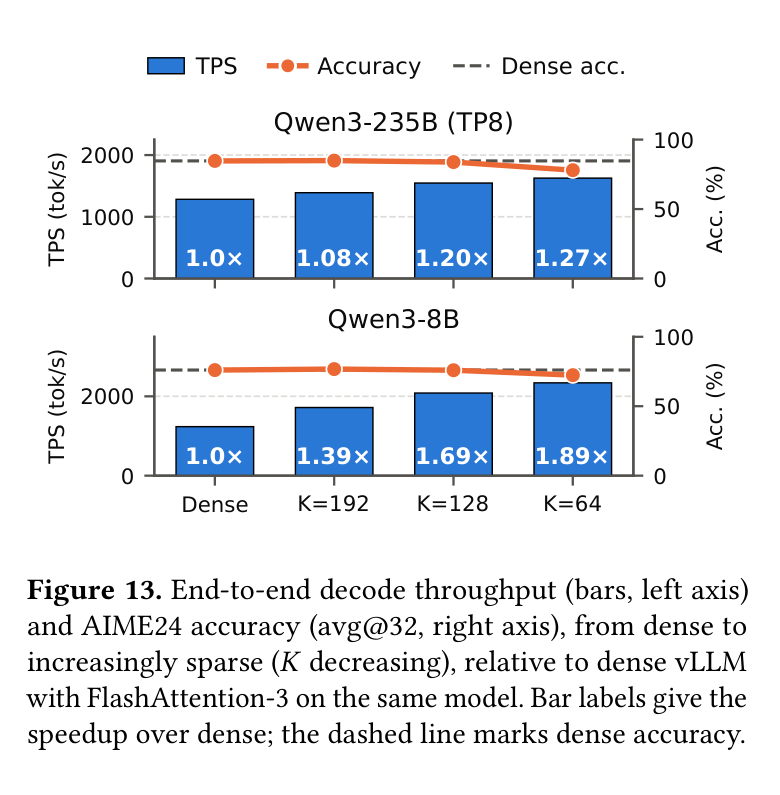

图 13：减小 top-K 会提高 decode throughput，但过小的 working set 会带来准确率损失；K=128 是较稳妥折中。

准确率以各 serving stack 的 full-attention anchor 为参照。LongBench v2 上，Qwen3-8B overall 下降 0.40，Llama-3.1-8B 下降 0.61；reasoning 任务的综合 pass@8 下降 0.66、avg@8 下降 0.35；AIME24 pass@8 基本不变，GPQA-Diamond avg@4 下降约 1.1。参数选择体现了明确的速度--准确率权衡：fetch ratio 为 0.05 时，吞吐达 2,083 tok/s，准确率为 75.94，与 dense 的 76.04 相差 0.1，却约为 fetch-all 吞吐的 2.5 倍；将 K 从 192 降至 64 时，Qwen3-8B speedup 从 1.39 倍增至 1.89 倍，但 AIME24 准确率从 76.77 降至 72.40。

## Limitations

OasisKV 的 top-K 本质是 attention 近似，效果依赖 draft token 质量和任务分布。需要远距离证据的检索任务可能需要更大的 K；fetch cap 又受 PCIe、NVLink 和网络带宽约束，互连拥塞时异步 overlap 会失效。当前原型没有完整 prefix cache，部分 PD TTFT 是分析模型结果，也不理解工具调用、Agent 阶段或租户公平性。

它与 CacheScout、Pythia 的控制点不同：CacheScout 决定跨 Agent 的哪个 anchor 值得留下，Pythia 决定工作流中哪些请求和模型资源应被提前准备，而 OasisKV 决定当前 decode step 应读取哪些历史 block。因此 OasisKV 更像可与上层 workflow-aware 策略组合的底层 memory backend，而不是替代它们的工作流调度系统。

---
