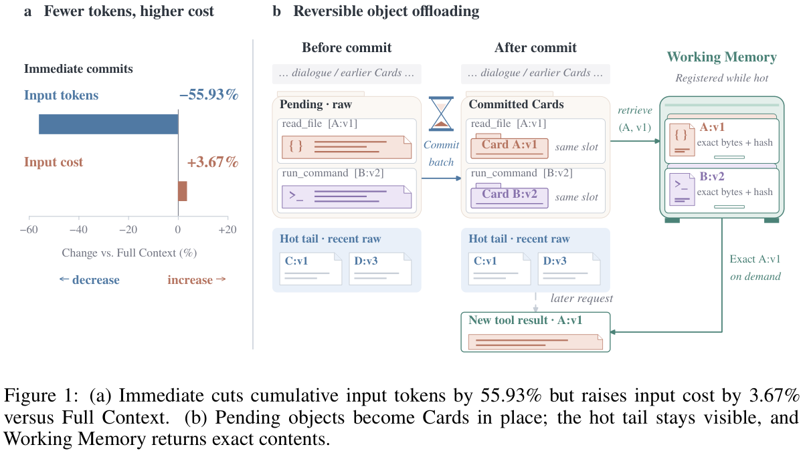
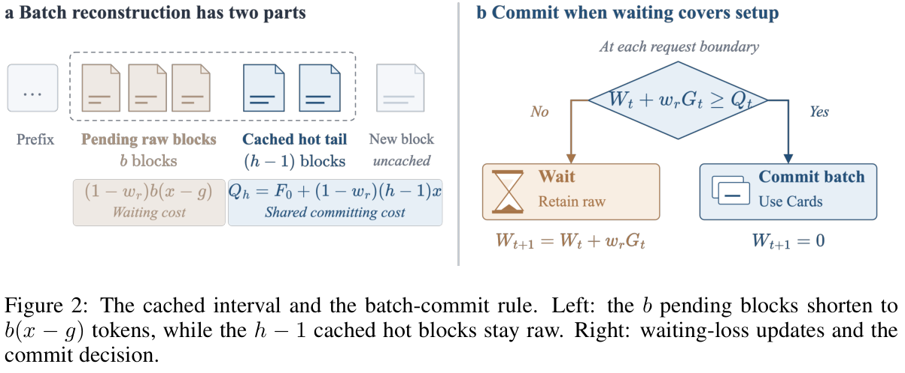
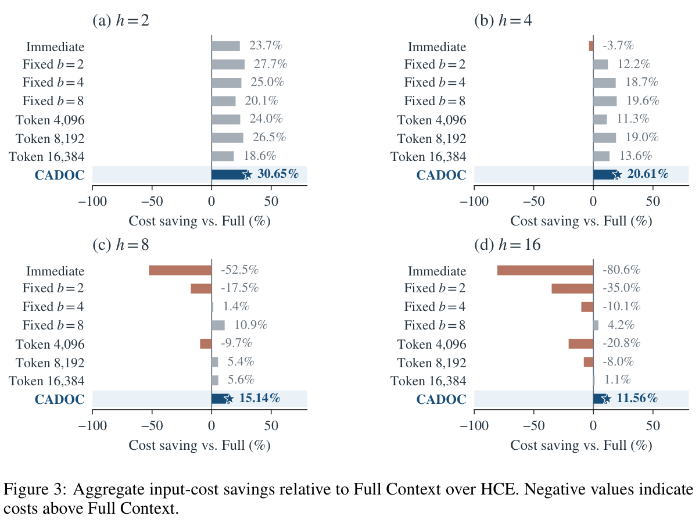
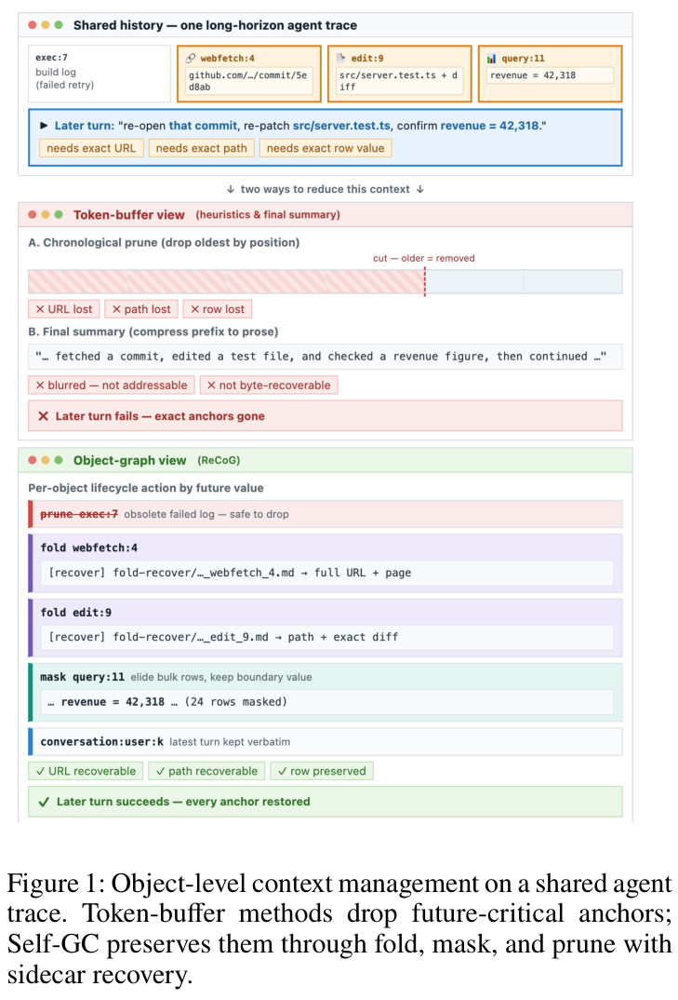
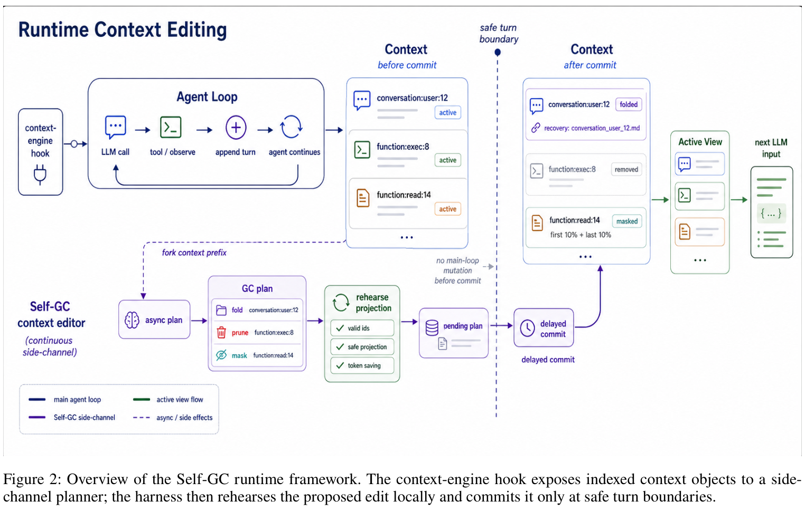
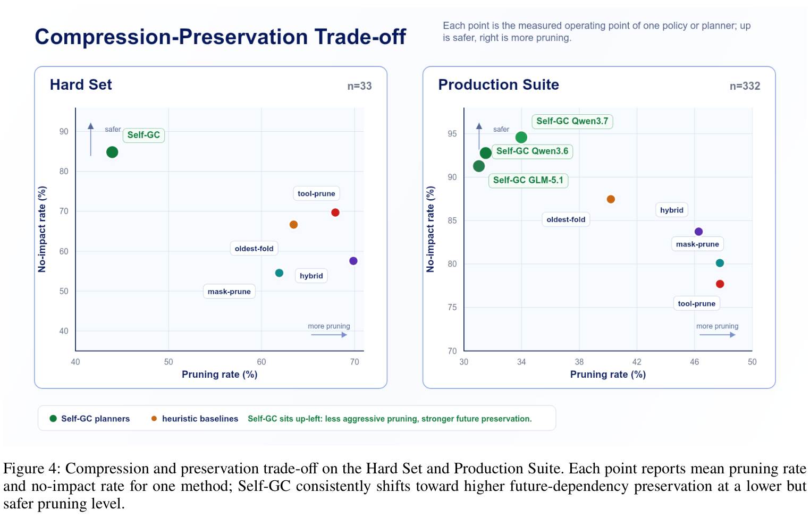
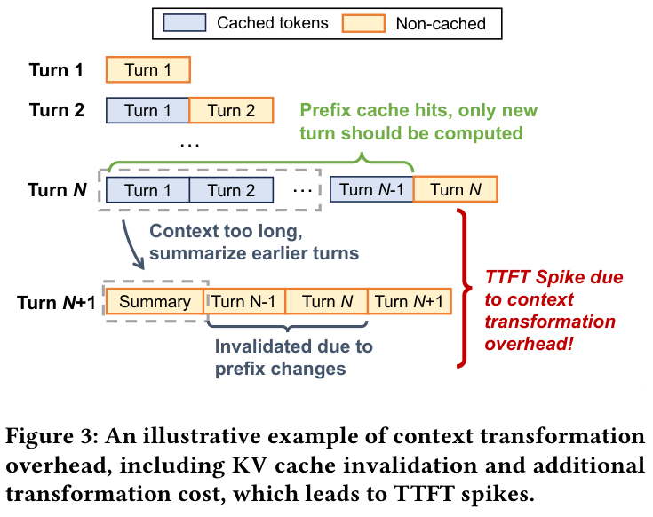
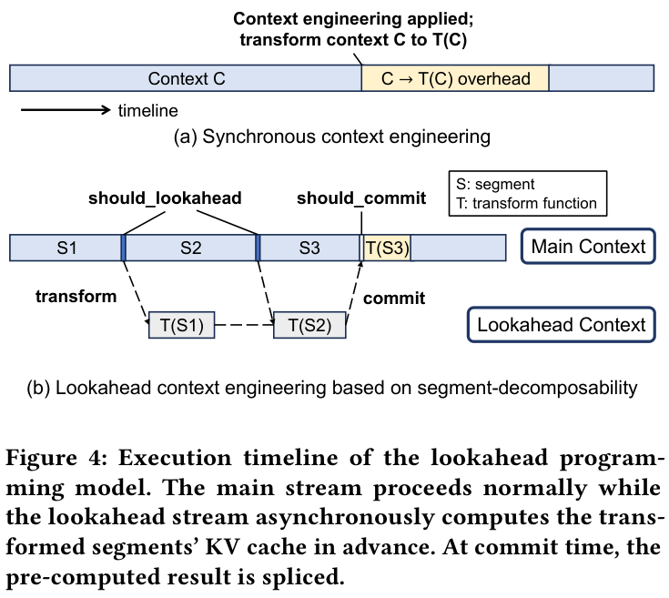
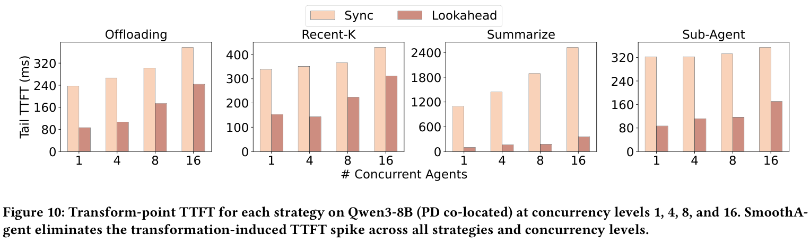
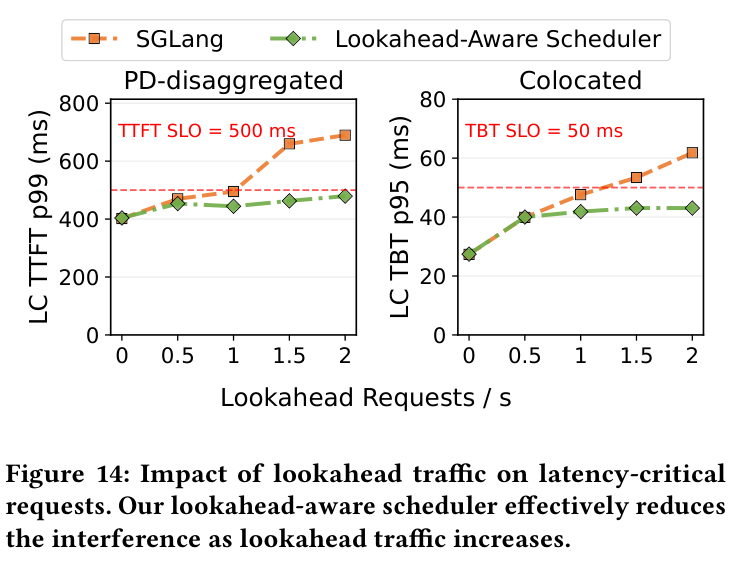

# CADOC、Self-GC、SmoothAgent

## 一、CADOC

*CADOC: Cache-Aware Dynamic Object Context for Long-Horizon Agents*。Junjie Yao、Zhangchen Zhou、Zhi-Qin John Xu，上海交通大学。**arXiv 预印本**，[arXiv:2609.37012v1](https://arxiv.org/abs/2609.37012v1)，2026-09-29 提交；截至 2026-10-19，所核查 arXiv 元数据未列会议录用信息。

### 解决问题

场景是**长轮 Agent 持续读取文件、运行命令和产生工具结果**。这些结构化内容在刚产生时需要完整可见，之后却可能长期滞留在每轮输入中。将原文外置、只保留可检索的短引用，可以缩短上下文；但替换历史内容会改变 token 前缀，使首个编辑位置之后的 KV 失效，包括没有被修改的近期历史。每出现一个可替换对象就立即提交，可能反复重建同一段后缀。

图 1 左侧给出动机实验：立即替换减少 **55.93% 累计输入 token**，加权输入成本反而增加 **3.67%**。右侧展示对象从原文变成 Card，近期原文继续保留；需要细节时，按对象版本取回原始内容。

**相关工作与 insight。** 摘要和 token 裁剪侧重保留什么信息，外部记忆侧重怎样找回内容；Self-GC 已进一步考虑编辑后的未来收益是否覆盖缓存破坏。CADOC 聚焦提交时机：多个编辑可以共享一次后缀重建，延迟编辑又会持续携带冗余原文，因此应将“对象已经可以替换”与“现在就提交替换”分开，用已发生的等待成本决定何时合并提交。

### 解决方案

**对象与 Card。** 文件、日志、代码和工具结果注册为不可变版本，原始字节保存在 Working Memory。Card 只记录身份、版本、来源和结构元数据，不调用 LLM 生成摘要；模型通过 `retrieve_object` 取回对应版本，作为新的工具结果加入历史。普通对话保持可见。最近的 hot tail 同时受块数与 token 上限保护，对象离开该区域后进入 pending 队列，提交前仍保留原文。

**在线批量提交。** 总输入成本按未命中 token 数 `N` 加缓存读取 token 数 `R` 的相对权重计算，即 `C = Σ(N + wᵣR)`，主实验取 `wᵣ = 0.1`。控制器维护三项：本次替换可减少的 token 数 `G`，pending 原文在此前请求中累计产生的额外成本 `W`，以及多次编辑可共享的后缀重建成本 `Q`。

Wt + wrGt ≥ Qt

满足上式就一次提交全部 pending 替换；否则继续等待，并在每次携带原文后累加 `wᵣG`。最早的编辑已经确定重建起点，顺带提交后面的替换不会再增加一次缓存断裂。容量上限可强制提前提交，成功收到模型响应后才确认提交并清账。

图 2 左侧区分 pending 对象和仍保持原文的 hot tail，右侧对应上述等待／提交规则。调度不预测未来轮数、不额外调用 LLM；平稳假设下可恢复最优整数批量，理论结论依赖相应成本模型，并非任意真实负载的全局最优保证。

### 实验数据集、场景与效果

**固定历史回放**使用 Hermes Compression Evaluation 的三条配置、调试与功能开发历史，共 83 个请求边界。固定模型输出、对象和 Card，在相同历史上比较立即提交、固定批量、token 阈值和 CADOC。hot tail 上限为 2／4／8／16 块时，CADOC 相对全文的成本分别减少 **30.65%／20.61%／15.14%／11.56%**；固定小批量在较长 hot tail 下可能比全文更贵。

**完整 Agent 实验**将任务依次接入同一条持续历史，各方法独立生成和调用工具；附录记载使用 `gpt-5.6-terra` 路由。它测试人为组织的 continuing benchmark chains，不是把原数据集全部视为天然连续会话。

| 连续任务链 | FULL 完成数 | CADOC 完成数 | 累计输入减少 | 加权输入成本减少 |
|---|---:|---:|---:|---:|
| Terminal-Bench 2.1，89 任务 | 38/89 | 36/89 | 49.40% | 47.13% |
| LongMemEval-V2，18 任务 | 10/18 | 10/18 | 80.60% | 42.40% |
| SWE-bench Verified，50 任务 | 31/50 | 29/50 | 44.72% | 34.12% |

成本包含按需取回原文后的输入。另对 FULL 轨迹的 1,801 个请求边界做无模型调用回放，隔离调度差异。**这些结果证明的是指定缓存读取权重下的输入成本收益，不能换算成同幅度 GPU 加速。** 任务完成数也有小幅下降；“原文可精确取回”不等于模型一定会正确检索、任务质量必然无损。

## 二、Self-GC

*Self-GC: Self-Governing Context for Long-Horizon LLM Agents*。Xubin Hao、Hongjin Meng、Xin Yin、Jiawei Zhu、Chenpeng Cao，小红书。**arXiv 预印本**，[arXiv:2607.00692v1](https://arxiv.org/abs/2607.00692v1)，2026-07-01 提交；截至 2026-10-19，所核查 arXiv 元数据未列会议录用信息。

### 解决问题

场景覆盖**办公、浏览、Shell、代码与数据分析等长轮工具工作流**。上下文不仅是可以概括的聊天记录，还包含后续要继续使用的精确 URL、路径、表格值、用户约束、工具句柄和可编辑产物。按时间删除旧轮次、按类型清理工具结果，容易删除短小但不可替代的依赖；最终摘要即使保留了任务叙述，也可能丢掉原文或恢复入口。

图 1 在同一条历史上对比两类操作：文本清理删掉后续需要的命令、路径等锚点；对象级操作保留必要边界和恢复指针，使下一轮仍能找到原始证据。

**相关工作与 insight。** 固定裁剪便宜，但不知道未来依赖；自由摘要可以理解语义，却难以保证精确证据仍可访问。Self-GC 将两者职责拆开：LLM 判断对象的后续价值并提出操作，harness 验证对象、保存恢复副本、控制提交边界。上下文压缩因此变成可寻址对象的生命周期管理，而不是让模型直接重写整段历史。

### 解决方案

**稳定对象与三种操作。** 用户请求及其执行片段、独立工具结果分别获得 session 内稳定 ID；planner 只能引用已有 ID。完整 transcript 保留在 active view 之外，运行时另外维护供下一次模型调用使用的可见视图。

| 操作 | 对 active view 的修改 | 恢复语义 |
|---|---|---|
| Fold | 原文移到 sidecar，只留下短恢复指针 | 对应 payload 可精确恢复 |
| Mask | 保留对象边界，省略重复或低信息的中间内容 | 不提供 Fold 式恢复保证 |
| Prune | 从当前可见视图移除过时对象 | 不保证后续可通过该操作恢复 |

**旁路规划、预演、延迟提交。** 触发治理时，系统复制当前前缀给旁路 planner；它输出对象操作计划，不直接生成最终 prompt。harness 先检查 ID，拒绝最新用户轮次等受保护对象的编辑，合并重叠操作，在本地生成候选视图并估算节省。计划通过后仍可等待，到安全轮次边界再保存 sidecar、修复 lineage、整理消息并提交；被拒绝的计划不修改主执行流。

图 2 下方是独立规划和预演通路，上方主 Agent 继续执行；只有跨过安全边界后，pending plan 才改变 active view。

**缓存感知提交。** 系统估算“预计未来复用次数 × 每轮节省 − 缓存破坏成本 − GC 成本”，其中 GC 成本包括 planner 调用。收益不足时可等缓存过期或下一任务边界；部署校准采用约 30% 的压缩阈值，这是运行策略，不是通用常数。它管理的是输入视图与恢复路径，没有让被编辑后缀的旧 KV 自动精确有效。

### 实验数据集、场景与效果

离线数据来自生产轨迹，经筛选得到 **332 会话 Production Suite**，其中选出 **33 会话 Hard Set**，后者偏向高 token 压力、BI／表格及网页抓取依赖。对比按时间折叠、工具删除、工具 mask 后删除及混合规则；默认 planner 为 Qwen3.6-Plus，另测 Qwen3.7-Max 和 GLM-5.1。

图 4 横轴越右删得越多，纵轴越高保留越可靠。Self-GC 选择较保守的压缩比例，以减少对后续依赖的破坏。

| 数据／设置 | Self-GC 结果 | 启发式对照 |
|---|---|---|
| Hard Set，33 会话 | 删除 43.95% token；no-impact 84.85% | 删除 61.90%–69.87%；no-impact 54.55%–69.70% |
| Production Suite，332 会话 | 三个 planner 删除 31.04%–33.98%；no-impact 91.27%–94.58% | no-impact 77.71%–87.46% |
| 在线生产流量，5 月 25–30 日白天 | 平均主 Agent 输入 token 减少 10%–15%，峰值约 20% | 按账号邮箱首字符分组的对照流量 |

**no-impact 是 GPT-5.5 根据保留视图、修改差异与真实后续轮次，判断未来依赖是否仍可获得；不是完整任务重新执行的成功率。** 在线分组也不是随机试验，未给出包含全部旁路费用的匹配计费审计。原始生产轨迹不公开，论文提供了规划契约和评估说明，但公开可复现性仍受数据限制。

## 三、SmoothAgent

*SmoothAgent: Efficient Long-Horizon LLM-Based Agent Serving with Lookahead Context Engineering*。Zaifeng Pan、Qianxu Wang、Zhengding Hu、Chang Chen、Yue Guan、Yanbo Zhou、Steven Swanson、Yufei Ding，加州大学圣迭戈分校。[arXiv:2607.00151v1](https://arxiv.org/abs/2607.00151v1)，2026-06-30 提交。[代码](https://github.com/PanZaifeng/SmoothAgent)。**目前按 arXiv 预印本记录**；PDF 的 PVLDB 20(X)、2027 及 DOI 是占位格式，截至 2026-10-19 所核查元数据未给出正式发表记录。

### 解决问题

场景是**长轮 Agent 使用 offloading、历史截断、摘要或子 Agent 隔离来控制上下文增长**。同步实现通常等达到阈值才转换：既要生成摘要或准备新上下文，又要对新前缀重新 prefill，下一次生成因此被阻塞。即使转换后输入更短，转换轮仍会出现明显 TTFT 尖峰。

图 3 前几轮只计算新追加内容；加入摘要后，历史 token 前缀发生变化，旧缓存不能直接继续命中。额外转换和重建工作集中在同一轮。

**相关工作与 insight。** 前缀缓存改善未变化历史的执行，工作流感知驱逐改善状态驻留，两者都没有消除上下文转换的同步成本。SmoothAgent 观察到，一部分转换可以按已完成片段逐步计算，不依赖未来 token。于是下一版本可以提前构造并 prefill，真正切换时只补齐尚未准备的部分；同时必须限制后台工作，避免用下一次请求的加速换来当前请求变慢。

### 解决方案

**Lookahead 编程模型。** Runtime 同时维护 main state 和 lookahead state。策略声明何时启动提前转换、如何转换片段、何时正式 commit，以及提前结果何时可以 promote 为有效状态。主流程继续执行，后台对稳定片段准备转换后的文本与 KV；到切换边界再衔接剩余片段。该方式适用于论文规定的可分段转换，不能据此复用任意编辑后仍带旧因果依赖的 KV。

图 4 中 `T(S1)`、`T(S2)` 提前在旁路完成，提交时只处理未覆盖部分。实现覆盖工具结果外置、keep-recent-K、摘要和子 Agent 隔离，并通过 hook 接入 MiniAgent、LangChain、LlamaIndex、AutoGen 和 OpenClaw。

**引擎侧干扰控制。** 普通请求标记为 latency-critical（LC），lookahead 请求为 best-effort（BE），后台 prefill 切成小 chunk。PD 分离时，调度器根据前台排队请求的 TTFT deadline 计算剩余时间，仅在 slack 内加入 BE；PD 混部时按 decode → LC prefill → BE prefill 的顺序组批，预测 batch 延迟不能超过 TBT 预算。

预测模型同时考虑本轮 forward token 数、decode 已有 KV 长度及 prefill attention 工作量。相同 chunk token 数面对不同历史长度，执行时间仍可能不同，因此仅限制 token budget 不足以控制干扰。上述预算依赖成本预测，实际效果由负载下的 SLO 实验检验。

### 实验数据集、场景与效果

主负载是**MiniAgent 代码库分析工作流**：每个 Agent 通过 shell 读取代码并生成分析，28 步、每步增加约 600–650 token。它不是 SWE-bench 解题测试；各会话使用不同 prompt，避免跨会话 radix 共享掩盖上下文增长。实验用 SGLang 0.5.9、32K 窗口，基线执行相同转换策略但同步触发。

| 设置／场景 | 主要结果 |
|---|---|
| Qwen3-8B，单 H100，1–16 并发 Agent | 四种策略的转换点 tail TTFT 平均减少 62.0% |
| Qwen3-32B，4 张 H100、TP4，1–16 并发 | 平均减少 61.5% |
| 摘要策略 | 转换点 TTFT 最高改善 11.9 倍，包含提前生成摘要与新上下文 prefill |
| Qwen3-8B，4 prefill＋4 decode H100，最高 64 并发 | 转换点 TTFT 平均减少 64.5% |
| 接入不同 Agent 框架 | 转换点 TTFT 减少 26.8%–80.5% |

图 14 单独考察干扰：普通 SGLang 调度随 lookahead 流量增长越过前台延迟目标，lookahead-aware 调度更接近预算。**11.9 倍是转换点 TTFT 收益，不是完整任务加速或总计算减少。** 本文主要验证转换和服务效率，没有据此给出 coding 任务解决率；其适用条件是存在可提前准备的片段，以及足够的计算和缓存资源容纳新旧状态。

三篇与当前方向的关系：Self-GC 提供对象语义与恢复约束，CADOC 选择正式替换时机，SmoothAgent 将新状态构建移出关键路径并控制前台干扰。继续做跨层协同时，需要在这些已有能力之上明确新增决策及其可测收益。
