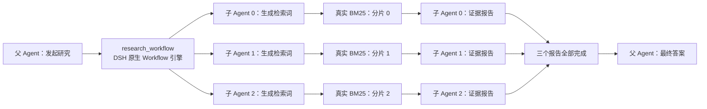

# 官方 DSH：八题最小对照组

**三轮已完成并通过审计。此次小组没有观察到限流或引擎压力反馈的时延收益。** 直接派发平均每题48.43秒，固定12为60.70秒，压力反馈12为60.47秒。压力反馈轮的收缩触发数为零，实际采用的始终是固定12，不能把它与固定轮的细小差异解释成反馈效果。

## 这次到底重跑哪组

用户先要求重跑E1，随后澄清“只跑已经完成的最小那一组”。因此选取早期 `v004` 八题 HotpotQA 校准组中的三个已完成条件：直接派发、固定在途12、压力反馈12。没有恢复二十题共享负载、长文、v025或后续大批次，也没有重跑整个九轮静态扫描。三轮顺序执行，实际测量总计约3.5分钟；单题校准和准备另记。

每轮都运行同八题、相同原始文档、三个必做分片、同一BM25算法与top-3、相同Qwen权重和参数。数据是原有校准集，不是新的隐藏评估集。所有根任务同时提交；从提交官方CLI进程开始计时，包含Host启动、前端等待、模型、检索、汇合与清理。

## 使用的是真正的 DSH 哪些部分

原生 DSH 负责创建Agent、保存Session、执行模型/工具循环、并行子工作流、等待汇合和资源清理。我们编写的是科研应用插件 `e1-plugin.mjs`，注册两个工具并接入官方扩展点，未修改官方框架源码：

每题4个Agent、8次模型调用、3次检索。其中第八次是父Agent发起原生工作流的规划调用；旧组由Python直接展开，每题七次模型调用。旧组不含后来的来源核验阶段，因此本组也没有把那一阶段额外加入。新旧模型推理设置和默认prompt也不同，**不跨框架用绝对耗时判断加速**。

BM25工具复用旧代码的纯检索函数，未调用旧Harness执行器。`agent/request` 插件等待独立CPU协调器给出派发许可；只改变就绪请求的提交时机，不改分支数、工具结果、模型prompt或必做工作。阶段标签仅记录，不参与排序。这些是基线实现，不是已经提出的工作流推进新机制。

## 实际结果

| 设置 | 平均每题 / 秒 | P95 / 秒 | 整轮 / 秒 | EM | 答案F1 | 实际解码token |
|---|---:|---:|---:|---:|---:|---:|
| 直接派发 | 48.43 | 55.59 | 58.29 | 0.500 | 0.815 | 20,445 |
| 固定12 | 60.70 | 69.01 | 70.52 | 0.625 | 0.908 | 20,707 |
| 实际压力反馈12 | 60.47 | 76.23 | 82.11 | 0.500 | 0.783 | 20,797 |

每种设置只有一次独立运行；P95来自轮内八题，不是多次实验的置信区间。F1和EM按旧分析器相同的标准化规则离线计算，保留yes/no/noanswer特殊规则。标签从未进入运行时任务、Agent或控制器。

| 系统观测 | 直接派发 | 固定12 | 压力反馈12 |
|---|---:|---:|---:|
| 引擎等待请求峰值 | 8 | 0 | 0 |
| 引擎运行请求峰值 | 24 | 12 | 12 |
| KV使用率峰值 | 42.89% | 20.93% | 24.03% |
| 抢占次数 | 0 | 0 | 0 |
| 每次调用平均前端等待 / 秒 | 0.0002 | 5.57 | 5.42 |
| 压力反馈收缩的准入次数 | 不适用 | 不适用 | **0** |

后端反馈来自每250毫秒采样的真实 `/metrics`，不是模拟压力。压力基线沿用旧规则：KV超过90%时目标上限减半；否则等待数超过2时按等待数收缩。变化只影响后续许可，不抢占已经执行的请求。每次准入记录当时指标与实际目标。压力轮未达到阈值，始终发放固定12的许可；三个条件都无KV抢占。瞬时峰值可能被采样遗漏，不能把采样结果当作精确连续轨迹。

这组数据说明，限制在途数确实能把排队移出引擎，却没有使小任务更快。它还没有证明“共享引擎上的工作流推进”是一个需要新机制的痛点，也没有证明反馈必然无用。当前小组不足以支撑后者的泛化结论。

## 为什么必须同时报告答案和工作量

三轮完成相同的必做Agent、工具和调用数，**生成文本、检索词与答案没有冻结**；它们不是v025式的相同请求/相同解码量回放。实际解码量约有1.7%差异，个别答案也发生变化，不能把速度差完全归因于调度。

例如题目 `5a78f59755429970f5fffdf7` 问：“Mick Carter担任房东的酒吧具体位于什么地址？”直接派发返回酒吧名称和虚构地点，固定/压力两轮返回标准地址 `46 Albert Square, Walford, London E20`。另一题 `5ae75a5a5542991bbc9761f3` 问Kriti Sanon出演的歌曲混音视频来自哪部电影，直接/固定返回 `Agent Vinod`，压力轮返回 `Raabta`。这些变化说明，一轮质量差异不能包装成某种并发策略稳定提高或降低推理质量。

严格EM还会将 `Maria Shvetsova` 与标签 `Chief Detective Maria Shvetsova` 判为不完全匹配；原始预测、标签及F1均保留，不能将EM直接当作人工语义准确率。

## 可核查的证据

三轮分别通过：8个根任务完整退出、32个原生Agent正常结束、64次原生模型步骤与64个实际接口响应一一对应、24次检索覆盖所有三个分片、无工具/接口错误、无输出长度截断、无悬挂派发许可。所有实际请求均为2048最大输出、temperature=0、low reasoning。引擎生成token计数器的逐轮增量与保存响应的解码token逐一相等。

汇总与逐题评分：[comparison.json](../results/e1-small-20261029/comparison.json)。以下每个压缩包都包含整轮八题的完整prompt、请求参数、流式响应、原生会话事件、工具参数/结果、原始文档、指标、评分及源码快照；对应目录的 `archive-index.json` 提供SHA256。

- [直接派发：全部原始证据](../evidence/e1-small-20261029/dsh-e1-small-native-raw.tar.gz) · [配置](../results/e1-small-20261029/dsh-e1-small-native/config.json) · [逐题答案](../results/e1-small-20261029/dsh-e1-small-native/scored.json) · [原生执行审计](../results/e1-small-20261029/dsh-e1-small-native/native-audit.json)。
- [固定12：全部原始证据](../evidence/e1-small-20261029/dsh-e1-small-fixed12-raw.tar.gz) · [逐题答案](../results/e1-small-20261029/dsh-e1-small-fixed12/scored.json)。
- [压力反馈12：全部原始证据](../evidence/e1-small-20261029/dsh-e1-small-pressure12-raw.tar.gz) · [逐题答案](../results/e1-small-20261029/dsh-e1-small-pressure12/scored.json)。
- [单题校准原始记录](../evidence/e1-small-20261029/dsh-e1-calibration-01-raw.tar.gz)，仅作功能/预热，不进入三轮性能表。
- [数据版本与许可](../evidence/e1-small-20261029/data-manifest.json)、[引擎实际配置](../evidence/e1-small-20261029/engine.json)、[每轮约300字记录](../RESEARCH_LOG.md)。

本次授权的小组已结束，没有安排后续自动GPU批次。复现入口为 `e1_batch.py` 与 `e1-small-plan.json`；现有run_id不会被覆盖，复现实验须使用新编号。后续研究若要验证复杂机制，应先根据真实原生轨迹选择有损失的场景，而不是在本组上继续堆控制器。
